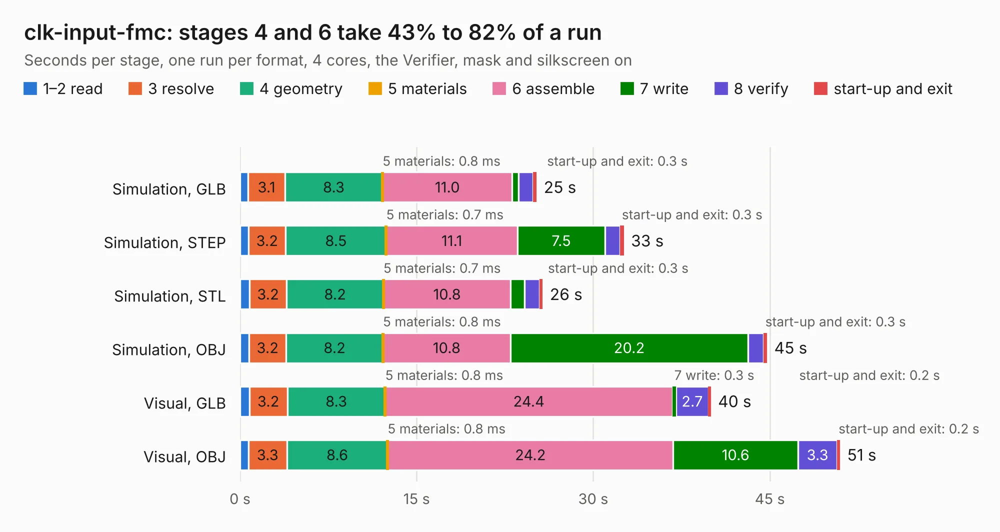

# 2212. clk-input-fmc

Board 2,212 of the 3,109 of [Corpus Testing](../Corpus-Testing.md), on [Corpus Page 21](../CorpusTestingPages/Corpus-Testing-21.md#2212-clk-input-fmc).

| Mode and format | 1–2 read | 3 resolve | 4 geometry | 5 materials | 6 assemble | 7 write | 8 verify | start-up and exit | Total |
|---|---:|---:|---:|---:|---:|---:|---:|---:|---:|
| Simulation, GLB | 0.7 | 3.1 | 8.3 | 0.8&nbsp;ms | 11.0 | 0.5 | 1.3 | 0.3 | 25.2 |
| Simulation, STEP | 0.7 | 3.2 | 8.5 | 0.7&nbsp;ms | 11.1 | 7.5 | 1.3 | 0.3 | 32.6 |
| Simulation, STL | 0.8 | 3.2 | 8.2 | 0.7&nbsp;ms | 10.8 | 1.2 | 1.3 | 0.3 | 25.7 |
| Simulation, OBJ | 0.8 | 3.2 | 8.2 | 0.8&nbsp;ms | 10.8 | 20.2 | 1.3 | 0.3 | 44.8 |
| Visual, GLB | 0.8 | 3.2 | 8.3 | 0.8&nbsp;ms | 24.4 | 0.3 | 2.7 | 0.2 | 40.0 |
| Visual, OBJ | 0.7 | 3.3 | 8.6 | 0.8&nbsp;ms | 24.2 | 10.6 | 3.3 | 0.2 | 51.0 |

<table align="center"><tr><td valign="top">

| Board | Repo: [osprey-dcs/clk-input-fmc](https://github.com/osprey-dcs/clk-input-fmc) Board: `clk-input-fmc.kicad_pcb` |
|---|---|
| Complexity | 417&nbsp;/&nbsp;1000 (size&nbsp;272, features&nbsp;145) |
| KESE&nbsp;features | through vias, slotted holes, rounded, trapezoid or chamfered pads, arc tracks, filled zones, curved board outline, knockout text, stack-up, dielectric εr and tanδ, copper finish, mask and silkscreen colours |
| Tested | 9th November 2026 |
| Copper&nbsp;layers | 6 |
| File&nbsp;format | KiCad 9 (20241229) |
| Parts,&nbsp;tracks,&nbsp;vias | 139, 1,528, 348 |
| Triangles,&nbsp;simulation | 3,732,828 in 355 parts |
| Verifier | PASS in all six runs |

</td><td valign="top">

<table>
<tr><th>File type</th><th>File size</th><th>Peak memory used</th></tr>
<tr><th colspan="3" align="left">Simulation</th></tr>
<tr><td>GLB</td><td align="right">124&nbsp;MB</td><td align="right">1.3&nbsp;GB</td></tr>
<tr><td>STEP</td><td align="right">414&nbsp;MB</td><td align="right">1.5&nbsp;GB</td></tr>
<tr><td>STL</td><td align="right">187&nbsp;MB</td><td align="right">1.4&nbsp;GB</td></tr>
<tr><td>OBJ</td><td align="right">390&nbsp;MB</td><td align="right">2.4&nbsp;GB</td></tr>
<tr><th colspan="3" align="left">Visual</th></tr>
<tr><td>GLB</td><td align="right">71&nbsp;MB</td><td align="right">1.6&nbsp;GB</td></tr>
<tr><td>OBJ</td><td align="right">225&nbsp;MB</td><td align="right">1.6&nbsp;GB</td></tr>
</table>

</td></tr></table>

| Previous | Next |
|:---|---:|
| [2211. icE1usb](b2211b_osmo-e1-hardware_hardware-icE1usb-r1-0_icE1usb.md) | [2213. trigger-output-fmc](b2213b_trigger-output-fmc_trigger-output-fmc.md) |
