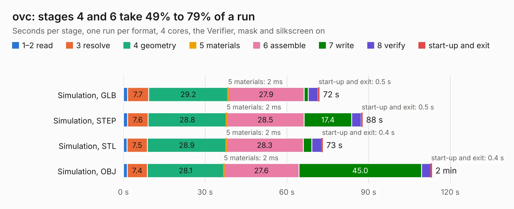

# 2213. ovc

Board 2,213 of the 3,105 of [Corpus Testing](../Corpus-Testing.md), on [Corpus Page 21](../CorpusTestingPages/Corpus-Testing-21.md#2213-ovc).

| Mode and format | 1–2 read | 3 resolve | 4 geometry | 5 materials | 6 assemble | 7 write | 8 verify | start-up and exit | Total |
|---|---:|---:|---:|---:|---:|---:|---:|---:|---:|
| Simulation, GLB | 1.5 | 7.7 | 29.2 | 2&nbsp;ms | 27.9 | 1.5 | 3.6 | 0.5 | 71.9 |
| Simulation, STEP | 1.5 | 7.6 | 28.8 | 2&nbsp;ms | 28.5 | 17.4 | 3.5 | 0.5 | 87.8 |
| Simulation, STL | 1.3 | 7.5 | 28.9 | 2&nbsp;ms | 28.3 | 3.2 | 3.6 | 0.4 | 73.1 |
| Simulation, OBJ | 1.4 | 7.4 | 28.1 | 2&nbsp;ms | 27.6 | 45.0 | 3.4 | 0.4 | 113.2 |
| Visual, GLB | 1.4 | 7.3 | 28.9 | 2&nbsp;ms | 59.8 | 0.8 | 7.9 | 0.3 | 106.3 |
| Visual, OBJ | 1.7 | 7.4 | 27.8 | 2&nbsp;ms | 62.3 | 21.1 | 8.1 | 0.4 | 128.7 |

<table align="center"><tr><td valign="top">

| Board | Repo: [osrf/ovc](https://github.com/osrf/ovc) Board: `ovc.kicad_pcb` |
|---|---|
| Folder | ovc1 / hardware |
| Complexity | 358&nbsp;/&nbsp;1000 (size&nbsp;313, features&nbsp;45) |
| KESE&nbsp;features | through vias, slotted holes, filled zones |
| Tested | 9th November 2026 |
| Copper&nbsp;layers | 6 |
| File&nbsp;format | KiCad 5 (20171130) |
| Parts,&nbsp;tracks,&nbsp;vias | 379, 6,661, 835 |
| Triangles,&nbsp;simulation | 8,267,486 in 701 parts |
| Verifier | PASS in all six runs |

</td><td valign="top">

<table>
<tr><th>File type</th><th>File size</th><th>Peak memory used</th></tr>
<tr><th colspan="3" align="left">Simulation</th></tr>
<tr><td>GLB</td><td align="right">287&nbsp;MB</td><td align="right">1.9&nbsp;GB</td></tr>
<tr><td>STEP</td><td align="right">1.1&nbsp;GB</td><td align="right">2.6&nbsp;GB</td></tr>
<tr><td>STL</td><td align="right">413&nbsp;MB</td><td align="right">2.1&nbsp;GB</td></tr>
<tr><td>OBJ</td><td align="right">896&nbsp;MB</td><td align="right">5.3&nbsp;GB</td></tr>
<tr><th colspan="3" align="left">Visual</th></tr>
<tr><td>GLB</td><td align="right">151&nbsp;MB</td><td align="right">2.5&nbsp;GB</td></tr>
<tr><td>OBJ</td><td align="right">485&nbsp;MB</td><td align="right">3.0&nbsp;GB</td></tr>
</table>

</td></tr></table>

| Previous | Next |
|:---|---:|
| [2212. HarleyTandemRevB](b2212b_ovc_HarleyTandemRevB.md) | [2214. mobof](b2214b_ovc_mobof.md) |
