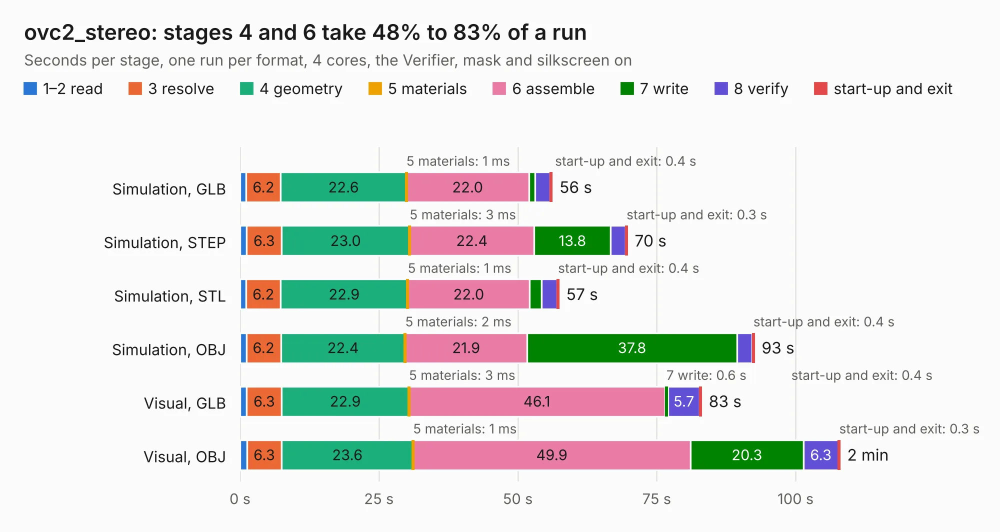

# 2214. ovc2_stereo

Board 2,214 of the 3,101 of [Corpus Testing](../Corpus-Testing.md), on [Corpus Page 21](../CorpusTestingPages/Corpus-Testing-21.md#2214-ovc2_stereo).

| Mode and format | 1–2 read | 3 resolve | 4 geometry | 5 materials | 6 assemble | 7 write | 8 verify | start-up and exit | Total |
|---|---:|---:|---:|---:|---:|---:|---:|---:|---:|
| Simulation, GLB | 1.1 | 6.2 | 22.6 | 1&nbsp;ms | 22.0 | 1.1 | 2.7 | 0.4 | 56.2 |
| Simulation, STEP | 1.2 | 6.3 | 23.0 | 3&nbsp;ms | 22.4 | 13.8 | 2.7 | 0.3 | 69.7 |
| Simulation, STL | 1.1 | 6.2 | 22.9 | 1&nbsp;ms | 22.0 | 2.2 | 2.8 | 0.4 | 57.4 |
| Simulation, OBJ | 1.1 | 6.2 | 22.4 | 2&nbsp;ms | 21.9 | 37.8 | 2.7 | 0.4 | 92.6 |
| Visual, GLB | 1.2 | 6.3 | 22.9 | 3&nbsp;ms | 46.1 | 0.6 | 5.7 | 0.4 | 83.1 |
| Visual, OBJ | 1.2 | 6.3 | 23.6 | 1&nbsp;ms | 49.9 | 20.3 | 6.3 | 0.3 | 108.0 |

<table align="center"><tr><td valign="top">

| Board | Repo: [osrf/ovc](https://github.com/osrf/ovc) Board: `ovc2_stereo.kicad_pcb` |
|---|---|
| Folder | ovc2 / hardware / ovc2a / stereo |
| Complexity | 345&nbsp;/&nbsp;1000 (size&nbsp;300, features&nbsp;45) |
| KESE&nbsp;features | through vias, filled zones, curved board outline |
| Tested | 9th November 2026 |
| Copper&nbsp;layers | 6 |
| File&nbsp;format | KiCad 5 (20171130) |
| Parts,&nbsp;tracks,&nbsp;vias | 215, 4,411, 693 |
| Triangles,&nbsp;simulation | 5,974,648 in 519 parts |
| Verifier | PASS in all six runs |

</td><td valign="top">

<table>
<tr><th>File type</th><th>File size</th><th>Peak memory used</th></tr>
<tr><th colspan="3" align="left">Simulation</th></tr>
<tr><td>GLB</td><td align="right">207&nbsp;MB</td><td align="right">1.5&nbsp;GB</td></tr>
<tr><td>STEP</td><td align="right">751&nbsp;MB</td><td align="right">2.0&nbsp;GB</td></tr>
<tr><td>STL</td><td align="right">299&nbsp;MB</td><td align="right">1.5&nbsp;GB</td></tr>
<tr><td>OBJ</td><td align="right">648&nbsp;MB</td><td align="right">3.8&nbsp;GB</td></tr>
<tr><th colspan="3" align="left">Visual</th></tr>
<tr><td>GLB</td><td align="right">111&nbsp;MB</td><td align="right">1.9&nbsp;GB</td></tr>
<tr><td>OBJ</td><td align="right">356&nbsp;MB</td><td align="right">2.4&nbsp;GB</td></tr>
</table>

</td></tr></table>

| Previous | Next |
|:---|---:|
| [2213. ovc2_mobo](b2213b_ovc_ovc2-hardware-ovc2a-mobo_ovc2-mobo.md) | [2215. ovc2_mobo](b2215b_ovc_ovc2-hardware-ovc2b-mobo_ovc2-mobo.md) |
