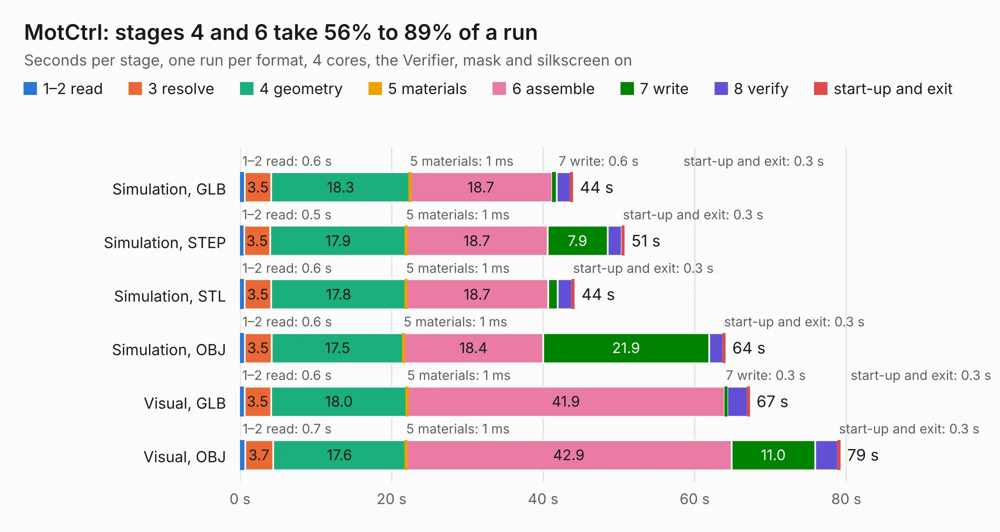

# 2215. MotCtrl

Board 2,215 of the 3,119 of [Corpus Testing](../Corpus-Testing.md), on [Corpus Page 21](../CorpusTestingPages/Corpus-Testing-21.md#2215-motctrl).

| Mode and format | 1–2 read | 3 resolve | 4 geometry | 5 materials | 6 assemble | 7 write | 8 verify | start-up and exit | Total |
|---|---:|---:|---:|---:|---:|---:|---:|---:|---:|
| Simulation, GLB | 0.6 | 3.5 | 18.3 | 1&nbsp;ms | 18.7 | 0.6 | 1.8 | 0.3 | 43.9 |
| Simulation, STEP | 0.5 | 3.5 | 17.9 | 1&nbsp;ms | 18.7 | 7.9 | 1.9 | 0.3 | 50.7 |
| Simulation, STL | 0.6 | 3.5 | 17.8 | 1&nbsp;ms | 18.7 | 1.3 | 1.9 | 0.3 | 44.1 |
| Simulation, OBJ | 0.6 | 3.5 | 17.5 | 1&nbsp;ms | 18.4 | 21.9 | 1.9 | 0.3 | 64.0 |
| Visual, GLB | 0.6 | 3.5 | 18.0 | 1&nbsp;ms | 41.9 | 0.3 | 2.7 | 0.3 | 67.2 |
| Visual, OBJ | 0.7 | 3.7 | 17.6 | 1&nbsp;ms | 42.9 | 11.0 | 3.0 | 0.3 | 79.2 |

<table align="center"><tr><td valign="top">

| Board | Repo: [osannolik/motctrl](https://github.com/osannolik/motctrl) Board: `MotCtrl.kicad_pcb` |
|---|---|
| Folder | hw / kicad |
| Complexity | 319&nbsp;/&nbsp;1000 (size&nbsp;264, features&nbsp;55) |
| KESE&nbsp;features | through vias, rounded, trapezoid or chamfered pads, filled zones, curved board outline |
| Tested | 9th November 2026 |
| Copper&nbsp;layers | 4 |
| File&nbsp;format | KiCad 4 (4) |
| Parts,&nbsp;tracks,&nbsp;vias | 132, 2,127, 758 |
| Triangles,&nbsp;simulation | 3,514,890 in 119 parts |
| Verifier | PASS in all six runs |

</td><td valign="top">

<table>
<tr><th>File type</th><th>File size</th><th>Peak memory used</th></tr>
<tr><th colspan="3" align="left">Simulation</th></tr>
<tr><td>GLB</td><td align="right">122&nbsp;MB</td><td align="right">926&nbsp;MB</td></tr>
<tr><td>STEP</td><td align="right">429&nbsp;MB</td><td align="right">1.2&nbsp;GB</td></tr>
<tr><td>STL</td><td align="right">176&nbsp;MB</td><td align="right">908&nbsp;MB</td></tr>
<tr><td>OBJ</td><td align="right">377&nbsp;MB</td><td align="right">2.3&nbsp;GB</td></tr>
<tr><th colspan="3" align="left">Visual</th></tr>
<tr><td>GLB</td><td align="right">61&nbsp;MB</td><td align="right">1.2&nbsp;GB</td></tr>
<tr><td>OBJ</td><td align="right">191&nbsp;MB</td><td align="right">1.4&nbsp;GB</td></tr>
</table>

</td></tr></table>

| Previous | Next |
|:---|---:|
| [2214. Edison_Motor_Servo](b2214b_reaction-wheels_Edison-Motor-Servo.md) | [2216. logicbone](b2216b_logicbone_logicbone.md) |
