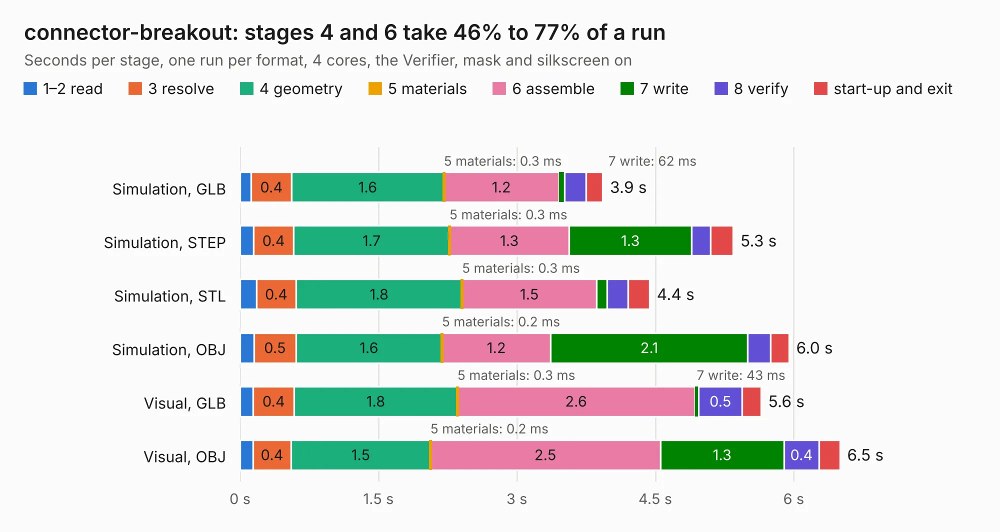

# 2215. connector-breakout

Board 2,215 of the 3,132 of [Corpus Testing](../Corpus-Testing.md), on [Corpus Page 21](../CorpusTestingPages/Corpus-Testing-21.md#2215-connector-breakout).

| Mode and format | 1–2 read | 3 resolve | 4 geometry | 5 materials | 6 assemble | 7 write | 8 verify | start-up and exit | Total |
|---|---:|---:|---:|---:|---:|---:|---:|---:|---:|
| Simulation, GLB | 0.1 | 0.4 | 1.6 | 0.3&nbsp;ms | 1.2 | 62&nbsp;ms | 0.2 | 0.2 | 3.9 |
| Simulation, STEP | 0.1 | 0.4 | 1.7 | 0.3&nbsp;ms | 1.3 | 1.3 | 0.2 | 0.2 | 5.3 |
| Simulation, STL | 0.2 | 0.4 | 1.8 | 0.3&nbsp;ms | 1.5 | 0.1 | 0.2 | 0.2 | 4.4 |
| Simulation, OBJ | 0.2 | 0.5 | 1.6 | 0.2&nbsp;ms | 1.2 | 2.1 | 0.2 | 0.2 | 6.0 |
| Visual, GLB | 0.1 | 0.4 | 1.8 | 0.3&nbsp;ms | 2.6 | 43&nbsp;ms | 0.5 | 0.2 | 5.6 |
| Visual, OBJ | 0.1 | 0.4 | 1.5 | 0.2&nbsp;ms | 2.5 | 1.3 | 0.4 | 0.2 | 6.5 |

<table align="center"><tr><td valign="top">

| Board | Repo: [oresat/oresat-solar-simulator-hardware](https://github.com/oresat/oresat-solar-simulator-hardware) Board: `connector-breakout.kicad_pcb` |
|---|---|
| Folder | boards / connector-breakout |
| Complexity | 226&nbsp;/&nbsp;1000 (size&nbsp;131, features&nbsp;95) |
| KESE&nbsp;features | through vias, rounded, trapezoid or chamfered pads, filled zones, stack-up, dielectric εr and tanδ, copper finish, mask and silkscreen colours |
| Tested | 9th November 2026 |
| Copper&nbsp;layers | 2 |
| File&nbsp;format | KiCad 10 (20260206) |
| Parts,&nbsp;tracks,&nbsp;vias | 5, 115, 69 |
| Triangles,&nbsp;simulation | 430,384 in 18 parts |
| Verifier | PASS in all six runs |

</td><td valign="top">

<table>
<tr><th>File type</th><th>File size</th><th>Peak memory used</th></tr>
<tr><th colspan="3" align="left">Simulation</th></tr>
<tr><td>GLB</td><td align="right">15&nbsp;MB</td><td align="right">303&nbsp;MB</td></tr>
<tr><td>STEP</td><td align="right">56&nbsp;MB</td><td align="right">321&nbsp;MB</td></tr>
<tr><td>STL</td><td align="right">22&nbsp;MB</td><td align="right">274&nbsp;MB</td></tr>
<tr><td>OBJ</td><td align="right">43&nbsp;MB</td><td align="right">342&nbsp;MB</td></tr>
<tr><th colspan="3" align="left">Visual</th></tr>
<tr><td>GLB</td><td align="right">9.6&nbsp;MB</td><td align="right">292&nbsp;MB</td></tr>
<tr><td>OBJ</td><td align="right">28&nbsp;MB</td><td align="right">295&nbsp;MB</td></tr>
</table>

</td></tr></table>

| Previous | Next |
|:---|---:|
| [2214. 1u_panel_breakout](b2214b_oresat-solar-hardware_1u-panel-breakout.md) | [2216. controller-board](b2216b_oresat-solar-simulator-hardware_controller-board.md) |
