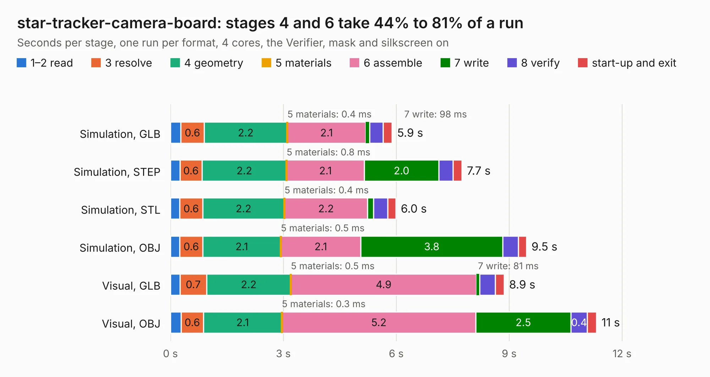

# 2215. star-tracker-camera-board

Board 2,215 of the 3,124 of [Corpus Testing](../Corpus-Testing.md), on [Corpus Page 21](../CorpusTestingPages/Corpus-Testing-21.md#2215-star-tracker-camera-board).

| Mode and format | 1–2 read | 3 resolve | 4 geometry | 5 materials | 6 assemble | 7 write | 8 verify | start-up and exit | Total |
|---|---:|---:|---:|---:|---:|---:|---:|---:|---:|
| Simulation, GLB | 0.3 | 0.6 | 2.2 | 0.4&nbsp;ms | 2.1 | 98&nbsp;ms | 0.4 | 0.2 | 5.9 |
| Simulation, STEP | 0.3 | 0.6 | 2.2 | 0.8&nbsp;ms | 2.1 | 2.0 | 0.4 | 0.2 | 7.7 |
| Simulation, STL | 0.2 | 0.6 | 2.2 | 0.4&nbsp;ms | 2.2 | 0.2 | 0.4 | 0.2 | 6.0 |
| Simulation, OBJ | 0.2 | 0.6 | 2.1 | 0.5&nbsp;ms | 2.1 | 3.8 | 0.4 | 0.2 | 9.5 |
| Visual, GLB | 0.3 | 0.7 | 2.2 | 0.5&nbsp;ms | 4.9 | 81&nbsp;ms | 0.4 | 0.2 | 8.9 |
| Visual, OBJ | 0.3 | 0.6 | 2.1 | 0.3&nbsp;ms | 5.2 | 2.5 | 0.4 | 0.2 | 11.3 |

<table align="center"><tr><td valign="top">

| Board | Repo: [oresat/oresat-star-tracker-hardware](https://github.com/oresat/oresat-star-tracker-hardware) Board: `star-tracker-camera-board.kicad_pcb` |
|---|---|
| Folder | hardware / star-tracker-2.0 / star-tracker-camera-board-2.0 |
| Complexity | 310&nbsp;/&nbsp;1000 (size&nbsp;180, features&nbsp;130) |
| KESE&nbsp;features | through vias, custom pads, rounded, trapezoid or chamfered pads, filled zones, copper drawings, curved board outline, stack-up, dielectric εr and tanδ, copper finish, mask and silkscreen colours |
| Tested | 9th November 2026 |
| Copper&nbsp;layers | 4 |
| File&nbsp;format | KiCad 10 (20260206) |
| Parts,&nbsp;tracks,&nbsp;vias | 36, 402, 108 |
| Triangles,&nbsp;simulation | 670,218 in 55 parts |
| Verifier | PASS in all six runs |

</td><td valign="top">

<table>
<tr><th>File type</th><th>File size</th><th>Peak memory used</th></tr>
<tr><th colspan="3" align="left">Simulation</th></tr>
<tr><td>GLB</td><td align="right">23&nbsp;MB</td><td align="right">346&nbsp;MB</td></tr>
<tr><td>STEP</td><td align="right">106&nbsp;MB</td><td align="right">407&nbsp;MB</td></tr>
<tr><td>STL</td><td align="right">34&nbsp;MB</td><td align="right">349&nbsp;MB</td></tr>
<tr><td>OBJ</td><td align="right">69&nbsp;MB</td><td align="right">491&nbsp;MB</td></tr>
<tr><th colspan="3" align="left">Visual</th></tr>
<tr><td>GLB</td><td align="right">16&nbsp;MB</td><td align="right">415&nbsp;MB</td></tr>
<tr><td>OBJ</td><td align="right">49&nbsp;MB</td><td align="right">414&nbsp;MB</td></tr>
</table>

</td></tr></table>

| Previous | Next |
|:---|---:|
| [2214. star-tracker-card](b2214b_oresat-star-tracker-hardware_hardware-star-tracker-2-0-star-tracker-2-0-card_star-tracker-card.md) | [2216. star-tracker-camera-board](b2216b_oresat-star-tracker-hardware_hardware-star-tracker-camera-board_star-tracker-camera-board.md) |
