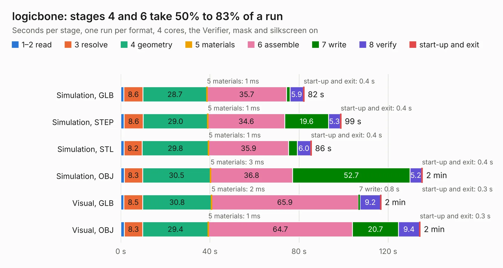

# 2216. logicbone

Board 2,216 of the 3,119 of [Corpus Testing](../Corpus-Testing.md), on [Corpus Page 21](../CorpusTestingPages/Corpus-Testing-21.md#2216-logicbone).

| Mode and format | 1–2 read | 3 resolve | 4 geometry | 5 materials | 6 assemble | 7 write | 8 verify | start-up and exit | Total |
|---|---:|---:|---:|---:|---:|---:|---:|---:|---:|
| Simulation, GLB | 1.4 | 8.6 | 28.7 | 1&nbsp;ms | 35.7 | 1.6 | 5.9 | 0.4 | 82.3 |
| Simulation, STEP | 1.5 | 8.6 | 29.0 | 1&nbsp;ms | 34.6 | 19.6 | 5.3 | 0.4 | 98.9 |
| Simulation, STL | 1.4 | 8.2 | 29.8 | 1&nbsp;ms | 35.9 | 3.9 | 6.0 | 0.4 | 85.6 |
| Simulation, OBJ | 1.5 | 8.3 | 30.5 | 3&nbsp;ms | 36.8 | 52.7 | 5.2 | 0.4 | 135.4 |
| Visual, GLB | 1.4 | 8.5 | 30.8 | 2&nbsp;ms | 65.9 | 0.8 | 9.2 | 0.3 | 116.9 |
| Visual, OBJ | 1.5 | 8.3 | 29.4 | 1&nbsp;ms | 64.7 | 20.7 | 9.4 | 0.3 | 134.4 |

<table align="center"><tr><td valign="top">

| Board | Repo: [oskirby/logicbone](https://github.com/oskirby/logicbone) Board: `logicbone.kicad_pcb` |
|---|---|
| Complexity | 419&nbsp;/&nbsp;1000 (size&nbsp;329, features&nbsp;90) |
| KESE&nbsp;features | through vias, slotted holes, custom pads, rounded, trapezoid or chamfered pads, filled zones, copper drawings, curved board outline |
| Tested | 9th November 2026 |
| Copper&nbsp;layers | 8 |
| File&nbsp;format | KiCad 5 (20171130) |
| Parts,&nbsp;tracks,&nbsp;vias | 258, 9,859, 658 |
| Triangles,&nbsp;simulation | 9,046,192 in 404 parts |
| Verifier | PASS in all six runs |

</td><td valign="top">

<table>
<tr><th>File type</th><th>File size</th><th>Peak memory used</th></tr>
<tr><th colspan="3" align="left">Simulation</th></tr>
<tr><td>GLB</td><td align="right">311&nbsp;MB</td><td align="right">2.1&nbsp;GB</td></tr>
<tr><td>STEP</td><td align="right">1.2&nbsp;GB</td><td align="right">2.9&nbsp;GB</td></tr>
<tr><td>STL</td><td align="right">452&nbsp;MB</td><td align="right">2.2&nbsp;GB</td></tr>
<tr><td>OBJ</td><td align="right">997&nbsp;MB</td><td align="right">5.7&nbsp;GB</td></tr>
<tr><th colspan="3" align="left">Visual</th></tr>
<tr><td>GLB</td><td align="right">145&nbsp;MB</td><td align="right">2.5&nbsp;GB</td></tr>
<tr><td>OBJ</td><td align="right">480&nbsp;MB</td><td align="right">3.1&nbsp;GB</td></tr>
</table>

</td></tr></table>

| Previous | Next |
|:---|---:|
| [2215. MotCtrl](b2215b_motctrl_MotCtrl.md) | [2217. icE1usb-rs422](b2217b_osmo-e1-hardware_icE1usb-rs422.md) |
