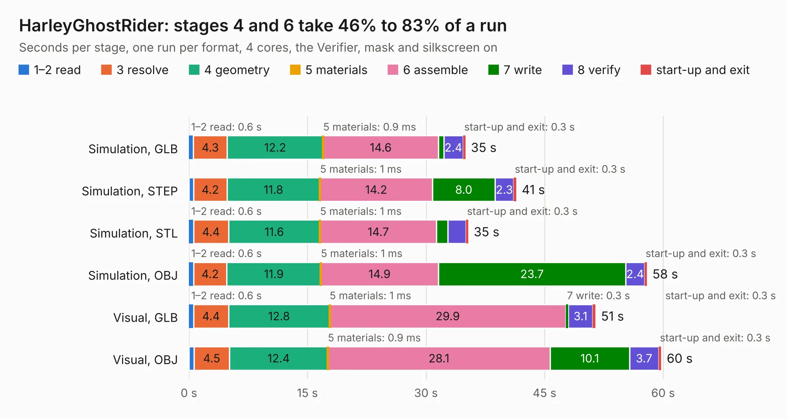

# 2217. HarleyGhostRider

Board 2,217 of the 3,112 of [Corpus Testing](../Corpus-Testing.md), on [Corpus Page 21](../CorpusTestingPages/Corpus-Testing-21.md#2217-harleyghostrider).

| Mode and format | 1–2 read | 3 resolve | 4 geometry | 5 materials | 6 assemble | 7 write | 8 verify | start-up and exit | Total |
|---|---:|---:|---:|---:|---:|---:|---:|---:|---:|
| Simulation, GLB | 0.6 | 4.3 | 12.2 | 0.9&nbsp;ms | 14.6 | 0.7 | 2.4 | 0.3 | 35.0 |
| Simulation, STEP | 0.6 | 4.2 | 11.8 | 1&nbsp;ms | 14.2 | 8.0 | 2.3 | 0.3 | 41.4 |
| Simulation, STL | 0.6 | 4.4 | 11.6 | 1&nbsp;ms | 14.7 | 1.4 | 2.3 | 0.3 | 35.3 |
| Simulation, OBJ | 0.6 | 4.2 | 11.9 | 1&nbsp;ms | 14.9 | 23.7 | 2.4 | 0.3 | 57.9 |
| Visual, GLB | 0.6 | 4.4 | 12.8 | 1&nbsp;ms | 29.9 | 0.3 | 3.1 | 0.3 | 51.4 |
| Visual, OBJ | 0.6 | 4.5 | 12.4 | 0.9&nbsp;ms | 28.1 | 10.1 | 3.7 | 0.3 | 59.8 |

<table align="center"><tr><td valign="top">

| Board | Repo: [osrf/ovc](https://github.com/osrf/ovc) Board: `HarleyGhostRider.kicad_pcb` |
|---|---|
| Folder | ovc0 / hardware / HarleyGhostRider |
| Complexity | 393&nbsp;/&nbsp;1000 (size&nbsp;318, features&nbsp;75) |
| KESE&nbsp;features | through vias, microvias, filled zones |
| Tested | 9th November 2026 |
| Copper&nbsp;layers | 10 |
| File&nbsp;format | KiCad 4 (4) |
| Parts,&nbsp;tracks,&nbsp;vias | 172, 3,596, 586 |
| Triangles,&nbsp;simulation | 5,222,722 in 323 parts |
| Verifier | PASS in all six runs |

</td><td valign="top">

<table>
<tr><th>File type</th><th>File size</th><th>Peak memory used</th></tr>
<tr><th colspan="3" align="left">Simulation</th></tr>
<tr><td>GLB</td><td align="right">180&nbsp;MB</td><td align="right">1.1&nbsp;GB</td></tr>
<tr><td>STEP</td><td align="right">541&nbsp;MB</td><td align="right">1.5&nbsp;GB</td></tr>
<tr><td>STL</td><td align="right">261&nbsp;MB</td><td align="right">1.1&nbsp;GB</td></tr>
<tr><td>OBJ</td><td align="right">572&nbsp;MB</td><td align="right">3.3&nbsp;GB</td></tr>
<tr><th colspan="3" align="left">Visual</th></tr>
<tr><td>GLB</td><td align="right">77&nbsp;MB</td><td align="right">1.4&nbsp;GB</td></tr>
<tr><td>OBJ</td><td align="right">259&nbsp;MB</td><td align="right">1.8&nbsp;GB</td></tr>
</table>

</td></tr></table>

| Previous | Next |
|:---|---:|
| [2216. trigger-output-fmc](b2216b_trigger-output-fmc_trigger-output-fmc.md) | [2218. HarleyTandem](b2218b_ovc_HarleyTandem.md) |
