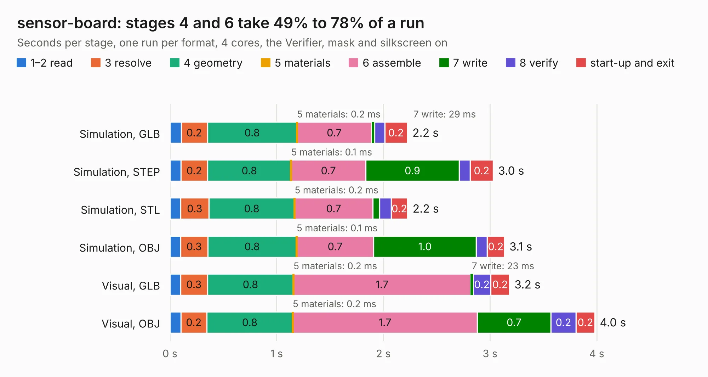

# 2218. sensor-board

Board 2,218 of the 3,132 of [Corpus Testing](../Corpus-Testing.md), on [Corpus Page 21](../CorpusTestingPages/Corpus-Testing-21.md#2218-sensor-board).

| Mode and format | 1–2 read | 3 resolve | 4 geometry | 5 materials | 6 assemble | 7 write | 8 verify | start-up and exit | Total |
|---|---:|---:|---:|---:|---:|---:|---:|---:|---:|
| Simulation, GLB | 0.1 | 0.2 | 0.8 | 0.2&nbsp;ms | 0.7 | 29&nbsp;ms | 93&nbsp;ms | 0.2 | 2.2 |
| Simulation, STEP | 0.1 | 0.2 | 0.8 | 0.1&nbsp;ms | 0.7 | 0.9 | 0.1 | 0.2 | 3.0 |
| Simulation, STL | 99&nbsp;ms | 0.3 | 0.8 | 0.2&nbsp;ms | 0.7 | 64&nbsp;ms | 0.1 | 0.2 | 2.2 |
| Simulation, OBJ | 0.1 | 0.3 | 0.8 | 0.1&nbsp;ms | 0.7 | 1.0 | 0.1 | 0.2 | 3.1 |
| Visual, GLB | 98&nbsp;ms | 0.3 | 0.8 | 0.2&nbsp;ms | 1.7 | 23&nbsp;ms | 0.2 | 0.2 | 3.2 |
| Visual, OBJ | 0.1 | 0.2 | 0.8 | 0.2&nbsp;ms | 1.7 | 0.7 | 0.2 | 0.2 | 4.0 |

<table align="center"><tr><td valign="top">

| Board | Repo: [oresat/oresat-solar-simulator-hardware](https://github.com/oresat/oresat-solar-simulator-hardware) Board: `sensor-board.kicad_pcb` |
|---|---|
| Folder | boards / sensor-board |
| Complexity | 229&nbsp;/&nbsp;1000 (size&nbsp;139, features&nbsp;90) |
| KESE&nbsp;features | through vias, rounded, trapezoid or chamfered pads, filled zones, curved board outline, stack-up, dielectric εr and tanδ, mask and silkscreen colours |
| Tested | 9th November 2026 |
| Copper&nbsp;layers | 2 |
| File&nbsp;format | KiCad 8 (20240108) |
| Parts,&nbsp;tracks,&nbsp;vias | 12, 59, 86 |
| Triangles,&nbsp;simulation | 236,226 in 20 parts |
| Verifier | PASS in all six runs |

</td><td valign="top">

<table>
<tr><th>File type</th><th>File size</th><th>Peak memory used</th></tr>
<tr><th colspan="3" align="left">Simulation</th></tr>
<tr><td>GLB</td><td align="right">8.2&nbsp;MB</td><td align="right">240&nbsp;MB</td></tr>
<tr><td>STEP</td><td align="right">32&nbsp;MB</td><td align="right">240&nbsp;MB</td></tr>
<tr><td>STL</td><td align="right">12&nbsp;MB</td><td align="right">236&nbsp;MB</td></tr>
<tr><td>OBJ</td><td align="right">24&nbsp;MB</td><td align="right">238&nbsp;MB</td></tr>
<tr><th colspan="3" align="left">Visual</th></tr>
<tr><td>GLB</td><td align="right">6.0&nbsp;MB</td><td align="right">199&nbsp;MB</td></tr>
<tr><td>OBJ</td><td align="right">17&nbsp;MB</td><td align="right">198&nbsp;MB</td></tr>
</table>

</td></tr></table>

| Previous | Next |
|:---|---:|
| [2217. cree-xega-led-breakout](b2217b_oresat-solar-simulator-hardware_cree-xega-led-breakout.md) | [2219. star-tracker-card](b2219b_oresat-star-tracker-hardware_hardware-star-tracker-2-0-star-tracker-2-0-card_star-tracker-card.md) |
