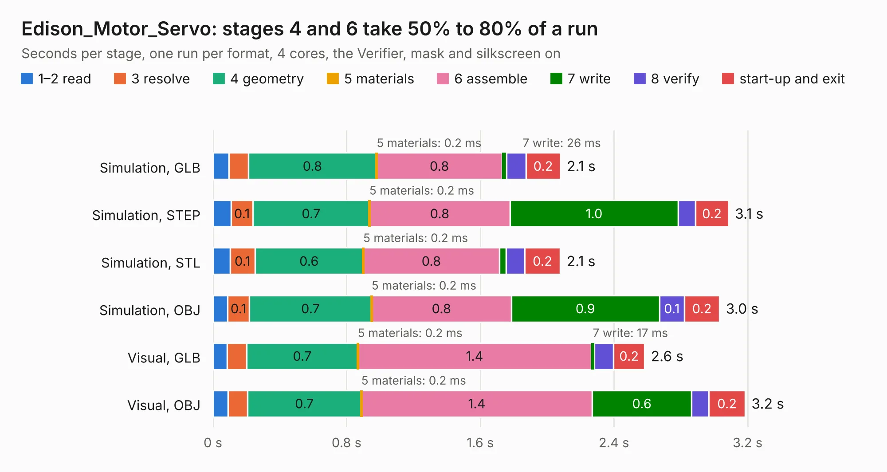

# 2219. Edison_Motor_Servo

Board 2,219 of the 3,125 of [Corpus Testing](../Corpus-Testing.md), on [Corpus Page 21](../CorpusTestingPages/Corpus-Testing-21.md#2219-edison_motor_servo).

| Mode and format | 1–2 read | 3 resolve | 4 geometry | 5 materials | 6 assemble | 7 write | 8 verify | start-up and exit | Total |
|---|---:|---:|---:|---:|---:|---:|---:|---:|---:|
| Simulation, GLB | 96&nbsp;ms | 0.1 | 0.8 | 0.2&nbsp;ms | 0.8 | 26&nbsp;ms | 0.1 | 0.2 | 2.1 |
| Simulation, STEP | 0.1 | 0.1 | 0.7 | 0.2&nbsp;ms | 0.8 | 1.0 | 0.1 | 0.2 | 3.1 |
| Simulation, STL | 0.1 | 0.1 | 0.6 | 0.2&nbsp;ms | 0.8 | 39&nbsp;ms | 0.1 | 0.2 | 2.1 |
| Simulation, OBJ | 87&nbsp;ms | 0.1 | 0.7 | 0.2&nbsp;ms | 0.8 | 0.9 | 0.1 | 0.2 | 3.0 |
| Visual, GLB | 85&nbsp;ms | 0.1 | 0.7 | 0.2&nbsp;ms | 1.4 | 17&nbsp;ms | 0.1 | 0.2 | 2.6 |
| Visual, OBJ | 91&nbsp;ms | 0.1 | 0.7 | 0.2&nbsp;ms | 1.4 | 0.6 | 0.1 | 0.2 | 3.2 |

<table align="center"><tr><td valign="top">

| Board | Repo: [oresat/reaction-wheels](https://github.com/oresat/reaction-wheels) Board: `Edison_Motor_Servo.kicad_pcb` |
|---|---|
| Folder | Edison_GPIO_Motor_via_servo |
| Complexity | 130&nbsp;/&nbsp;1000 (size&nbsp;90, features&nbsp;40) |
| KESE&nbsp;features | filled zones, copper text, curved board outline |
| Tested | 9th November 2026 |
| Copper&nbsp;layers | 2 |
| File&nbsp;format | KiCad 4 (4) |
| Parts,&nbsp;tracks,&nbsp;vias | 6, 23, 0 |
| Triangles,&nbsp;simulation | 156,220 in 35 parts |
| Verifier | PASS in all six runs |

</td><td valign="top">

<table>
<tr><th>File type</th><th>File size</th><th>Peak memory used</th></tr>
<tr><th colspan="3" align="left">Simulation</th></tr>
<tr><td>GLB</td><td align="right">4.8&nbsp;MB</td><td align="right">193&nbsp;MB</td></tr>
<tr><td>STEP</td><td align="right">25&nbsp;MB</td><td align="right">217&nbsp;MB</td></tr>
<tr><td>STL</td><td align="right">7.8&nbsp;MB</td><td align="right">193&nbsp;MB</td></tr>
<tr><td>OBJ</td><td align="right">15&nbsp;MB</td><td align="right">189&nbsp;MB</td></tr>
<tr><th colspan="3" align="left">Visual</th></tr>
<tr><td>GLB</td><td align="right">3.3&nbsp;MB</td><td align="right">166&nbsp;MB</td></tr>
<tr><td>OBJ</td><td align="right">9.2&nbsp;MB</td><td align="right">165&nbsp;MB</td></tr>
</table>

</td></tr></table>

| Previous | Next |
|:---|---:|
| [2218. GPIO to motor](b2218b_reaction-wheels_GPIO-to-motor.md) | [2220. MotCtrl](b2220b_motctrl_MotCtrl.md) |
