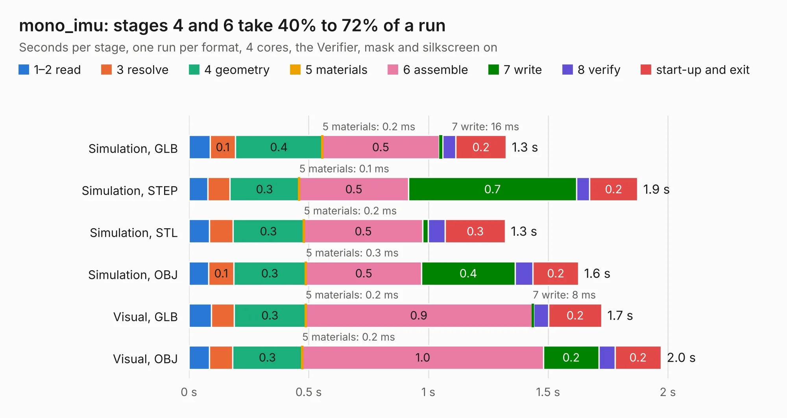

# 2222. mono_imu

Board 2,222 of the 3,111 of [Corpus Testing](../Corpus-Testing.md), on [Corpus Page 21](../CorpusTestingPages/Corpus-Testing-21.md#2222-mono_imu).

| Mode and format | 1–2 read | 3 resolve | 4 geometry | 5 materials | 6 assemble | 7 write | 8 verify | start-up and exit | Total |
|---|---:|---:|---:|---:|---:|---:|---:|---:|---:|
| Simulation, GLB | 88&nbsp;ms | 0.1 | 0.4 | 0.2&nbsp;ms | 0.5 | 16&nbsp;ms | 54&nbsp;ms | 0.2 | 1.3 |
| Simulation, STEP | 79&nbsp;ms | 92&nbsp;ms | 0.3 | 0.1&nbsp;ms | 0.5 | 0.7 | 54&nbsp;ms | 0.2 | 1.9 |
| Simulation, STL | 86&nbsp;ms | 98&nbsp;ms | 0.3 | 0.2&nbsp;ms | 0.5 | 23&nbsp;ms | 71&nbsp;ms | 0.3 | 1.3 |
| Simulation, OBJ | 83&nbsp;ms | 0.1 | 0.3 | 0.3&nbsp;ms | 0.5 | 0.4 | 75&nbsp;ms | 0.2 | 1.6 |
| Visual, GLB | 93&nbsp;ms | 96&nbsp;ms | 0.3 | 0.2&nbsp;ms | 0.9 | 8&nbsp;ms | 62&nbsp;ms | 0.2 | 1.7 |
| Visual, OBJ | 85&nbsp;ms | 98&nbsp;ms | 0.3 | 0.2&nbsp;ms | 1.0 | 0.2 | 68&nbsp;ms | 0.2 | 2.0 |

<table align="center"><tr><td valign="top">

| Board | Repo: [osrf/ovc](https://github.com/osrf/ovc) Board: `mono_imu.kicad_pcb` |
|---|---|
| Folder | ovc2 / hardware / ovc2a / graveyard / mono_imu |
| Complexity | 134&nbsp;/&nbsp;1000 (size&nbsp;114, features&nbsp;20) |
| KESE&nbsp;features | filled zones |
| Tested | 9th November 2026 |
| Copper&nbsp;layers | 6 |
| File&nbsp;format | KiCad 5 (20171130) |
| Parts,&nbsp;tracks,&nbsp;vias | 6, 20, 0 |
| Triangles,&nbsp;simulation | 77,536 in 43 parts |
| Verifier | PASS in all six runs |

</td><td valign="top">

<table>
<tr><th>File type</th><th>File size</th><th>Peak memory used</th></tr>
<tr><th colspan="3" align="left">Simulation</th></tr>
<tr><td>GLB</td><td align="right">2.6&nbsp;MB</td><td align="right">169&nbsp;MB</td></tr>
<tr><td>STEP</td><td align="right">8.0&nbsp;MB</td><td align="right">173&nbsp;MB</td></tr>
<tr><td>STL</td><td align="right">3.9&nbsp;MB</td><td align="right">168&nbsp;MB</td></tr>
<tr><td>OBJ</td><td align="right">7.5&nbsp;MB</td><td align="right">167&nbsp;MB</td></tr>
<tr><th colspan="3" align="left">Visual</th></tr>
<tr><td>GLB</td><td align="right">1.2&nbsp;MB</td><td align="right">151&nbsp;MB</td></tr>
<tr><td>OBJ</td><td align="right">3.3&nbsp;MB</td><td align="right">151&nbsp;MB</td></tr>
</table>

</td></tr></table>

| Previous | Next |
|:---|---:|
| [2221. ovc2_mono](b2221b_ovc_ovc2-mono.md) | [2223. ovc2_mobo](b2223b_ovc_ovc2-hardware-ovc2a-mobo_ovc2-mobo.md) |
