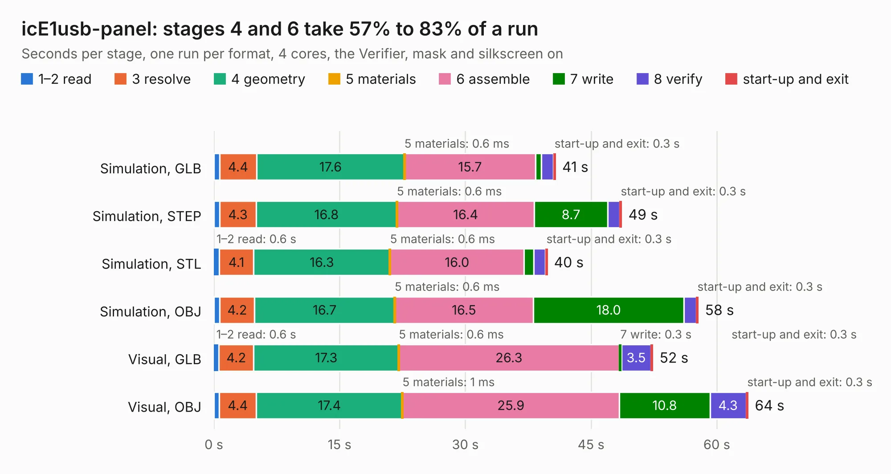

# 2223. icE1usb-panel

Board 2,223 of the 3,122 of [Corpus Testing](../Corpus-Testing.md), on [Corpus Page 21](../CorpusTestingPages/Corpus-Testing-21.md#2223-ice1usb-panel).

| Mode and format | 1–2 read | 3 resolve | 4 geometry | 5 materials | 6 assemble | 7 write | 8 verify | start-up and exit | Total |
|---|---:|---:|---:|---:|---:|---:|---:|---:|---:|
| Simulation, GLB | 0.7 | 4.4 | 17.6 | 0.6&nbsp;ms | 15.7 | 0.7 | 1.4 | 0.3 | 40.8 |
| Simulation, STEP | 0.7 | 4.3 | 16.8 | 0.6&nbsp;ms | 16.4 | 8.7 | 1.4 | 0.3 | 48.7 |
| Simulation, STL | 0.6 | 4.1 | 16.3 | 0.6&nbsp;ms | 16.0 | 1.2 | 1.4 | 0.3 | 39.8 |
| Simulation, OBJ | 0.7 | 4.2 | 16.7 | 0.6&nbsp;ms | 16.5 | 18.0 | 1.5 | 0.3 | 57.8 |
| Visual, GLB | 0.6 | 4.2 | 17.3 | 0.6&nbsp;ms | 26.3 | 0.3 | 3.5 | 0.3 | 52.4 |
| Visual, OBJ | 0.6 | 4.4 | 17.4 | 1&nbsp;ms | 25.9 | 10.8 | 4.3 | 0.3 | 63.8 |

<table align="center"><tr><td valign="top">

| Board | Repo: [osmocom/osmo-e1-hardware](https://github.com/osmocom/osmo-e1-hardware) Board: `icE1usb-panel.kicad_pcb` |
|---|---|
| Folder | hardware / icE1usb / r1.0 |
| Complexity | 341&nbsp;/&nbsp;1000 (size&nbsp;276, features&nbsp;65) |
| KESE&nbsp;features | through vias, slotted holes, rounded, trapezoid or chamfered pads, filled zones, curved board outline |
| Tested | 9th November 2026 |
| Copper&nbsp;layers | 4 |
| File&nbsp;format | KiCad 5 (20171130) |
| Parts,&nbsp;tracks,&nbsp;vias | 240, 3,164, 370 |
| Triangles,&nbsp;simulation | 3,815,094 in 169 parts |
| Note | panel |
| Verifier | PASS in all six runs |

</td><td valign="top">

<table>
<tr><th>File type</th><th>File size</th><th>Peak memory used</th></tr>
<tr><th colspan="3" align="left">Simulation</th></tr>
<tr><td>GLB</td><td align="right">132&nbsp;MB</td><td align="right">1.1&nbsp;GB</td></tr>
<tr><td>STEP</td><td align="right">572&nbsp;MB</td><td align="right">1.5&nbsp;GB</td></tr>
<tr><td>STL</td><td align="right">191&nbsp;MB</td><td align="right">1.2&nbsp;GB</td></tr>
<tr><td>OBJ</td><td align="right">408&nbsp;MB</td><td align="right">2.5&nbsp;GB</td></tr>
<tr><th colspan="3" align="left">Visual</th></tr>
<tr><td>GLB</td><td align="right">74&nbsp;MB</td><td align="right">1.3&nbsp;GB</td></tr>
<tr><td>OBJ</td><td align="right">232&nbsp;MB</td><td align="right">1.6&nbsp;GB</td></tr>
</table>

</td></tr></table>

| Previous | Next |
|:---|---:|
| [2222. icE1usb](b2222b_osmo-e1-hardware_hardware-icE1usb-r0-1_icE1usb.md) | [2224. icE1usb](b2224b_osmo-e1-hardware_hardware-icE1usb-r1-0_icE1usb.md) |
