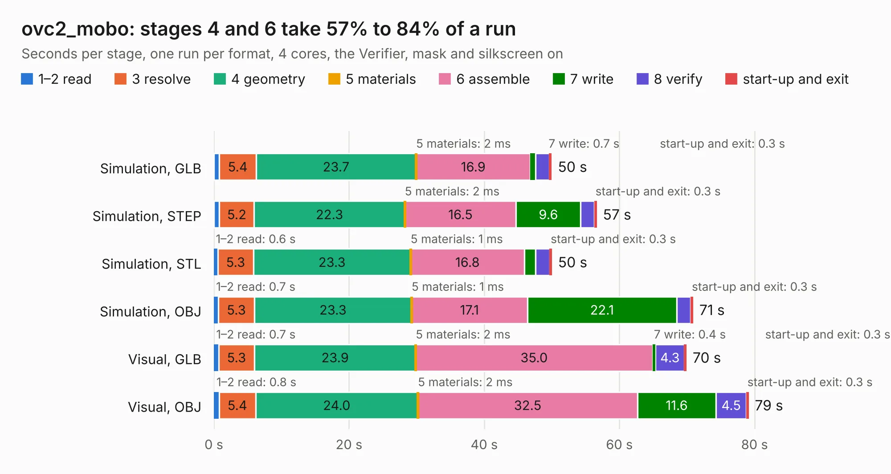

# 2223. ovc2_mobo

Board 2,223 of the 3,109 of [Corpus Testing](../Corpus-Testing.md), on [Corpus Page 21](../CorpusTestingPages/Corpus-Testing-21.md#2223-ovc2_mobo).

| Mode and format | 1–2 read | 3 resolve | 4 geometry | 5 materials | 6 assemble | 7 write | 8 verify | start-up and exit | Total |
|---|---:|---:|---:|---:|---:|---:|---:|---:|---:|
| Simulation, GLB | 0.8 | 5.4 | 23.7 | 2&nbsp;ms | 16.9 | 0.7 | 2.1 | 0.3 | 50.0 |
| Simulation, STEP | 0.8 | 5.2 | 22.3 | 2&nbsp;ms | 16.5 | 9.6 | 2.0 | 0.3 | 56.6 |
| Simulation, STL | 0.6 | 5.3 | 23.3 | 1&nbsp;ms | 16.8 | 1.7 | 2.1 | 0.3 | 50.0 |
| Simulation, OBJ | 0.7 | 5.3 | 23.3 | 1&nbsp;ms | 17.1 | 22.1 | 2.1 | 0.3 | 70.9 |
| Visual, GLB | 0.7 | 5.3 | 23.9 | 2&nbsp;ms | 35.0 | 0.4 | 4.3 | 0.3 | 69.9 |
| Visual, OBJ | 0.8 | 5.4 | 24.0 | 2&nbsp;ms | 32.5 | 11.6 | 4.5 | 0.3 | 79.1 |

<table align="center"><tr><td valign="top">

| Board | Repo: [osrf/ovc](https://github.com/osrf/ovc) Board: `ovc2_mobo.kicad_pcb` |
|---|---|
| Folder | ovc2 / hardware / ovc2b / mobo |
| Complexity | 341&nbsp;/&nbsp;1000 (size&nbsp;286, features&nbsp;55) |
| KESE&nbsp;features | through vias, slotted holes, rounded, trapezoid or chamfered pads, filled zones |
| Tested | 9th November 2026 |
| Copper&nbsp;layers | 6 |
| File&nbsp;format | KiCad 5 (20171130) |
| Parts,&nbsp;tracks,&nbsp;vias | 189, 3,726, 442 |
| Triangles,&nbsp;simulation | 4,626,256 in 447 parts |
| Verifier | PASS in all six runs |

</td><td valign="top">

<table>
<tr><th>File type</th><th>File size</th><th>Peak memory used</th></tr>
<tr><th colspan="3" align="left">Simulation</th></tr>
<tr><td>GLB</td><td align="right">160&nbsp;MB</td><td align="right">1.2&nbsp;GB</td></tr>
<tr><td>STEP</td><td align="right">623&nbsp;MB</td><td align="right">1.6&nbsp;GB</td></tr>
<tr><td>STL</td><td align="right">231&nbsp;MB</td><td align="right">1.2&nbsp;GB</td></tr>
<tr><td>OBJ</td><td align="right">499&nbsp;MB</td><td align="right">3.0&nbsp;GB</td></tr>
<tr><th colspan="3" align="left">Visual</th></tr>
<tr><td>GLB</td><td align="right">81&nbsp;MB</td><td align="right">1.5&nbsp;GB</td></tr>
<tr><td>OBJ</td><td align="right">262&nbsp;MB</td><td align="right">1.9&nbsp;GB</td></tr>
</table>

</td></tr></table>

| Previous | Next |
|:---|---:|
| [2222. ovc2_stereo](b2222b_ovc_ovc2-hardware-ovc2a-stereo_ovc2-stereo.md) | [2224. ovc2_stereo](b2224b_ovc_ovc2-hardware-ovc2b-stereo_ovc2-stereo.md) |
