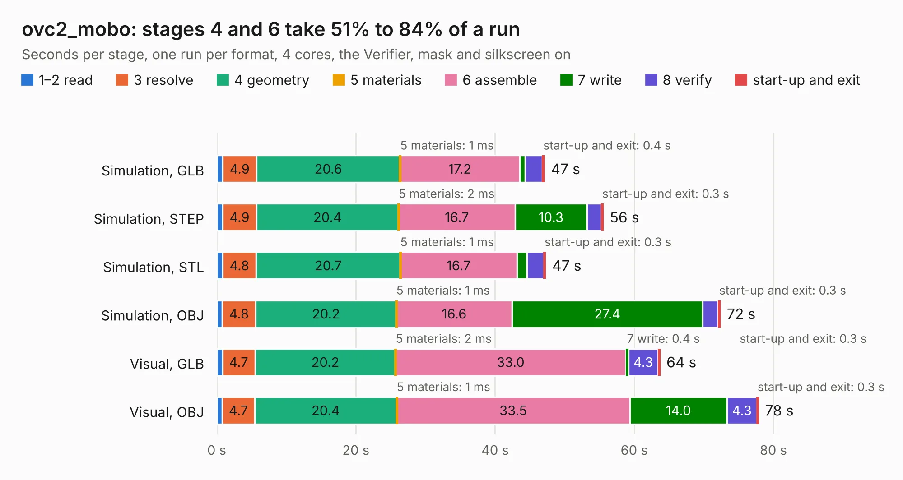

# 2224. ovc2_mobo

Board 2,224 of the 3,112 of [Corpus Testing](../Corpus-Testing.md), on [Corpus Page 21](../CorpusTestingPages/Corpus-Testing-21.md#2224-ovc2_mobo).

| Mode and format | 1–2 read | 3 resolve | 4 geometry | 5 materials | 6 assemble | 7 write | 8 verify | start-up and exit | Total |
|---|---:|---:|---:|---:|---:|---:|---:|---:|---:|
| Simulation, GLB | 0.9 | 4.9 | 20.6 | 1&nbsp;ms | 17.2 | 0.8 | 2.4 | 0.4 | 47.1 |
| Simulation, STEP | 0.8 | 4.9 | 20.4 | 2&nbsp;ms | 16.7 | 10.3 | 2.0 | 0.3 | 55.5 |
| Simulation, STL | 0.9 | 4.8 | 20.7 | 1&nbsp;ms | 16.7 | 1.5 | 2.4 | 0.3 | 47.3 |
| Simulation, OBJ | 0.8 | 4.8 | 20.2 | 1&nbsp;ms | 16.6 | 27.4 | 2.2 | 0.3 | 72.4 |
| Visual, GLB | 0.8 | 4.7 | 20.2 | 2&nbsp;ms | 33.0 | 0.4 | 4.3 | 0.3 | 63.7 |
| Visual, OBJ | 0.8 | 4.7 | 20.4 | 1&nbsp;ms | 33.5 | 14.0 | 4.3 | 0.3 | 77.9 |

<table align="center"><tr><td valign="top">

| Board | Repo: [osrf/ovc](https://github.com/osrf/ovc) Board: `ovc2_mobo.kicad_pcb` |
|---|---|
| Folder | ovc2 / hardware / ovc2a / mobo |
| Complexity | 330&nbsp;/&nbsp;1000 (size&nbsp;275, features&nbsp;55) |
| KESE&nbsp;features | through vias, slotted holes, rounded, trapezoid or chamfered pads, filled zones |
| Tested | 9th November 2026 |
| Copper&nbsp;layers | 6 |
| File&nbsp;format | KiCad 5 (20171130) |
| Parts,&nbsp;tracks,&nbsp;vias | 181, 2,473, 450 |
| Triangles,&nbsp;simulation | 4,341,994 in 430 parts |
| Verifier | PASS in all six runs |

</td><td valign="top">

<table>
<tr><th>File type</th><th>File size</th><th>Peak memory used</th></tr>
<tr><th colspan="3" align="left">Simulation</th></tr>
<tr><td>GLB</td><td align="right">150&nbsp;MB</td><td align="right">1.3&nbsp;GB</td></tr>
<tr><td>STEP</td><td align="right">529&nbsp;MB</td><td align="right">1.5&nbsp;GB</td></tr>
<tr><td>STL</td><td align="right">217&nbsp;MB</td><td align="right">1.2&nbsp;GB</td></tr>
<tr><td>OBJ</td><td align="right">468&nbsp;MB</td><td align="right">2.9&nbsp;GB</td></tr>
<tr><th colspan="3" align="left">Visual</th></tr>
<tr><td>GLB</td><td align="right">76&nbsp;MB</td><td align="right">1.4&nbsp;GB</td></tr>
<tr><td>OBJ</td><td align="right">246&nbsp;MB</td><td align="right">1.7&nbsp;GB</td></tr>
</table>

</td></tr></table>

| Previous | Next |
|:---|---:|
| [2223. mono_imu](b2223b_ovc_mono-imu.md) | [2225. ovc2_stereo](b2225b_ovc_ovc2-hardware-ovc2a-stereo_ovc2-stereo.md) |
