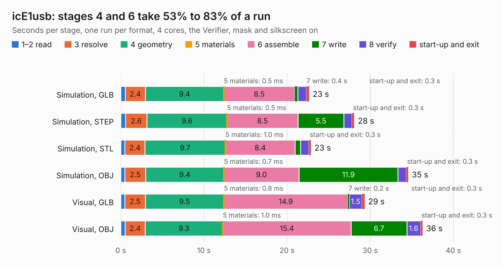

# 2226. icE1usb

Board 2,226 of the 3,130 of [Corpus Testing](../Corpus-Testing.md), on [Corpus Page 21](../CorpusTestingPages/Corpus-Testing-21.md#2226-ice1usb).

| Mode and format | 1–2 read | 3 resolve | 4 geometry | 5 materials | 6 assemble | 7 write | 8 verify | start-up and exit | Total |
|---|---:|---:|---:|---:|---:|---:|---:|---:|---:|
| Simulation, GLB | 0.5 | 2.4 | 9.4 | 0.5&nbsp;ms | 8.5 | 0.4 | 1.0 | 0.3 | 22.6 |
| Simulation, STEP | 0.6 | 2.6 | 9.6 | 0.5&nbsp;ms | 8.5 | 5.5 | 0.9 | 0.3 | 28.1 |
| Simulation, STL | 0.5 | 2.4 | 9.7 | 1.0&nbsp;ms | 8.4 | 0.7 | 1.0 | 0.3 | 22.9 |
| Simulation, OBJ | 0.5 | 2.5 | 9.4 | 0.7&nbsp;ms | 9.0 | 11.9 | 1.0 | 0.3 | 34.6 |
| Visual, GLB | 0.5 | 2.5 | 9.5 | 0.8&nbsp;ms | 14.9 | 0.2 | 1.5 | 0.3 | 29.3 |
| Visual, OBJ | 0.5 | 2.4 | 9.3 | 1.0&nbsp;ms | 15.4 | 6.7 | 1.6 | 0.3 | 36.3 |

<table align="center"><tr><td valign="top">

| Board | Repo: [osmocom/osmo-e1-hardware](https://github.com/osmocom/osmo-e1-hardware) Board: `icE1usb.kicad_pcb` |
|---|---|
| Folder | hardware / icE1usb |
| Complexity | 315&nbsp;/&nbsp;1000 (size&nbsp;250, features&nbsp;65) |
| KESE&nbsp;features | through vias, slotted holes, rounded, trapezoid or chamfered pads, filled zones, curved board outline |
| Tested | 9th November 2026 |
| Copper&nbsp;layers | 4 |
| File&nbsp;format | KiCad 6 (20211014) |
| Parts,&nbsp;tracks,&nbsp;vias | 118, 1,527, 169 |
| Triangles,&nbsp;simulation | 1,851,700 in 171 parts |
| Verifier | PASS in all six runs |

</td><td valign="top">

<table>
<tr><th>File type</th><th>File size</th><th>Peak memory used</th></tr>
<tr><th colspan="3" align="left">Simulation</th></tr>
<tr><td>GLB</td><td align="right">64&nbsp;MB</td><td align="right">660&nbsp;MB</td></tr>
<tr><td>STEP</td><td align="right">281&nbsp;MB</td><td align="right">823&nbsp;MB</td></tr>
<tr><td>STL</td><td align="right">93&nbsp;MB</td><td align="right">635&nbsp;MB</td></tr>
<tr><td>OBJ</td><td align="right">195&nbsp;MB</td><td align="right">1.3&nbsp;GB</td></tr>
<tr><th colspan="3" align="left">Visual</th></tr>
<tr><td>GLB</td><td align="right">35&nbsp;MB</td><td align="right">756&nbsp;MB</td></tr>
<tr><td>OBJ</td><td align="right">108&nbsp;MB</td><td align="right">852&nbsp;MB</td></tr>
</table>

</td></tr></table>

| Previous | Next |
|:---|---:|
| [2225. icE1usb-rs422](b2225b_osmo-e1-hardware_icE1usb-rs422.md) | [2227. icE1usb](b2227b_osmo-e1-hardware_hardware-icE1usb-r0-1_icE1usb.md) |
