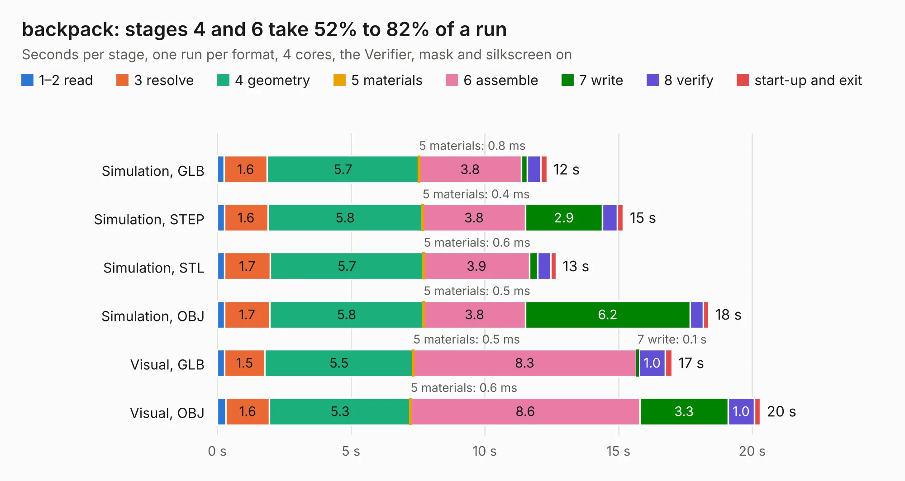

# 2227. backpack

Board 2,227 of the 3,111 of [Corpus Testing](../Corpus-Testing.md), on [Corpus Page 21](../CorpusTestingPages/Corpus-Testing-21.md#2227-backpack).

| Mode and format | 1–2 read | 3 resolve | 4 geometry | 5 materials | 6 assemble | 7 write | 8 verify | start-up and exit | Total |
|---|---:|---:|---:|---:|---:|---:|---:|---:|---:|
| Simulation, GLB | 0.3 | 1.6 | 5.7 | 0.8&nbsp;ms | 3.8 | 0.2 | 0.5 | 0.2 | 12.3 |
| Simulation, STEP | 0.3 | 1.6 | 5.8 | 0.4&nbsp;ms | 3.8 | 2.9 | 0.6 | 0.2 | 15.2 |
| Simulation, STL | 0.3 | 1.7 | 5.7 | 0.6&nbsp;ms | 3.9 | 0.3 | 0.5 | 0.2 | 12.7 |
| Simulation, OBJ | 0.3 | 1.7 | 5.8 | 0.5&nbsp;ms | 3.8 | 6.2 | 0.5 | 0.2 | 18.4 |
| Visual, GLB | 0.3 | 1.5 | 5.5 | 0.5&nbsp;ms | 8.3 | 0.1 | 1.0 | 0.2 | 17.0 |
| Visual, OBJ | 0.3 | 1.6 | 5.3 | 0.6&nbsp;ms | 8.6 | 3.3 | 1.0 | 0.2 | 20.3 |

<table align="center"><tr><td valign="top">

| Board | Repo: [osrf/ovc](https://github.com/osrf/ovc) Board: `backpack.kicad_pcb` |
|---|---|
| Folder | ovc3 / hardware / ovc3a / ovc3a / backpack |
| Complexity | 235&nbsp;/&nbsp;1000 (size&nbsp;190, features&nbsp;45) |
| KESE&nbsp;features | through vias, rounded, trapezoid or chamfered pads, filled zones |
| Tested | 9th November 2026 |
| Copper&nbsp;layers | 4 |
| File&nbsp;format | KiCad 6 (20190605) |
| Parts,&nbsp;tracks,&nbsp;vias | 54, 692, 106 |
| Triangles,&nbsp;simulation | 1,324,744 in 127 parts |
| Verifier | PASS in all six runs |

</td><td valign="top">

<table>
<tr><th>File type</th><th>File size</th><th>Peak memory used</th></tr>
<tr><th colspan="3" align="left">Simulation</th></tr>
<tr><td>GLB</td><td align="right">46&nbsp;MB</td><td align="right">509&nbsp;MB</td></tr>
<tr><td>STEP</td><td align="right">205&nbsp;MB</td><td align="right">551&nbsp;MB</td></tr>
<tr><td>STL</td><td align="right">66&nbsp;MB</td><td align="right">494&nbsp;MB</td></tr>
<tr><td>OBJ</td><td align="right">138&nbsp;MB</td><td align="right">925&nbsp;MB</td></tr>
<tr><th colspan="3" align="left">Visual</th></tr>
<tr><td>GLB</td><td align="right">25&nbsp;MB</td><td align="right">556&nbsp;MB</td></tr>
<tr><td>OBJ</td><td align="right">75&nbsp;MB</td><td align="right">621&nbsp;MB</td></tr>
</table>

</td></tr></table>

| Previous | Next |
|:---|---:|
| [2226. ovc2_stereo](b2226b_ovc_ovc2-hardware-ovc2b-stereo_ovc2-stereo.md) | [2228. ovc3](b2228b_ovc_ovc3-hardware-ovc3a-ovc3a-camera_ovc3.md) |
