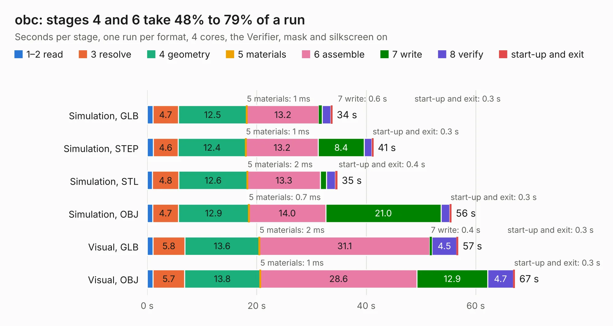

# 2230. obc

Board 2,230 of the 3,103 of [Corpus Testing](../Corpus-Testing.md), on [Corpus Page 21](../CorpusTestingPages/Corpus-Testing-21.md#2230-obc).

| Mode and format | 1–2 read | 3 resolve | 4 geometry | 5 materials | 6 assemble | 7 write | 8 verify | start-up and exit | Total |
|---|---:|---:|---:|---:|---:|---:|---:|---:|---:|
| Simulation, GLB | 1.0 | 4.7 | 12.5 | 1&nbsp;ms | 13.2 | 0.6 | 1.6 | 0.3 | 33.8 |
| Simulation, STEP | 1.1 | 4.6 | 12.4 | 1&nbsp;ms | 13.2 | 8.4 | 1.4 | 0.3 | 41.3 |
| Simulation, STL | 1.0 | 4.8 | 12.6 | 2&nbsp;ms | 13.3 | 1.1 | 1.6 | 0.4 | 34.7 |
| Simulation, OBJ | 1.0 | 4.7 | 12.9 | 0.7&nbsp;ms | 14.0 | 21.0 | 1.6 | 0.3 | 55.6 |
| Visual, GLB | 1.0 | 5.8 | 13.6 | 2&nbsp;ms | 31.1 | 0.4 | 4.5 | 0.3 | 56.8 |
| Visual, OBJ | 1.1 | 5.7 | 13.8 | 1&nbsp;ms | 28.6 | 12.9 | 4.7 | 0.3 | 67.2 |

<table align="center"><tr><td valign="top">

| Board | Repo: [osusat/cubesat](https://github.com/osusat/cubesat) Board: `obc.kicad_pcb` |
|---|---|
| Folder | obc / v1 / hardware |
| Complexity | 397&nbsp;/&nbsp;1000 (size&nbsp;262, features&nbsp;135) |
| KESE&nbsp;features | through vias, slotted holes, custom pads, rounded, trapezoid or chamfered pads, filled zones, copper drawings, copper text, knockout text, stack-up, dielectric εr and tanδ |
| Tested | 9th November 2026 |
| Copper&nbsp;layers | 4 |
| File&nbsp;format | KiCad 10 (20260206) |
| Parts,&nbsp;tracks,&nbsp;vias | 144, 1,011, 940 |
| Triangles,&nbsp;simulation | 3,414,442 in 208 parts |
| Verifier | PASS in all six runs |

</td><td valign="top">

<table>
<tr><th>File type</th><th>File size</th><th>Peak memory used</th></tr>
<tr><th colspan="3" align="left">Simulation</th></tr>
<tr><td>GLB</td><td align="right">116&nbsp;MB</td><td align="right">1.4&nbsp;GB</td></tr>
<tr><td>STEP</td><td align="right">338&nbsp;MB</td><td align="right">1.6&nbsp;GB</td></tr>
<tr><td>STL</td><td align="right">171&nbsp;MB</td><td align="right">1.4&nbsp;GB</td></tr>
<tr><td>OBJ</td><td align="right">358&nbsp;MB</td><td align="right">2.2&nbsp;GB</td></tr>
<tr><th colspan="3" align="left">Visual</th></tr>
<tr><td>GLB</td><td align="right">70&nbsp;MB</td><td align="right">1.2&nbsp;GB</td></tr>
<tr><td>OBJ</td><td align="right">220&nbsp;MB</td><td align="right">1.5&nbsp;GB</td></tr>
</table>

</td></tr></table>

| Previous | Next |
|:---|---:|
| [2229. eps](b2229b_cubesat_eps.md) | [2231. payload](b2231b_cubesat_payload.md) |
