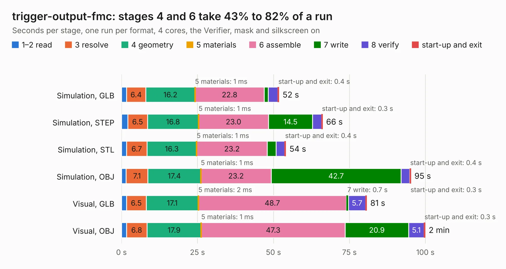

# 2230. trigger-output-fmc

Board 2,230 of the 3,129 of [Corpus Testing](../Corpus-Testing.md), on [Corpus Page 21](../CorpusTestingPages/Corpus-Testing-21.md#2230-trigger-output-fmc).

| Mode and format | 1–2 read | 3 resolve | 4 geometry | 5 materials | 6 assemble | 7 write | 8 verify | start-up and exit | Total |
|---|---:|---:|---:|---:|---:|---:|---:|---:|---:|
| Simulation, GLB | 1.6 | 6.4 | 16.2 | 1&nbsp;ms | 22.8 | 1.3 | 3.2 | 0.4 | 51.8 |
| Simulation, STEP | 2.1 | 6.5 | 16.8 | 1&nbsp;ms | 23.0 | 14.5 | 2.9 | 0.3 | 66.1 |
| Simulation, STL | 1.7 | 6.7 | 16.3 | 1&nbsp;ms | 23.2 | 2.9 | 2.8 | 0.4 | 54.1 |
| Simulation, OBJ | 1.5 | 7.1 | 17.4 | 1&nbsp;ms | 23.2 | 42.7 | 2.9 | 0.4 | 95.2 |
| Visual, GLB | 1.6 | 6.5 | 17.1 | 2&nbsp;ms | 48.7 | 0.7 | 5.7 | 0.3 | 80.7 |
| Visual, OBJ | 1.6 | 6.8 | 17.9 | 1&nbsp;ms | 47.3 | 20.9 | 5.1 | 0.3 | 99.9 |

<table align="center"><tr><td valign="top">

| Board | Repo: [osprey-dcs/trigger-output-fmc](https://github.com/osprey-dcs/trigger-output-fmc) Board: `trigger-output-fmc.kicad_pcb` |
|---|---|
| Complexity | 428&nbsp;/&nbsp;1000 (size&nbsp;298, features&nbsp;130) |
| KESE&nbsp;features | through vias, slotted holes, rounded, trapezoid or chamfered pads, filled zones, curved board outline, knockout text, stack-up, dielectric εr and tanδ, copper finish, mask and silkscreen colours |
| Tested | 9th November 2026 |
| Copper&nbsp;layers | 8 |
| File&nbsp;format | KiCad 9 (20241229) |
| Parts,&nbsp;tracks,&nbsp;vias | 323, 3,090, 543 |
| Triangles,&nbsp;simulation | 6,780,940 in 429 parts |
| Verifier | PASS in all six runs |

</td><td valign="top">

<table>
<tr><th>File type</th><th>File size</th><th>Peak memory used</th></tr>
<tr><th colspan="3" align="left">Simulation</th></tr>
<tr><td>GLB</td><td align="right">225&nbsp;MB</td><td align="right">2.1&nbsp;GB</td></tr>
<tr><td>STEP</td><td align="right">730&nbsp;MB</td><td align="right">2.3&nbsp;GB</td></tr>
<tr><td>STL</td><td align="right">339&nbsp;MB</td><td align="right">2.0&nbsp;GB</td></tr>
<tr><td>OBJ</td><td align="right">722&nbsp;MB</td><td align="right">4.2&nbsp;GB</td></tr>
<tr><th colspan="3" align="left">Visual</th></tr>
<tr><td>GLB</td><td align="right">115&nbsp;MB</td><td align="right">2.0&nbsp;GB</td></tr>
<tr><td>OBJ</td><td align="right">373&nbsp;MB</td><td align="right">2.5&nbsp;GB</td></tr>
</table>

</td></tr></table>

| Previous | Next |
|:---|---:|
| [2229. clk-input-fmc](b2229b_clk-input-fmc_clk-input-fmc.md) | [2231. HarleyGhostRider](b2231b_ovc_HarleyGhostRider.md) |
