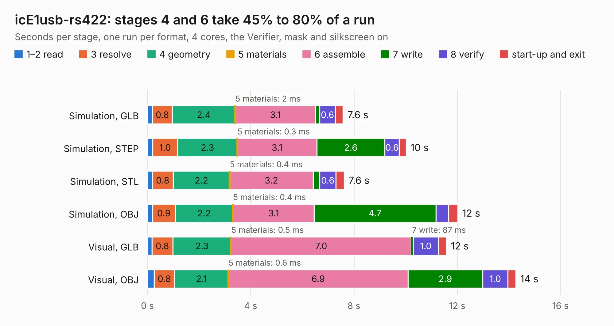

# 2231 icE1usb-rs422

Board 2,231 of the 3,138 of [Corpus Testing](../Corpus-Testing.md), on [Corpus Page 21](../CorpusTestingPages/Corpus-Testing-21.md#2231-ice1usb-rs422).

| Mode and format | 1–2 read | 3 resolve | 4 geometry | 5 materials | 6 assemble | 7 write | 8 verify | start-up and exit | Total |
|---|---:|---:|---:|---:|---:|---:|---:|---:|---:|
| Simulation, GLB | 0.2 | 0.8 | 2.4 | 2&nbsp;ms | 3.1 | 0.2 | 0.6 | 0.3 | 7.6 |
| Simulation, STEP | 0.2 | 1.0 | 2.3 | 0.3&nbsp;ms | 3.1 | 2.6 | 0.6 | 0.3 | 10.0 |
| Simulation, STL | 0.2 | 0.8 | 2.2 | 0.4&nbsp;ms | 3.2 | 0.3 | 0.6 | 0.3 | 7.6 |
| Simulation, OBJ | 0.2 | 0.9 | 2.2 | 0.4&nbsp;ms | 3.1 | 4.7 | 0.5 | 0.4 | 12.0 |
| Visual, GLB | 0.2 | 0.8 | 2.3 | 0.5&nbsp;ms | 7.0 | 87&nbsp;ms | 1.0 | 0.3 | 11.6 |
| Visual, OBJ | 0.3 | 0.8 | 2.1 | 0.6&nbsp;ms | 6.9 | 2.9 | 1.0 | 0.3 | 14.3 |

<table align="center"><tr><td valign="top">

| Board | Repo: [osmocom/osmo-e1-hardware](https://github.com/osmocom/osmo-e1-hardware) Board: `icE1usb-rs422.kicad_pcb` |
|---|---|
| Folder | hardware / icE1usb-rs422 |
| Complexity | 272&nbsp;/&nbsp;1000 (size&nbsp;187, features&nbsp;85) |
| KESE&nbsp;features | through vias, rounded, trapezoid or chamfered pads, filled zones, curved board outline, stack-up, dielectric εr and tanδ |
| Tested | 9th November 2026 |
| Copper&nbsp;layers | 4 |
| File&nbsp;format | KiCad 6 (20211014) |
| Parts,&nbsp;tracks,&nbsp;vias | 52, 501, 110 |
| Triangles,&nbsp;simulation | 713,298 in 68 parts |
| Verifier | PASS in all six runs |

</td><td valign="top">

<table>
<tr><th>File type</th><th>File size</th><th>Peak memory used</th></tr>
<tr><th colspan="3" align="left">Simulation</th></tr>
<tr><td>GLB</td><td align="right">24&nbsp;MB</td><td align="right">318&nbsp;MB</td></tr>
<tr><td>STEP</td><td align="right">89&nbsp;MB</td><td align="right">377&nbsp;MB</td></tr>
<tr><td>STL</td><td align="right">36&nbsp;MB</td><td align="right">353&nbsp;MB</td></tr>
<tr><td>OBJ</td><td align="right">71&nbsp;MB</td><td align="right">472&nbsp;MB</td></tr>
<tr><th colspan="3" align="left">Visual</th></tr>
<tr><td>GLB</td><td align="right">15&nbsp;MB</td><td align="right">399&nbsp;MB</td></tr>
<tr><td>OBJ</td><td align="right">47&nbsp;MB</td><td align="right">390&nbsp;MB</td></tr>
</table>

</td></tr></table>

| Previous | Next |
|:---|---:|
| [2230 logicbone](b2230b_logicbone_logicbone.md) | [2232 icE1usb](b2232b_osmo-e1-hardware_hardware-icE1usb_icE1usb.md) |
