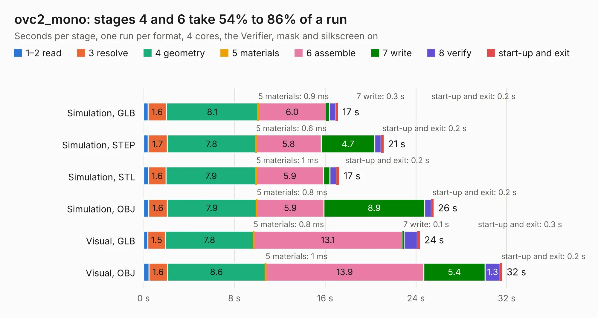

# 2231. ovc2_mono

Board 2,231 of the 3,121 of [Corpus Testing](../Corpus-Testing.md), on [Corpus Page 21](../CorpusTestingPages/Corpus-Testing-21.md#2231-ovc2_mono).

| Mode and format | 1–2 read | 3 resolve | 4 geometry | 5 materials | 6 assemble | 7 write | 8 verify | start-up and exit | Total |
|---|---:|---:|---:|---:|---:|---:|---:|---:|---:|
| Simulation, GLB | 0.4 | 1.6 | 8.1 | 0.9&nbsp;ms | 6.0 | 0.3 | 0.6 | 0.2 | 17.1 |
| Simulation, STEP | 0.4 | 1.7 | 7.8 | 0.6&nbsp;ms | 5.8 | 4.7 | 0.6 | 0.2 | 21.2 |
| Simulation, STL | 0.4 | 1.6 | 7.9 | 1&nbsp;ms | 5.9 | 0.5 | 0.6 | 0.2 | 17.2 |
| Simulation, OBJ | 0.4 | 1.6 | 7.9 | 0.8&nbsp;ms | 5.9 | 8.9 | 0.6 | 0.2 | 25.6 |
| Visual, GLB | 0.4 | 1.5 | 7.8 | 0.8&nbsp;ms | 13.1 | 0.1 | 1.1 | 0.3 | 24.4 |
| Visual, OBJ | 0.5 | 1.6 | 8.6 | 1&nbsp;ms | 13.9 | 5.4 | 1.3 | 0.2 | 31.6 |

<table align="center"><tr><td valign="top">

| Board | Repo: [osrf/ovc](https://github.com/osrf/ovc) Board: `ovc2_mono.kicad_pcb` |
|---|---|
| Folder | ovc2 / hardware / ovc2a / graveyard / mono |
| Complexity | 290&nbsp;/&nbsp;1000 (size&nbsp;255, features&nbsp;35) |
| KESE&nbsp;features | through vias, filled zones |
| Tested | 9th November 2026 |
| Copper&nbsp;layers | 6 |
| File&nbsp;format | KiCad 5 (20171130) |
| Parts,&nbsp;tracks,&nbsp;vias | 134, 386, 90 |
| Triangles,&nbsp;simulation | 1,501,204 in 379 parts |
| Verifier | PASS in all six runs |

</td><td valign="top">

<table>
<tr><th>File type</th><th>File size</th><th>Peak memory used</th></tr>
<tr><th colspan="3" align="left">Simulation</th></tr>
<tr><td>GLB</td><td align="right">51&nbsp;MB</td><td align="right">559&nbsp;MB</td></tr>
<tr><td>STEP</td><td align="right">229&nbsp;MB</td><td align="right">763&nbsp;MB</td></tr>
<tr><td>STL</td><td align="right">75&nbsp;MB</td><td align="right">564&nbsp;MB</td></tr>
<tr><td>OBJ</td><td align="right">158&nbsp;MB</td><td align="right">1.1&nbsp;GB</td></tr>
<tr><th colspan="3" align="left">Visual</th></tr>
<tr><td>GLB</td><td align="right">31&nbsp;MB</td><td align="right">679&nbsp;MB</td></tr>
<tr><td>OBJ</td><td align="right">94&nbsp;MB</td><td align="right">716&nbsp;MB</td></tr>
</table>

</td></tr></table>

| Previous | Next |
|:---|---:|
| [2230. mobof](b2230b_ovc_mobof.md) | [2232. mono_imu](b2232b_ovc_mono-imu.md) |
