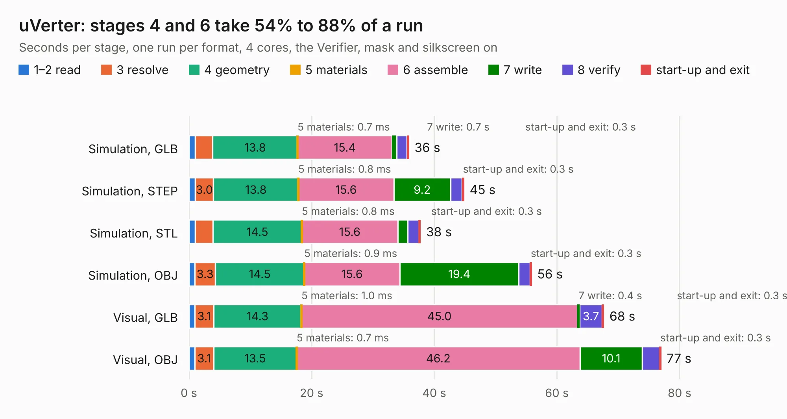

# 2232. uVerter

Board 2,232 of the 3,100 of [Corpus Testing](../Corpus-Testing.md), on [Corpus Page 21](../CorpusTestingPages/Corpus-Testing-21.md#2232-uverter).

| Mode and format | 1–2 read | 3 resolve | 4 geometry | 5 materials | 6 assemble | 7 write | 8 verify | start-up and exit | Total |
|---|---:|---:|---:|---:|---:|---:|---:|---:|---:|
| Simulation, GLB | 1.0 | 2.9 | 13.8 | 0.7&nbsp;ms | 15.4 | 0.7 | 1.7 | 0.3 | 35.9 |
| Simulation, STEP | 1.0 | 3.0 | 13.8 | 0.8&nbsp;ms | 15.6 | 9.2 | 1.9 | 0.3 | 44.9 |
| Simulation, STL | 1.0 | 2.9 | 14.5 | 0.8&nbsp;ms | 15.6 | 1.6 | 1.8 | 0.3 | 37.8 |
| Simulation, OBJ | 1.0 | 3.3 | 14.5 | 0.9&nbsp;ms | 15.6 | 19.4 | 1.8 | 0.3 | 55.9 |
| Visual, GLB | 1.0 | 3.1 | 14.3 | 1.0&nbsp;ms | 45.0 | 0.4 | 3.7 | 0.3 | 67.7 |
| Visual, OBJ | 1.0 | 3.1 | 13.5 | 0.7&nbsp;ms | 46.2 | 10.1 | 2.8 | 0.3 | 77.0 |

<table align="center"><tr><td valign="top">

| Board | Repo: [owntech-foundation/micro-inverter](https://github.com/owntech-foundation/micro-inverter) Board: `uVerter.kicad_pcb` |
|---|---|
| Folder | KiCAD_Files |
| Complexity | 453&nbsp;/&nbsp;1000 (size&nbsp;228, features&nbsp;225) |
| KESE&nbsp;features | through vias, microvias, slotted holes, custom pads, rounded, trapezoid or chamfered pads, drill offsets, arc tracks, filled zones, copper drawings, curved board outline, TrueType text, stack-up, dielectric εr and tanδ, castellated pads |
| Tested | 9th November 2026 |
| Copper&nbsp;layers | 4 |
| File&nbsp;format | KiCad 9 (20241229) |
| Parts,&nbsp;tracks,&nbsp;vias | 322, 1,492, 529 |
| Triangles,&nbsp;simulation | 4,476,104 in 240 parts |
| Verifier | PASS in all six runs |

</td><td valign="top">

<table>
<tr><th>File type</th><th>File size</th><th>Peak memory used</th></tr>
<tr><th colspan="3" align="left">Simulation</th></tr>
<tr><td>GLB</td><td align="right">153&nbsp;MB</td><td align="right">1.5&nbsp;GB</td></tr>
<tr><td>STEP</td><td align="right">651&nbsp;MB</td><td align="right">1.5&nbsp;GB</td></tr>
<tr><td>STL</td><td align="right">224&nbsp;MB</td><td align="right">1.4&nbsp;GB</td></tr>
<tr><td>OBJ</td><td align="right">478&nbsp;MB</td><td align="right">2.8&nbsp;GB</td></tr>
<tr><th colspan="3" align="left">Visual</th></tr>
<tr><td>GLB</td><td align="right">84&nbsp;MB</td><td align="right">1.5&nbsp;GB</td></tr>
<tr><td>OBJ</td><td align="right">266&nbsp;MB</td><td align="right">1.8&nbsp;GB</td></tr>
</table>

</td></tr></table>

| Previous | Next |
|:---|---:|
| [2231. film_capacitors](b2231b_micro-inverter_film-capacitors.md) | [2233. ownverter](b2233b_ownverter_ownverter.md) |
