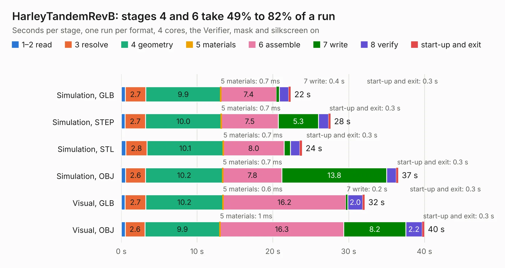

# 2232. HarleyTandemRevB

Board 2,232 of the 3,127 of [Corpus Testing](../Corpus-Testing.md), on [Corpus Page 21](../CorpusTestingPages/Corpus-Testing-21.md#2232-harleytandemrevb).

| Mode and format | 1–2 read | 3 resolve | 4 geometry | 5 materials | 6 assemble | 7 write | 8 verify | start-up and exit | Total |
|---|---:|---:|---:|---:|---:|---:|---:|---:|---:|
| Simulation, GLB | 0.5 | 2.7 | 9.9 | 0.7&nbsp;ms | 7.4 | 0.4 | 1.2 | 0.3 | 22.4 |
| Simulation, STEP | 0.5 | 2.7 | 10.0 | 0.7&nbsp;ms | 7.5 | 5.3 | 1.3 | 0.3 | 27.6 |
| Simulation, STL | 0.6 | 2.8 | 10.1 | 0.7&nbsp;ms | 8.0 | 0.8 | 1.2 | 0.3 | 23.9 |
| Simulation, OBJ | 0.6 | 2.6 | 10.2 | 0.7&nbsp;ms | 7.8 | 13.8 | 1.3 | 0.3 | 36.5 |
| Visual, GLB | 0.5 | 2.7 | 10.2 | 0.6&nbsp;ms | 16.2 | 0.2 | 2.0 | 0.3 | 32.1 |
| Visual, OBJ | 0.5 | 2.6 | 9.9 | 1&nbsp;ms | 16.3 | 8.2 | 2.2 | 0.3 | 40.0 |

<table align="center"><tr><td valign="top">

| Board | Repo: [osrf/ovc](https://github.com/osrf/ovc) Board: `HarleyTandemRevB.kicad_pcb` |
|---|---|
| Folder | ovc0 / hardware / HarleyTandem |
| Complexity | 321&nbsp;/&nbsp;1000 (size&nbsp;276, features&nbsp;45) |
| KESE&nbsp;features | through vias, filled zones, curved board outline |
| Tested | 9th November 2026 |
| Copper&nbsp;layers | 6 |
| File&nbsp;format | KiCad 5 (20160815) |
| Parts,&nbsp;tracks,&nbsp;vias | 149, 2,035, 258 |
| Triangles,&nbsp;simulation | 2,500,382 in 162 parts |
| Verifier | PASS in all six runs |

</td><td valign="top">

<table>
<tr><th>File type</th><th>File size</th><th>Peak memory used</th></tr>
<tr><th colspan="3" align="left">Simulation</th></tr>
<tr><td>GLB</td><td align="right">88&nbsp;MB</td><td align="right">773&nbsp;MB</td></tr>
<tr><td>STEP</td><td align="right">298&nbsp;MB</td><td align="right">886&nbsp;MB</td></tr>
<tr><td>STL</td><td align="right">125&nbsp;MB</td><td align="right">805&nbsp;MB</td></tr>
<tr><td>OBJ</td><td align="right">268&nbsp;MB</td><td align="right">1.7&nbsp;GB</td></tr>
<tr><th colspan="3" align="left">Visual</th></tr>
<tr><td>GLB</td><td align="right">49&nbsp;MB</td><td align="right">887&nbsp;MB</td></tr>
<tr><td>OBJ</td><td align="right">151&nbsp;MB</td><td align="right">1.1&nbsp;GB</td></tr>
</table>

</td></tr></table>

| Previous | Next |
|:---|---:|
| [2231. HarleyTandem](b2231b_ovc_HarleyTandem.md) | [2233. ovc](b2233b_ovc_ovc.md) |
