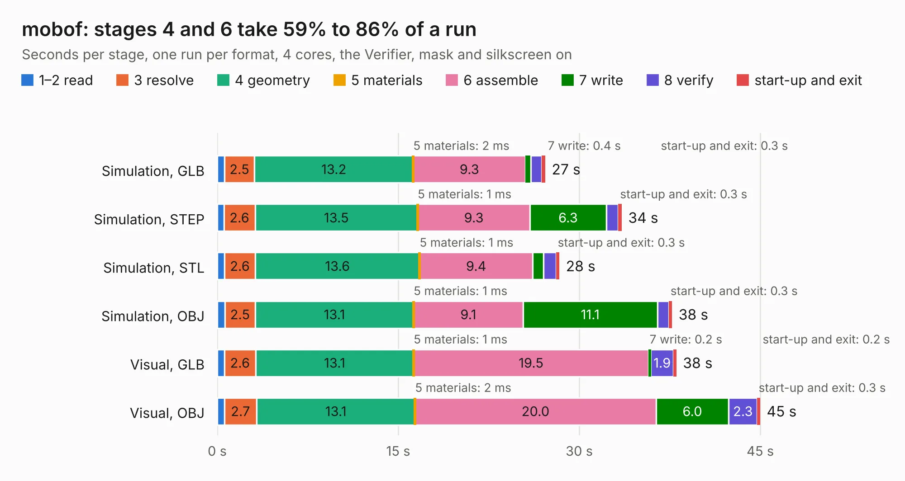

# 2232. mobof

Board 2,232 of the 3,123 of [Corpus Testing](../Corpus-Testing.md), on [Corpus Page 21](../CorpusTestingPages/Corpus-Testing-21.md#2232-mobof).

| Mode and format | 1–2 read | 3 resolve | 4 geometry | 5 materials | 6 assemble | 7 write | 8 verify | start-up and exit | Total |
|---|---:|---:|---:|---:|---:|---:|---:|---:|---:|
| Simulation, GLB | 0.6 | 2.5 | 13.2 | 2&nbsp;ms | 9.3 | 0.4 | 0.9 | 0.3 | 27.2 |
| Simulation, STEP | 0.5 | 2.6 | 13.5 | 1&nbsp;ms | 9.3 | 6.3 | 1.0 | 0.3 | 33.5 |
| Simulation, STL | 0.6 | 2.6 | 13.6 | 1&nbsp;ms | 9.4 | 0.9 | 1.0 | 0.3 | 28.4 |
| Simulation, OBJ | 0.6 | 2.5 | 13.1 | 1&nbsp;ms | 9.1 | 11.1 | 1.0 | 0.3 | 37.7 |
| Visual, GLB | 0.6 | 2.6 | 13.1 | 1&nbsp;ms | 19.5 | 0.2 | 1.9 | 0.2 | 38.1 |
| Visual, OBJ | 0.6 | 2.7 | 13.1 | 2&nbsp;ms | 20.0 | 6.0 | 2.3 | 0.3 | 45.0 |

<table align="center"><tr><td valign="top">

| Board | Repo: [osrf/ovc](https://github.com/osrf/ovc) Board: `mobof.kicad_pcb` |
|---|---|
| Folder | ovc2 / hardware / ovc2a / graveyard / mobof |
| Complexity | 314&nbsp;/&nbsp;1000 (size&nbsp;259, features&nbsp;55) |
| KESE&nbsp;features | through vias, slotted holes, rounded, trapezoid or chamfered pads, filled zones |
| Tested | 9th November 2026 |
| Copper&nbsp;layers | 6 |
| File&nbsp;format | KiCad 5 (20171130) |
| Parts,&nbsp;tracks,&nbsp;vias | 225, 323, 93 |
| Triangles,&nbsp;simulation | 2,331,998 in 555 parts |
| Verifier | PASS in all six runs |

</td><td valign="top">

<table>
<tr><th>File type</th><th>File size</th><th>Peak memory used</th></tr>
<tr><th colspan="3" align="left">Simulation</th></tr>
<tr><td>GLB</td><td align="right">78&nbsp;MB</td><td align="right">763&nbsp;MB</td></tr>
<tr><td>STEP</td><td align="right">364&nbsp;MB</td><td align="right">1.0&nbsp;GB</td></tr>
<tr><td>STL</td><td align="right">117&nbsp;MB</td><td align="right">741&nbsp;MB</td></tr>
<tr><td>OBJ</td><td align="right">248&nbsp;MB</td><td align="right">1.6&nbsp;GB</td></tr>
<tr><th colspan="3" align="left">Visual</th></tr>
<tr><td>GLB</td><td align="right">42&nbsp;MB</td><td align="right">942&nbsp;MB</td></tr>
<tr><td>OBJ</td><td align="right">128&nbsp;MB</td><td align="right">942&nbsp;MB</td></tr>
</table>

</td></tr></table>

| Previous | Next |
|:---|---:|
| [2231. ovc](b2231b_ovc_ovc.md) | [2233. ovc2_mono](b2233b_ovc_ovc2-mono.md) |
