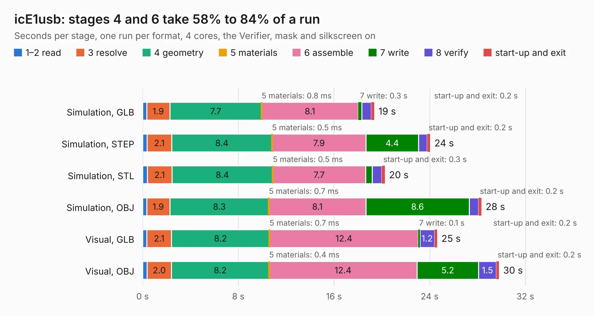

# 2233. icE1usb

Board 2,233 of the 3,138 of [Corpus Testing](../Corpus-Testing.md), on [Corpus Page 21](../CorpusTestingPages/Corpus-Testing-21.md#2233-ice1usb).

| Mode and format | 1–2 read | 3 resolve | 4 geometry | 5 materials | 6 assemble | 7 write | 8 verify | start-up and exit | Total |
|---|---:|---:|---:|---:|---:|---:|---:|---:|---:|
| Simulation, GLB | 0.3 | 1.9 | 7.7 | 0.8&nbsp;ms | 8.1 | 0.3 | 0.8 | 0.2 | 19.4 |
| Simulation, STEP | 0.4 | 2.1 | 8.4 | 0.5&nbsp;ms | 7.9 | 4.4 | 0.7 | 0.2 | 24.0 |
| Simulation, STL | 0.4 | 2.1 | 8.4 | 0.5&nbsp;ms | 7.7 | 0.6 | 0.8 | 0.3 | 20.3 |
| Simulation, OBJ | 0.3 | 1.9 | 8.3 | 0.7&nbsp;ms | 8.1 | 8.6 | 0.8 | 0.2 | 28.3 |
| Visual, GLB | 0.4 | 2.1 | 8.2 | 0.7&nbsp;ms | 12.4 | 0.1 | 1.2 | 0.2 | 24.6 |
| Visual, OBJ | 0.4 | 2.0 | 8.2 | 0.4&nbsp;ms | 12.4 | 5.2 | 1.5 | 0.2 | 29.8 |

<table align="center"><tr><td valign="top">

| Board | Repo: [osmocom/osmo-e1-hardware](https://github.com/osmocom/osmo-e1-hardware) Board: `icE1usb.kicad_pcb` |
|---|---|
| Folder | hardware / icE1usb / r0.1 |
| Complexity | 316&nbsp;/&nbsp;1000 (size&nbsp;251, features&nbsp;65) |
| KESE&nbsp;features | through vias, slotted holes, rounded, trapezoid or chamfered pads, filled zones, curved board outline |
| Tested | 9th November 2026 |
| Copper&nbsp;layers | 4 |
| File&nbsp;format | KiCad 5 (20171130) |
| Parts,&nbsp;tracks,&nbsp;vias | 116, 1,597, 187 |
| Triangles,&nbsp;simulation | 1,861,880 in 169 parts |
| Verifier | PASS in all six runs |

</td><td valign="top">

<table>
<tr><th>File type</th><th>File size</th><th>Peak memory used</th></tr>
<tr><th colspan="3" align="left">Simulation</th></tr>
<tr><td>GLB</td><td align="right">64&nbsp;MB</td><td align="right">656&nbsp;MB</td></tr>
<tr><td>STEP</td><td align="right">276&nbsp;MB</td><td align="right">833&nbsp;MB</td></tr>
<tr><td>STL</td><td align="right">93&nbsp;MB</td><td align="right">651&nbsp;MB</td></tr>
<tr><td>OBJ</td><td align="right">196&nbsp;MB</td><td align="right">1.3&nbsp;GB</td></tr>
<tr><th colspan="3" align="left">Visual</th></tr>
<tr><td>GLB</td><td align="right">35&nbsp;MB</td><td align="right">811&nbsp;MB</td></tr>
<tr><td>OBJ</td><td align="right">108&nbsp;MB</td><td align="right">806&nbsp;MB</td></tr>
</table>

</td></tr></table>

| Previous | Next |
|:---|---:|
| [2232. icE1usb](b2232b_osmo-e1-hardware_hardware-icE1usb_icE1usb.md) | [2234. icE1usb-panel](b2234b_osmo-e1-hardware_icE1usb-panel.md) |
