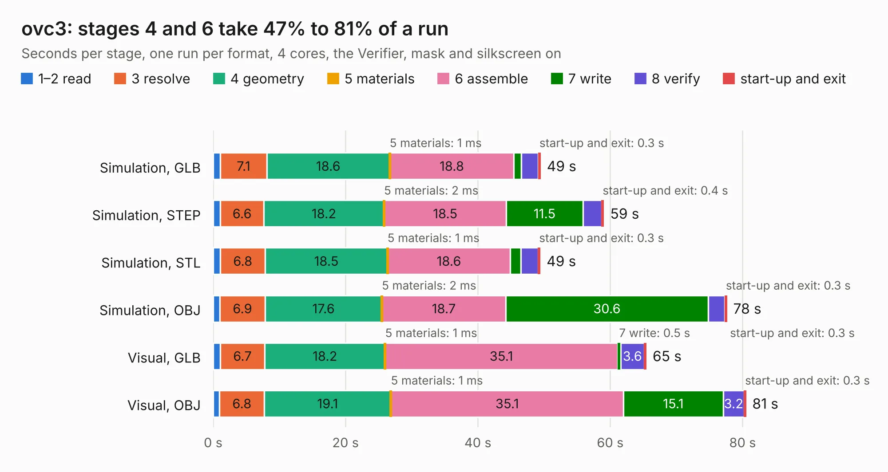

# 2235. ovc3

Board 2,235 of the 3,118 of [Corpus Testing](../Corpus-Testing.md), on [Corpus Page 21](../CorpusTestingPages/Corpus-Testing-21.md#2235-ovc3).

| Mode and format | 1–2 read | 3 resolve | 4 geometry | 5 materials | 6 assemble | 7 write | 8 verify | start-up and exit | Total |
|---|---:|---:|---:|---:|---:|---:|---:|---:|---:|
| Simulation, GLB | 1.1 | 7.1 | 18.6 | 1&nbsp;ms | 18.8 | 1.1 | 2.6 | 0.3 | 49.5 |
| Simulation, STEP | 1.1 | 6.6 | 18.2 | 2&nbsp;ms | 18.5 | 11.5 | 2.8 | 0.4 | 59.0 |
| Simulation, STL | 1.1 | 6.8 | 18.5 | 1&nbsp;ms | 18.6 | 1.6 | 2.6 | 0.3 | 49.4 |
| Simulation, OBJ | 1.0 | 6.9 | 17.6 | 2&nbsp;ms | 18.7 | 30.6 | 2.5 | 0.3 | 77.6 |
| Visual, GLB | 1.1 | 6.7 | 18.2 | 1&nbsp;ms | 35.1 | 0.5 | 3.6 | 0.3 | 65.4 |
| Visual, OBJ | 1.0 | 6.8 | 19.1 | 1&nbsp;ms | 35.1 | 15.1 | 3.2 | 0.3 | 80.5 |

<table align="center"><tr><td valign="top">

| Board | Repo: [osrf/ovc](https://github.com/osrf/ovc) Board: `ovc3.kicad_pcb` |
|---|---|
| Folder | ovc3 / hardware / ovc3a / ovc3a / camera |
| Complexity | 373&nbsp;/&nbsp;1000 (size&nbsp;303, features&nbsp;70) |
| KESE&nbsp;features | through vias, custom pads, rounded, trapezoid or chamfered pads, filled zones, copper drawings |
| Tested | 9th November 2026 |
| Copper&nbsp;layers | 6 |
| File&nbsp;format | KiCad 6 (20190331) |
| Parts,&nbsp;tracks,&nbsp;vias | 148, 4,165, 531 |
| Triangles,&nbsp;simulation | 5,090,930 in 380 parts |
| Verifier | PASS in all six runs |

</td><td valign="top">

<table>
<tr><th>File type</th><th>File size</th><th>Peak memory used</th></tr>
<tr><th colspan="3" align="left">Simulation</th></tr>
<tr><td>GLB</td><td align="right">176&nbsp;MB</td><td align="right">1.2&nbsp;GB</td></tr>
<tr><td>STEP</td><td align="right">618&nbsp;MB</td><td align="right">1.6&nbsp;GB</td></tr>
<tr><td>STL</td><td align="right">255&nbsp;MB</td><td align="right">1.2&nbsp;GB</td></tr>
<tr><td>OBJ</td><td align="right">548&nbsp;MB</td><td align="right">3.3&nbsp;GB</td></tr>
<tr><th colspan="3" align="left">Visual</th></tr>
<tr><td>GLB</td><td align="right">84&nbsp;MB</td><td align="right">1.5&nbsp;GB</td></tr>
<tr><td>OBJ</td><td align="right">271&nbsp;MB</td><td align="right">1.8&nbsp;GB</td></tr>
</table>

</td></tr></table>

| Previous | Next |
|:---|---:|
| [2234. backpack](b2234b_ovc_backpack.md) | [2236. external_camera](b2236b_ovc_external-camera.md) |
