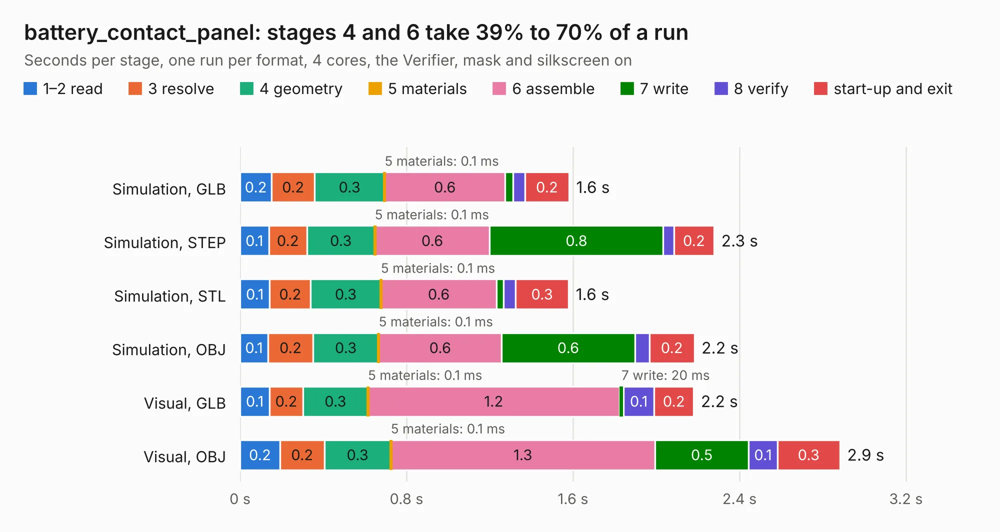

# 2236. battery_contact_panel

Board 2,236 of the 3,112 of [Corpus Testing](../Corpus-Testing.md), on [Corpus Page 21](../CorpusTestingPages/Corpus-Testing-21.md#2236-battery_contact_panel).

| Mode and format | 1–2 read | 3 resolve | 4 geometry | 5 materials | 6 assemble | 7 write | 8 verify | start-up and exit | Total |
|---|---:|---:|---:|---:|---:|---:|---:|---:|---:|
| Simulation, GLB | 0.2 | 0.2 | 0.3 | 0.1&nbsp;ms | 0.6 | 38&nbsp;ms | 57&nbsp;ms | 0.2 | 1.6 |
| Simulation, STEP | 0.1 | 0.2 | 0.3 | 0.1&nbsp;ms | 0.6 | 0.8 | 51&nbsp;ms | 0.2 | 2.3 |
| Simulation, STL | 0.1 | 0.2 | 0.3 | 0.1&nbsp;ms | 0.6 | 32&nbsp;ms | 58&nbsp;ms | 0.3 | 1.6 |
| Simulation, OBJ | 0.1 | 0.2 | 0.3 | 0.1&nbsp;ms | 0.6 | 0.6 | 70&nbsp;ms | 0.2 | 2.2 |
| Visual, GLB | 0.1 | 0.2 | 0.3 | 0.1&nbsp;ms | 1.2 | 20&nbsp;ms | 0.1 | 0.2 | 2.2 |
| Visual, OBJ | 0.2 | 0.2 | 0.3 | 0.1&nbsp;ms | 1.3 | 0.5 | 0.1 | 0.3 | 2.9 |

<table align="center"><tr><td valign="top">

| Board | Repo: [osusat/cubesat](https://github.com/osusat/cubesat) Board: `battery_contact_panel.kicad_pcb` |
|---|---|
| Folder | eps / v1 / battery_contact_panel |
| Complexity | 178&nbsp;/&nbsp;1000 (size&nbsp;118, features&nbsp;60) |
| KESE&nbsp;features | through vias, custom pads, rounded, trapezoid or chamfered pads, filled zones |
| Tested | 9th November 2026 |
| Copper&nbsp;layers | 2 |
| File&nbsp;format | KiCad 10 (20260206) |
| Parts,&nbsp;tracks,&nbsp;vias | 4, 18, 50 |
| Triangles,&nbsp;simulation | 118,252 in 18 parts |
| Note | panel |
| Verifier | PASS in all six runs |

</td><td valign="top">

<table>
<tr><th>File type</th><th>File size</th><th>Peak memory used</th></tr>
<tr><th colspan="3" align="left">Simulation</th></tr>
<tr><td>GLB</td><td align="right">4.1&nbsp;MB</td><td align="right">194&nbsp;MB</td></tr>
<tr><td>STEP</td><td align="right">8.1&nbsp;MB</td><td align="right">196&nbsp;MB</td></tr>
<tr><td>STL</td><td align="right">5.9&nbsp;MB</td><td align="right">199&nbsp;MB</td></tr>
<tr><td>OBJ</td><td align="right">12&nbsp;MB</td><td align="right">196&nbsp;MB</td></tr>
<tr><th colspan="3" align="left">Visual</th></tr>
<tr><td>GLB</td><td align="right">2.9&nbsp;MB</td><td align="right">154&nbsp;MB</td></tr>
<tr><td>OBJ</td><td align="right">8.5&nbsp;MB</td><td align="right">154&nbsp;MB</td></tr>
</table>

</td></tr></table>

| Previous | Next |
|:---|---:|
| [2235. battery_contact](b2235b_cubesat_eps-v1-battery-contact-l_battery-contact.md) | [2237. battery_contact](b2237b_cubesat_eps-v1-battery-contact-r_battery-contact.md) |
