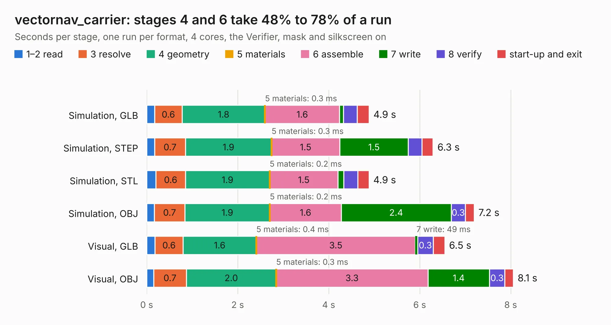

# 2237. vectornav_carrier

Board 2,237 of the 3,117 of [Corpus Testing](../Corpus-Testing.md), on [Corpus Page 21](../CorpusTestingPages/Corpus-Testing-21.md#2237-vectornav_carrier).

| Mode and format | 1–2 read | 3 resolve | 4 geometry | 5 materials | 6 assemble | 7 write | 8 verify | start-up and exit | Total |
|---|---:|---:|---:|---:|---:|---:|---:|---:|---:|
| Simulation, GLB | 0.2 | 0.6 | 1.8 | 0.3&nbsp;ms | 1.6 | 87&nbsp;ms | 0.3 | 0.3 | 4.9 |
| Simulation, STEP | 0.2 | 0.7 | 1.9 | 0.3&nbsp;ms | 1.5 | 1.5 | 0.3 | 0.2 | 6.3 |
| Simulation, STL | 0.2 | 0.6 | 1.9 | 0.2&nbsp;ms | 1.5 | 0.1 | 0.3 | 0.2 | 4.9 |
| Simulation, OBJ | 0.2 | 0.7 | 1.9 | 0.2&nbsp;ms | 1.6 | 2.4 | 0.3 | 0.2 | 7.2 |
| Visual, GLB | 0.2 | 0.6 | 1.6 | 0.4&nbsp;ms | 3.5 | 49&nbsp;ms | 0.3 | 0.3 | 6.5 |
| Visual, OBJ | 0.2 | 0.7 | 2.0 | 0.3&nbsp;ms | 3.3 | 1.4 | 0.3 | 0.2 | 8.1 |

<table align="center"><tr><td valign="top">

| Board | Repo: [osrf/ovc](https://github.com/osrf/ovc) Board: `vectornav_carrier.kicad_pcb` |
|---|---|
| Folder | ovc3 / hardware / ovc3b / ovc3b / vectornav_carrier |
| Complexity | 225&nbsp;/&nbsp;1000 (size&nbsp;170, features&nbsp;55) |
| KESE&nbsp;features | through vias, rounded, trapezoid or chamfered pads, filled zones, curved board outline |
| Tested | 9th November 2026 |
| Copper&nbsp;layers | 4 |
| File&nbsp;format | KiCad 6 (20200104) |
| Parts,&nbsp;tracks,&nbsp;vias | 23, 374, 44 |
| Triangles,&nbsp;simulation | 529,270 in 74 parts |
| Verifier | PASS in all six runs |

</td><td valign="top">

<table>
<tr><th>File type</th><th>File size</th><th>Peak memory used</th></tr>
<tr><th colspan="3" align="left">Simulation</th></tr>
<tr><td>GLB</td><td align="right">18&nbsp;MB</td><td align="right">310&nbsp;MB</td></tr>
<tr><td>STEP</td><td align="right">72&nbsp;MB</td><td align="right">317&nbsp;MB</td></tr>
<tr><td>STL</td><td align="right">26&nbsp;MB</td><td align="right">276&nbsp;MB</td></tr>
<tr><td>OBJ</td><td align="right">54&nbsp;MB</td><td align="right">406&nbsp;MB</td></tr>
<tr><th colspan="3" align="left">Visual</th></tr>
<tr><td>GLB</td><td align="right">10&nbsp;MB</td><td align="right">297&nbsp;MB</td></tr>
<tr><td>OBJ</td><td align="right">30&nbsp;MB</td><td align="right">301&nbsp;MB</td></tr>
</table>

</td></tr></table>

| Previous | Next |
|:---|---:|
| [2236. ovc3](b2236b_ovc_ovc3-hardware-ovc3b-ovc3b-camera_ovc3.md) | [2238. ovc4](b2238b_ovc_ovc4.md) |
