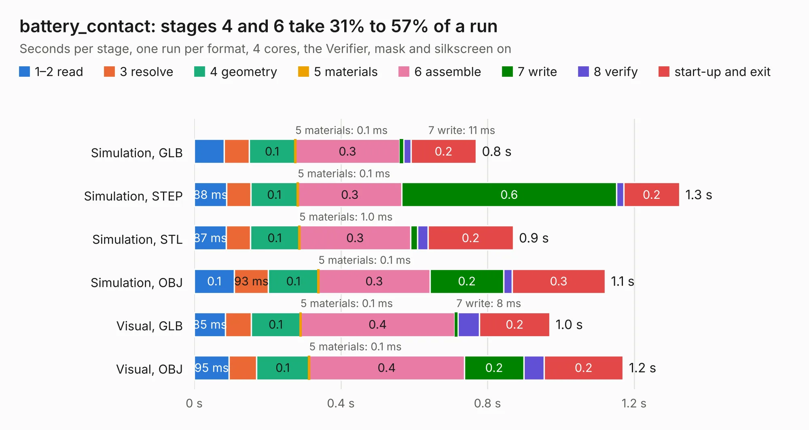

# 2239. battery_contact

Board 2,239 of the 3,116 of [Corpus Testing](../Corpus-Testing.md), on [Corpus Page 21](../CorpusTestingPages/Corpus-Testing-21.md#2239-battery_contact).

| Mode and format | 1–2 read | 3 resolve | 4 geometry | 5 materials | 6 assemble | 7 write | 8 verify | start-up and exit | Total |
|---|---:|---:|---:|---:|---:|---:|---:|---:|---:|
| Simulation, GLB | 82&nbsp;ms | 68&nbsp;ms | 0.1 | 0.1&nbsp;ms | 0.3 | 11&nbsp;ms | 20&nbsp;ms | 0.2 | 0.8 |
| Simulation, STEP | 88&nbsp;ms | 66&nbsp;ms | 0.1 | 0.1&nbsp;ms | 0.3 | 0.6 | 19&nbsp;ms | 0.2 | 1.3 |
| Simulation, STL | 87&nbsp;ms | 66&nbsp;ms | 0.1 | 1.0&nbsp;ms | 0.3 | 18&nbsp;ms | 29&nbsp;ms | 0.2 | 0.9 |
| Simulation, OBJ | 0.1 | 93&nbsp;ms | 0.1 | 0.1&nbsp;ms | 0.3 | 0.2 | 23&nbsp;ms | 0.3 | 1.1 |
| Visual, GLB | 85&nbsp;ms | 70&nbsp;ms | 0.1 | 0.1&nbsp;ms | 0.4 | 8&nbsp;ms | 59&nbsp;ms | 0.2 | 1.0 |
| Visual, OBJ | 95&nbsp;ms | 74&nbsp;ms | 0.1 | 0.1&nbsp;ms | 0.4 | 0.2 | 55&nbsp;ms | 0.2 | 1.2 |

<table align="center"><tr><td valign="top">

| Board | Repo: [osusat/cubesat](https://github.com/osusat/cubesat) Board: `battery_contact.kicad_pcb` |
|---|---|
| Folder | eps / v1 / battery_contact_l |
| Complexity | 161&nbsp;/&nbsp;1000 (size&nbsp;101, features&nbsp;60) |
| KESE&nbsp;features | through vias, custom pads, rounded, trapezoid or chamfered pads, filled zones |
| Tested | 9th November 2026 |
| Copper&nbsp;layers | 2 |
| File&nbsp;format | KiCad 10 (20260206) |
| Parts,&nbsp;tracks,&nbsp;vias | 2, 9, 25 |
| Triangles,&nbsp;simulation | 52,764 in 14 parts |
| Verifier | PASS in all six runs |

</td><td valign="top">

<table>
<tr><th>File type</th><th>File size</th><th>Peak memory used</th></tr>
<tr><th colspan="3" align="left">Simulation</th></tr>
<tr><td>GLB</td><td align="right">1.8&nbsp;MB</td><td align="right">70&nbsp;MB</td></tr>
<tr><td>STEP</td><td align="right">3.8&nbsp;MB</td><td align="right">172&nbsp;MB</td></tr>
<tr><td>STL</td><td align="right">2.6&nbsp;MB</td><td align="right">71&nbsp;MB</td></tr>
<tr><td>OBJ</td><td align="right">5.1&nbsp;MB</td><td align="right">93&nbsp;MB</td></tr>
<tr><th colspan="3" align="left">Visual</th></tr>
<tr><td>GLB</td><td align="right">1.4&nbsp;MB</td><td align="right">110&nbsp;MB</td></tr>
<tr><td>OBJ</td><td align="right">3.9&nbsp;MB</td><td align="right">112&nbsp;MB</td></tr>
</table>

</td></tr></table>

| Previous | Next |
|:---|---:|
| [2238. ovc5](b2238b_ovc_ovc5.md) | [2240. battery_contact_panel](b2240b_cubesat_battery-contact-panel.md) |
