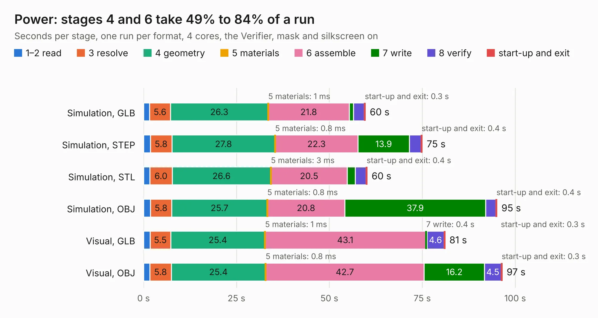

# 2241. Power

Board 2,241 of the 3,106 of [Corpus Testing](../Corpus-Testing.md), on [Corpus Page 21](../CorpusTestingPages/Corpus-Testing-21.md#2241-power).

| Mode and format | 1–2 read | 3 resolve | 4 geometry | 5 materials | 6 assemble | 7 write | 8 verify | start-up and exit | Total |
|---|---:|---:|---:|---:|---:|---:|---:|---:|---:|
| Simulation, GLB | 1.6 | 5.6 | 26.3 | 1&nbsp;ms | 21.8 | 1.1 | 2.9 | 0.3 | 59.7 |
| Simulation, STEP | 1.8 | 5.8 | 27.8 | 0.8&nbsp;ms | 22.3 | 13.9 | 3.1 | 0.4 | 75.0 |
| Simulation, STL | 1.7 | 6.0 | 26.6 | 3&nbsp;ms | 20.5 | 2.1 | 2.9 | 0.4 | 60.2 |
| Simulation, OBJ | 1.8 | 5.8 | 25.7 | 0.8&nbsp;ms | 20.8 | 37.9 | 2.7 | 0.4 | 95.2 |
| Visual, GLB | 1.7 | 5.5 | 25.4 | 1&nbsp;ms | 43.1 | 0.4 | 4.6 | 0.3 | 81.2 |
| Visual, OBJ | 1.7 | 5.8 | 25.4 | 0.8&nbsp;ms | 42.7 | 16.2 | 4.5 | 0.3 | 96.6 |

<table align="center"><tr><td valign="top">

| Board | Repo: [owntech-foundation/twist](https://github.com/owntech-foundation/twist) Board: `Power.kicad_pcb` |
|---|---|
| Folder | KiCAD_files |
| Complexity | 405&nbsp;/&nbsp;1000 (size&nbsp;240, features&nbsp;165) |
| KESE&nbsp;features | through vias, slotted holes, custom pads, rounded, trapezoid or chamfered pads, drill offsets, filled zones, copper drawings, TrueType text, stack-up, dielectric εr and tanδ, mask and silkscreen colours, castellated pads |
| Tested | 9th November 2026 |
| Copper&nbsp;layers | 6 |
| File&nbsp;format | KiCad 8 (20240108) |
| Parts,&nbsp;tracks,&nbsp;vias | 312, 1,740, 643 |
| Triangles,&nbsp;simulation | 6,140,102 in 230 parts |
| Verifier | PASS in all six runs |

</td><td valign="top">

<table>
<tr><th>File type</th><th>File size</th><th>Peak memory used</th></tr>
<tr><th colspan="3" align="left">Simulation</th></tr>
<tr><td>GLB</td><td align="right">208&nbsp;MB</td><td align="right">1.4&nbsp;GB</td></tr>
<tr><td>STEP</td><td align="right">808&nbsp;MB</td><td align="right">1.8&nbsp;GB</td></tr>
<tr><td>STL</td><td align="right">307&nbsp;MB</td><td align="right">1.4&nbsp;GB</td></tr>
<tr><td>OBJ</td><td align="right">661&nbsp;MB</td><td align="right">3.9&nbsp;GB</td></tr>
<tr><th colspan="3" align="left">Visual</th></tr>
<tr><td>GLB</td><td align="right">98&nbsp;MB</td><td align="right">1.8&nbsp;GB</td></tr>
<tr><td>OBJ</td><td align="right">312&nbsp;MB</td><td align="right">2.2&nbsp;GB</td></tr>
</table>

</td></tr></table>

| Previous | Next |
|:---|---:|
| [2240. heatsink_drawing](b2240b_twist_heatsink-drawing.md) | [2242. fpx](b2242b_fpx_fpx.md) |
