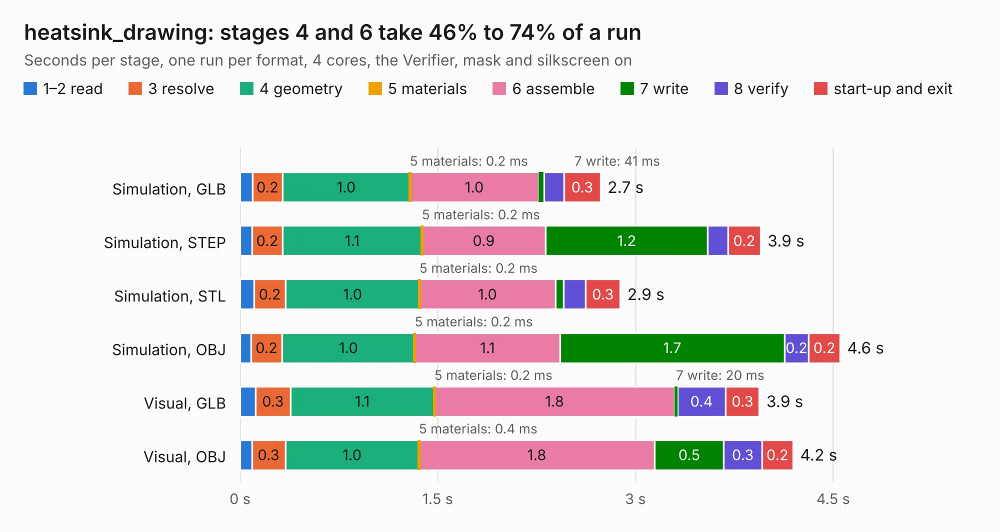

# 2242. heatsink_drawing

Board 2,242 of the 3,108 of [Corpus Testing](../Corpus-Testing.md), on [Corpus Page 21](../CorpusTestingPages/Corpus-Testing-21.md#2242-heatsink_drawing).

| Mode and format | 1–2 read | 3 resolve | 4 geometry | 5 materials | 6 assemble | 7 write | 8 verify | start-up and exit | Total |
|---|---:|---:|---:|---:|---:|---:|---:|---:|---:|
| Simulation, GLB | 94&nbsp;ms | 0.2 | 1.0 | 0.2&nbsp;ms | 1.0 | 41&nbsp;ms | 0.2 | 0.3 | 2.7 |
| Simulation, STEP | 91&nbsp;ms | 0.2 | 1.1 | 0.2&nbsp;ms | 0.9 | 1.2 | 0.2 | 0.2 | 3.9 |
| Simulation, STL | 0.1 | 0.2 | 1.0 | 0.2&nbsp;ms | 1.0 | 60&nbsp;ms | 0.2 | 0.3 | 2.9 |
| Simulation, OBJ | 82&nbsp;ms | 0.2 | 1.0 | 0.2&nbsp;ms | 1.1 | 1.7 | 0.2 | 0.2 | 4.6 |
| Visual, GLB | 0.1 | 0.3 | 1.1 | 0.2&nbsp;ms | 1.8 | 20&nbsp;ms | 0.4 | 0.3 | 3.9 |
| Visual, OBJ | 89&nbsp;ms | 0.3 | 1.0 | 0.4&nbsp;ms | 1.8 | 0.5 | 0.3 | 0.2 | 4.2 |

<table align="center"><tr><td valign="top">

| Board | Repo: [owntech-foundation/twist](https://github.com/owntech-foundation/twist) Board: `heatsink_drawing.kicad_pcb` |
|---|---|
| Folder | KiCAD_files |
| Complexity | 148&nbsp;/&nbsp;1000 (size&nbsp;58, features&nbsp;90) |
| KESE&nbsp;features | slotted holes, rounded, trapezoid or chamfered pads, filled zones, TrueType text, stack-up, dielectric εr and tanδ, mask and silkscreen colours |
| Tested | 9th November 2026 |
| Copper&nbsp;layers | 6 |
| File&nbsp;format | KiCad 8 (20240108) |
| Parts,&nbsp;tracks,&nbsp;vias | 3, 0, 0 |
| Triangles,&nbsp;simulation | 232,880 in 16 parts |
| Verifier | PASS in all six runs |

</td><td valign="top">

<table>
<tr><th>File type</th><th>File size</th><th>Peak memory used</th></tr>
<tr><th colspan="3" align="left">Simulation</th></tr>
<tr><td>GLB</td><td align="right">7.5&nbsp;MB</td><td align="right">202&nbsp;MB</td></tr>
<tr><td>STEP</td><td align="right">27&nbsp;MB</td><td align="right">213&nbsp;MB</td></tr>
<tr><td>STL</td><td align="right">12&nbsp;MB</td><td align="right">199&nbsp;MB</td></tr>
<tr><td>OBJ</td><td align="right">23&nbsp;MB</td><td align="right">206&nbsp;MB</td></tr>
<tr><th colspan="3" align="left">Visual</th></tr>
<tr><td>GLB</td><td align="right">3.0&nbsp;MB</td><td align="right">203&nbsp;MB</td></tr>
<tr><td>OBJ</td><td align="right">8.5&nbsp;MB</td><td align="right">215&nbsp;MB</td></tr>
</table>

</td></tr></table>

| Previous | Next |
|:---|---:|
| [2241. ownverter](b2241b_ownverter_ownverter.md) | [2243. Power](b2243b_twist_Power.md) |
