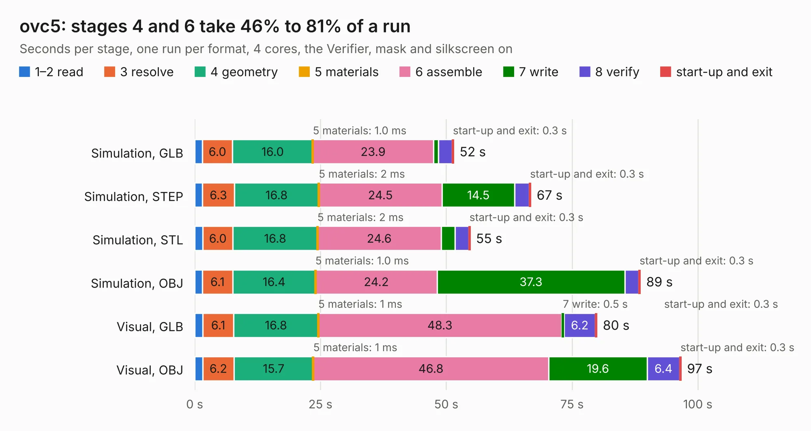

# 2243. ovc5

Board 2,243 of the 3,121 of [Corpus Testing](../Corpus-Testing.md), on [Corpus Page 21](../CorpusTestingPages/Corpus-Testing-21.md#2243-ovc5).

| Mode and format | 1–2 read | 3 resolve | 4 geometry | 5 materials | 6 assemble | 7 write | 8 verify | start-up and exit | Total |
|---|---:|---:|---:|---:|---:|---:|---:|---:|---:|
| Simulation, GLB | 1.5 | 6.0 | 16.0 | 1.0&nbsp;ms | 23.9 | 1.0 | 2.7 | 0.3 | 51.5 |
| Simulation, STEP | 1.6 | 6.3 | 16.8 | 2&nbsp;ms | 24.5 | 14.5 | 2.9 | 0.3 | 66.8 |
| Simulation, STL | 1.6 | 6.0 | 16.8 | 2&nbsp;ms | 24.6 | 2.8 | 2.7 | 0.3 | 54.8 |
| Simulation, OBJ | 1.5 | 6.1 | 16.4 | 1.0&nbsp;ms | 24.2 | 37.3 | 2.8 | 0.3 | 88.6 |
| Visual, GLB | 1.6 | 6.1 | 16.8 | 1&nbsp;ms | 48.3 | 0.5 | 6.2 | 0.3 | 80.0 |
| Visual, OBJ | 1.6 | 6.2 | 15.7 | 1&nbsp;ms | 46.8 | 19.6 | 6.4 | 0.3 | 96.7 |

<table align="center"><tr><td valign="top">

| Board | Repo: [osrf/ovc](https://github.com/osrf/ovc) Board: `ovc5.kicad_pcb` |
|---|---|
| Folder | ovc5 / hardware / carrier |
| Complexity | 425&nbsp;/&nbsp;1000 (size&nbsp;295, features&nbsp;130) |
| KESE&nbsp;features | through vias, slotted holes, custom pads, rounded, trapezoid or chamfered pads, arc tracks, filled zones, copper drawings, stack-up, dielectric εr and tanδ, mask and silkscreen colours |
| Tested | 9th November 2026 |
| Copper&nbsp;layers | 6 |
| File&nbsp;format | KiCad 6 (20210722) |
| Parts,&nbsp;tracks,&nbsp;vias | 197, 4,301, 769 |
| Triangles,&nbsp;simulation | 6,161,454 in 408 parts |
| Verifier | PASS in all six runs |

</td><td valign="top">

<table>
<tr><th>File type</th><th>File size</th><th>Peak memory used</th></tr>
<tr><th colspan="3" align="left">Simulation</th></tr>
<tr><td>GLB</td><td align="right">203&nbsp;MB</td><td align="right">1.7&nbsp;GB</td></tr>
<tr><td>STEP</td><td align="right">687&nbsp;MB</td><td align="right">2.2&nbsp;GB</td></tr>
<tr><td>STL</td><td align="right">308&nbsp;MB</td><td align="right">1.7&nbsp;GB</td></tr>
<tr><td>OBJ</td><td align="right">654&nbsp;MB</td><td align="right">3.8&nbsp;GB</td></tr>
<tr><th colspan="3" align="left">Visual</th></tr>
<tr><td>GLB</td><td align="right">116&nbsp;MB</td><td align="right">2.0&nbsp;GB</td></tr>
<tr><td>OBJ</td><td align="right">378&nbsp;MB</td><td align="right">2.5&nbsp;GB</td></tr>
</table>

</td></tr></table>

| Previous | Next |
|:---|---:|
| [2242. ovc4](b2242b_ovc_ovc4.md) | [2244. battery_contact](b2244b_cubesat_eps-v1-battery-contact-l_battery-contact.md) |
