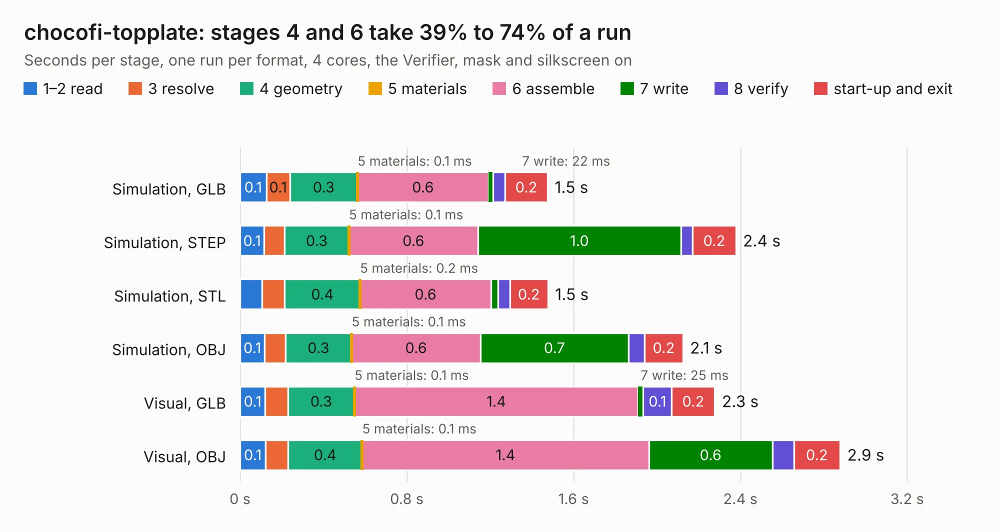

# 2244. chocofi-topplate

Board 2,244 of the 3,100 of [Corpus Testing](../Corpus-Testing.md), on [Corpus Page 21](../CorpusTestingPages/Corpus-Testing-21.md#2244-chocofi-topplate).

| Mode and format | 1–2 read | 3 resolve | 4 geometry | 5 materials | 6 assemble | 7 write | 8 verify | start-up and exit | Total |
|---|---:|---:|---:|---:|---:|---:|---:|---:|---:|
| Simulation, GLB | 0.1 | 0.1 | 0.3 | 0.1&nbsp;ms | 0.6 | 22&nbsp;ms | 59&nbsp;ms | 0.2 | 1.5 |
| Simulation, STEP | 0.1 | 98&nbsp;ms | 0.3 | 0.1&nbsp;ms | 0.6 | 1.0 | 57&nbsp;ms | 0.2 | 2.4 |
| Simulation, STL | 0.1 | 0.1 | 0.4 | 0.2&nbsp;ms | 0.6 | 33&nbsp;ms | 58&nbsp;ms | 0.2 | 1.5 |
| Simulation, OBJ | 0.1 | 99&nbsp;ms | 0.3 | 0.1&nbsp;ms | 0.6 | 0.7 | 77&nbsp;ms | 0.2 | 2.1 |
| Visual, GLB | 0.1 | 0.1 | 0.3 | 0.1&nbsp;ms | 1.4 | 25&nbsp;ms | 0.1 | 0.2 | 2.3 |
| Visual, OBJ | 0.1 | 0.1 | 0.4 | 0.1&nbsp;ms | 1.4 | 0.6 | 0.1 | 0.2 | 2.9 |

<table align="center"><tr><td valign="top">

| Board | Repo: [pashutk/chocofi](https://github.com/pashutk/chocofi) Board: `chocofi-topplate.kicad_pcb` |
|---|---|
| Folder | pcb |
| Complexity | 82&nbsp;/&nbsp;1000 (size&nbsp;17, features&nbsp;65) |
| KESE&nbsp;features | filled zones, curved board outline, stack-up, dielectric εr and tanδ, mask and silkscreen colours |
| Tested | 9th November 2026 |
| Copper&nbsp;layers | 2 |
| File&nbsp;format | KiCad 6 (20210606) |
| Parts,&nbsp;tracks,&nbsp;vias | 0, 0, 0 |
| Triangles,&nbsp;simulation | 140,648 in 12 parts |
| Note | no components |
| Verifier | PASS in all six runs |

</td><td valign="top">

<table>
<tr><th>File type</th><th>File size</th><th>Peak memory used</th></tr>
<tr><th colspan="3" align="left">Simulation</th></tr>
<tr><td>GLB</td><td align="right">4.8&nbsp;MB</td><td align="right">209&nbsp;MB</td></tr>
<tr><td>STEP</td><td align="right">33&nbsp;MB</td><td align="right">224&nbsp;MB</td></tr>
<tr><td>STL</td><td align="right">7.0&nbsp;MB</td><td align="right">204&nbsp;MB</td></tr>
<tr><td>OBJ</td><td align="right">14&nbsp;MB</td><td align="right">204&nbsp;MB</td></tr>
<tr><th colspan="3" align="left">Visual</th></tr>
<tr><td>GLB</td><td align="right">4.2&nbsp;MB</td><td align="right">182&nbsp;MB</td></tr>
<tr><td>OBJ</td><td align="right">12&nbsp;MB</td><td align="right">184&nbsp;MB</td></tr>
</table>

</td></tr></table>

| Previous | Next |
|:---|---:|
| [2243. porcupine](b2243b_parallella-hw_porcupine.md) | [2245. chocofi](b2245b_chocofi_chocofi.md) |
