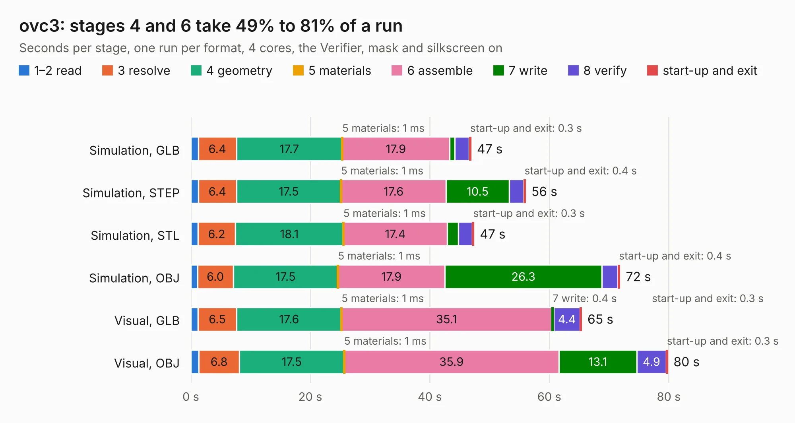

# 2244. ovc3

Board 2,244 of the 3,126 of [Corpus Testing](../Corpus-Testing.md), on [Corpus Page 21](../CorpusTestingPages/Corpus-Testing-21.md#2244-ovc3).

| Mode and format | 1–2 read | 3 resolve | 4 geometry | 5 materials | 6 assemble | 7 write | 8 verify | start-up and exit | Total |
|---|---:|---:|---:|---:|---:|---:|---:|---:|---:|
| Simulation, GLB | 1.3 | 6.4 | 17.7 | 1&nbsp;ms | 17.9 | 0.9 | 2.4 | 0.3 | 46.9 |
| Simulation, STEP | 1.3 | 6.4 | 17.5 | 1&nbsp;ms | 17.6 | 10.5 | 2.4 | 0.4 | 56.0 |
| Simulation, STL | 1.2 | 6.2 | 18.1 | 1&nbsp;ms | 17.4 | 1.9 | 2.3 | 0.3 | 47.4 |
| Simulation, OBJ | 1.1 | 6.0 | 17.5 | 1&nbsp;ms | 17.9 | 26.3 | 2.7 | 0.4 | 71.9 |
| Visual, GLB | 1.2 | 6.5 | 17.6 | 1&nbsp;ms | 35.1 | 0.4 | 4.4 | 0.3 | 65.4 |
| Visual, OBJ | 1.3 | 6.8 | 17.5 | 1&nbsp;ms | 35.9 | 13.1 | 4.9 | 0.3 | 79.8 |

<table align="center"><tr><td valign="top">

| Board | Repo: [osrf/ovc](https://github.com/osrf/ovc) Board: `ovc3.kicad_pcb` |
|---|---|
| Folder | ovc3 / hardware / ovc3b / ovc3b / camera |
| Complexity | 411&nbsp;/&nbsp;1000 (size&nbsp;306, features&nbsp;105) |
| KESE&nbsp;features | through vias, custom pads, rounded, trapezoid or chamfered pads, filled zones, copper drawings, stack-up, dielectric εr and tanδ, mask and silkscreen colours |
| Tested | 9th November 2026 |
| Copper&nbsp;layers | 6 |
| File&nbsp;format | KiCad 6 (20200119) |
| Parts,&nbsp;tracks,&nbsp;vias | 166, 4,554, 549 |
| Triangles,&nbsp;simulation | 5,252,182 in 401 parts |
| Verifier | PASS in all six runs |

</td><td valign="top">

<table>
<tr><th>File type</th><th>File size</th><th>Peak memory used</th></tr>
<tr><th colspan="3" align="left">Simulation</th></tr>
<tr><td>GLB</td><td align="right">178&nbsp;MB</td><td align="right">1.4&nbsp;GB</td></tr>
<tr><td>STEP</td><td align="right">668&nbsp;MB</td><td align="right">1.7&nbsp;GB</td></tr>
<tr><td>STL</td><td align="right">263&nbsp;MB</td><td align="right">1.4&nbsp;GB</td></tr>
<tr><td>OBJ</td><td align="right">564&nbsp;MB</td><td align="right">3.4&nbsp;GB</td></tr>
<tr><th colspan="3" align="left">Visual</th></tr>
<tr><td>GLB</td><td align="right">90&nbsp;MB</td><td align="right">1.7&nbsp;GB</td></tr>
<tr><td>OBJ</td><td align="right">290&nbsp;MB</td><td align="right">2.0&nbsp;GB</td></tr>
</table>

</td></tr></table>

| Previous | Next |
|:---|---:|
| [2243. external_camera](b2243b_ovc_external-camera.md) | [2245. vectornav_carrier](b2245b_ovc_vectornav-carrier.md) |
