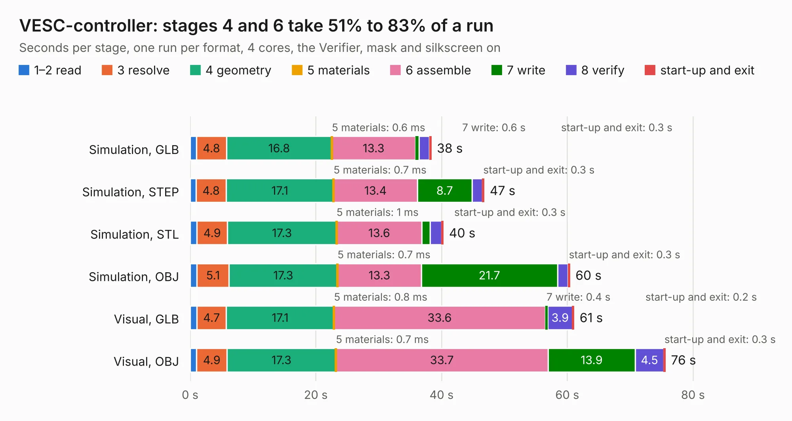

# 2244. VESC-controller

Board 2,244 of the 3,104 of [Corpus Testing](../Corpus-Testing.md), on [Corpus Page 21](../CorpusTestingPages/Corpus-Testing-21.md#2244-vesc-controller).

| Mode and format | 1–2 read | 3 resolve | 4 geometry | 5 materials | 6 assemble | 7 write | 8 verify | start-up and exit | Total |
|---|---:|---:|---:|---:|---:|---:|---:|---:|---:|
| Simulation, GLB | 1.0 | 4.8 | 16.8 | 0.6&nbsp;ms | 13.3 | 0.6 | 1.7 | 0.3 | 38.4 |
| Simulation, STEP | 0.9 | 4.8 | 17.1 | 0.7&nbsp;ms | 13.4 | 8.7 | 1.7 | 0.3 | 46.8 |
| Simulation, STL | 1.1 | 4.9 | 17.3 | 1&nbsp;ms | 13.6 | 1.3 | 1.8 | 0.3 | 40.3 |
| Simulation, OBJ | 1.1 | 5.1 | 17.3 | 0.7&nbsp;ms | 13.3 | 21.7 | 1.7 | 0.3 | 60.4 |
| Visual, GLB | 1.1 | 4.7 | 17.1 | 0.8&nbsp;ms | 33.6 | 0.4 | 3.9 | 0.2 | 61.1 |
| Visual, OBJ | 1.0 | 4.9 | 17.3 | 0.7&nbsp;ms | 33.7 | 13.9 | 4.5 | 0.3 | 75.6 |

<table align="center"><tr><td valign="top">

| Board | Repo: [paltatech/vesc-controller](https://github.com/paltatech/vesc-controller) Board: `VESC-controller.kicad_pcb` |
|---|---|
| Folder | pcb_design |
| Complexity | 362&nbsp;/&nbsp;1000 (size&nbsp;287, features&nbsp;75) |
| KESE&nbsp;features | through vias, slotted holes, rounded, trapezoid or chamfered pads, drill offsets, filled zones, curved board outline |
| Tested | 9th November 2026 |
| Copper&nbsp;layers | 4 |
| File&nbsp;format | KiCad 5 (20170922) |
| Parts,&nbsp;tracks,&nbsp;vias | 337, 4,385, 698 |
| Triangles,&nbsp;simulation | 4,130,828 in 252 parts |
| Verifier | PASS in all six runs |

</td><td valign="top">

<table>
<tr><th>File type</th><th>File size</th><th>Peak memory used</th></tr>
<tr><th colspan="3" align="left">Simulation</th></tr>
<tr><td>GLB</td><td align="right">144&nbsp;MB</td><td align="right">1.3&nbsp;GB</td></tr>
<tr><td>STEP</td><td align="right">526&nbsp;MB</td><td align="right">1.5&nbsp;GB</td></tr>
<tr><td>STL</td><td align="right">207&nbsp;MB</td><td align="right">1.2&nbsp;GB</td></tr>
<tr><td>OBJ</td><td align="right">445&nbsp;MB</td><td align="right">2.7&nbsp;GB</td></tr>
<tr><th colspan="3" align="left">Visual</th></tr>
<tr><td>GLB</td><td align="right">91&nbsp;MB</td><td align="right">1.5&nbsp;GB</td></tr>
<tr><td>OBJ</td><td align="right">286&nbsp;MB</td><td align="right">1.9&nbsp;GB</td></tr>
</table>

</td></tr></table>

| Previous | Next |
|:---|---:|
| [2243. Power_Integrations_interface](b2243b_vesc-controller_Power-Integrations-interface.md) | [2245. meta_breakout](b2245b_parallella-hw_meta-breakout.md) |
