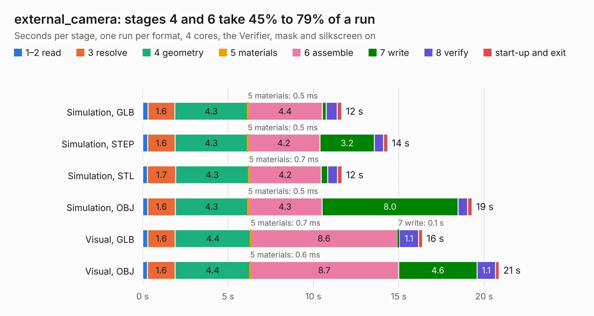

# 2245. external_camera

Board 2,245 of the 3,130 of [Corpus Testing](../Corpus-Testing.md), on [Corpus Page 21](../CorpusTestingPages/Corpus-Testing-21.md#2245-external_camera).

| Mode and format | 1–2 read | 3 resolve | 4 geometry | 5 materials | 6 assemble | 7 write | 8 verify | start-up and exit | Total |
|---|---:|---:|---:|---:|---:|---:|---:|---:|---:|
| Simulation, GLB | 0.3 | 1.6 | 4.3 | 0.5&nbsp;ms | 4.4 | 0.2 | 0.6 | 0.3 | 11.7 |
| Simulation, STEP | 0.3 | 1.6 | 4.3 | 0.5&nbsp;ms | 4.2 | 3.2 | 0.5 | 0.2 | 14.3 |
| Simulation, STL | 0.3 | 1.7 | 4.3 | 0.7&nbsp;ms | 4.2 | 0.4 | 0.6 | 0.3 | 11.7 |
| Simulation, OBJ | 0.3 | 1.6 | 4.3 | 0.5&nbsp;ms | 4.3 | 8.0 | 0.6 | 0.3 | 19.3 |
| Visual, GLB | 0.3 | 1.6 | 4.4 | 0.7&nbsp;ms | 8.6 | 0.1 | 1.1 | 0.2 | 16.4 |
| Visual, OBJ | 0.3 | 1.6 | 4.4 | 0.6&nbsp;ms | 8.7 | 4.6 | 1.1 | 0.2 | 20.9 |

<table align="center"><tr><td valign="top">

| Board | Repo: [osrf/ovc](https://github.com/osrf/ovc) Board: `external_camera.kicad_pcb` |
|---|---|
| Folder | ovc3 / hardware / ovc3a / ovc3a / external_camera |
| Complexity | 339&nbsp;/&nbsp;1000 (size&nbsp;264, features&nbsp;75) |
| KESE&nbsp;features | through vias, rounded, trapezoid or chamfered pads, filled zones, stack-up, dielectric εr and tanδ |
| Tested | 9th November 2026 |
| Copper&nbsp;layers | 6 |
| File&nbsp;format | KiCad 6 (20190905) |
| Parts,&nbsp;tracks,&nbsp;vias | 62, 818, 144 |
| Triangles,&nbsp;simulation | 1,370,156 in 90 parts |
| Verifier | PASS in all six runs |

</td><td valign="top">

<table>
<tr><th>File type</th><th>File size</th><th>Peak memory used</th></tr>
<tr><th colspan="3" align="left">Simulation</th></tr>
<tr><td>GLB</td><td align="right">46&nbsp;MB</td><td align="right">514&nbsp;MB</td></tr>
<tr><td>STEP</td><td align="right">180&nbsp;MB</td><td align="right">569&nbsp;MB</td></tr>
<tr><td>STL</td><td align="right">69&nbsp;MB</td><td align="right">511&nbsp;MB</td></tr>
<tr><td>OBJ</td><td align="right">142&nbsp;MB</td><td align="right">936&nbsp;MB</td></tr>
<tr><th colspan="3" align="left">Visual</th></tr>
<tr><td>GLB</td><td align="right">25&nbsp;MB</td><td align="right">580&nbsp;MB</td></tr>
<tr><td>OBJ</td><td align="right">77&nbsp;MB</td><td align="right">607&nbsp;MB</td></tr>
</table>

</td></tr></table>

| Previous | Next |
|:---|---:|
| [2244. ovc3](b2244b_ovc_ovc3-hardware-ovc3a-ovc3a-camera_ovc3.md) | [2246. ovc3](b2246b_ovc_ovc3-hardware-ovc3b-ovc3b-camera_ovc3.md) |
