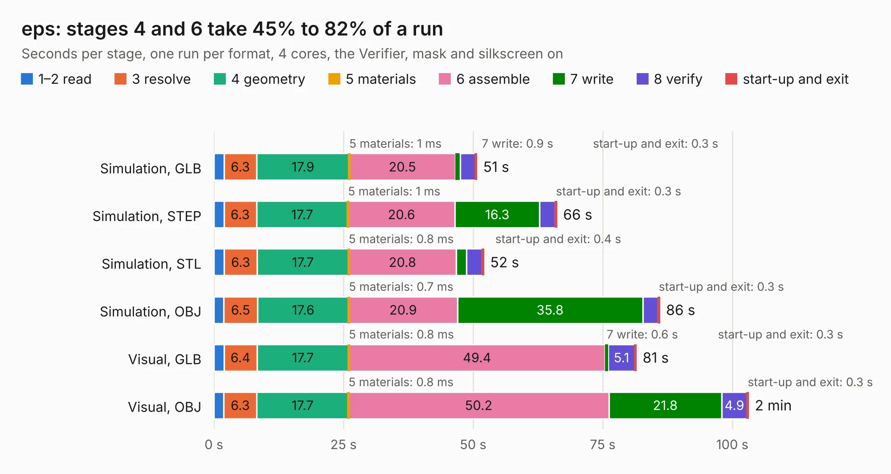

# 2246. eps

Board 2,246 of the 3,120 of [Corpus Testing](../Corpus-Testing.md), on [Corpus Page 21](../CorpusTestingPages/Corpus-Testing-21.md#2246-eps).

| Mode and format | 1–2 read | 3 resolve | 4 geometry | 5 materials | 6 assemble | 7 write | 8 verify | start-up and exit | Total |
|---|---:|---:|---:|---:|---:|---:|---:|---:|---:|
| Simulation, GLB | 2.0 | 6.3 | 17.9 | 1&nbsp;ms | 20.5 | 0.9 | 2.9 | 0.3 | 50.7 |
| Simulation, STEP | 1.9 | 6.3 | 17.7 | 1&nbsp;ms | 20.6 | 16.3 | 3.0 | 0.3 | 66.1 |
| Simulation, STL | 2.0 | 6.3 | 17.7 | 0.8&nbsp;ms | 20.8 | 1.9 | 3.0 | 0.4 | 52.1 |
| Simulation, OBJ | 1.9 | 6.5 | 17.6 | 0.7&nbsp;ms | 20.9 | 35.8 | 2.9 | 0.3 | 86.0 |
| Visual, GLB | 1.9 | 6.4 | 17.7 | 0.8&nbsp;ms | 49.4 | 0.6 | 5.1 | 0.3 | 81.5 |
| Visual, OBJ | 1.9 | 6.3 | 17.7 | 0.8&nbsp;ms | 50.2 | 21.8 | 4.9 | 0.3 | 103.1 |

<table align="center"><tr><td valign="top">

| Board | Repo: [osusat/cubesat](https://github.com/osusat/cubesat) Board: `eps.kicad_pcb` |
|---|---|
| Folder | eps / v1 / hardware |
| Complexity | 426&nbsp;/&nbsp;1000 (size&nbsp;301, features&nbsp;125) |
| KESE&nbsp;features | through vias, slotted holes, custom pads, rounded, trapezoid or chamfered pads, filled zones, copper drawings, TrueType text, stack-up, dielectric εr and tanδ |
| Tested | 9th November 2026 |
| Copper&nbsp;layers | 6 |
| File&nbsp;format | KiCad 10 (20260206) |
| Parts,&nbsp;tracks,&nbsp;vias | 365, 4,165, 712 |
| Triangles,&nbsp;simulation | 6,530,910 in 332 parts |
| Verifier | PASS in all six runs |

</td><td valign="top">

<table>
<tr><th>File type</th><th>File size</th><th>Peak memory used</th></tr>
<tr><th colspan="3" align="left">Simulation</th></tr>
<tr><td>GLB</td><td align="right">221&nbsp;MB</td><td align="right">1.8&nbsp;GB</td></tr>
<tr><td>STEP</td><td align="right">981&nbsp;MB</td><td align="right">2.3&nbsp;GB</td></tr>
<tr><td>STL</td><td align="right">327&nbsp;MB</td><td align="right">1.8&nbsp;GB</td></tr>
<tr><td>OBJ</td><td align="right">694&nbsp;MB</td><td align="right">4.2&nbsp;GB</td></tr>
<tr><th colspan="3" align="left">Visual</th></tr>
<tr><td>GLB</td><td align="right">139&nbsp;MB</td><td align="right">2.3&nbsp;GB</td></tr>
<tr><td>OBJ</td><td align="right">442&nbsp;MB</td><td align="right">2.8&nbsp;GB</td></tr>
</table>

</td></tr></table>

| Previous | Next |
|:---|---:|
| [2245. battery_contact](b2245b_cubesat_eps-v1-battery-contact-r_battery-contact.md) | [2247. obc](b2247b_cubesat_obc.md) |
