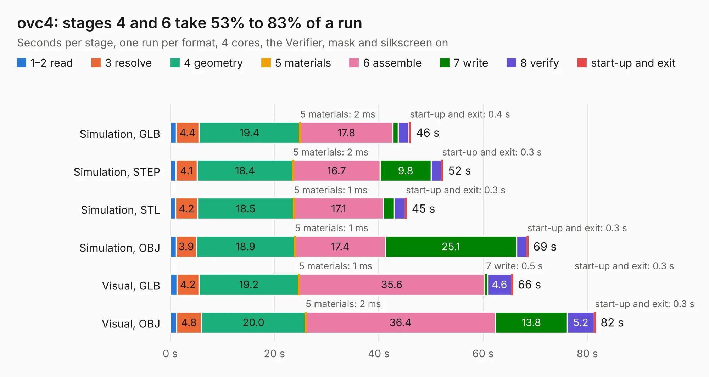

# 2246. ovc4

Board 2,246 of the 3,127 of [Corpus Testing](../Corpus-Testing.md), on [Corpus Page 21](../CorpusTestingPages/Corpus-Testing-21.md#2246-ovc4).

| Mode and format | 1–2 read | 3 resolve | 4 geometry | 5 materials | 6 assemble | 7 write | 8 verify | start-up and exit | Total |
|---|---:|---:|---:|---:|---:|---:|---:|---:|---:|
| Simulation, GLB | 1.1 | 4.4 | 19.4 | 2&nbsp;ms | 17.8 | 1.0 | 2.1 | 0.4 | 46.2 |
| Simulation, STEP | 1.1 | 4.1 | 18.4 | 2&nbsp;ms | 16.7 | 9.8 | 2.0 | 0.3 | 52.3 |
| Simulation, STL | 1.0 | 4.2 | 18.5 | 1&nbsp;ms | 17.1 | 2.1 | 2.1 | 0.3 | 45.4 |
| Simulation, OBJ | 1.2 | 3.9 | 18.9 | 1&nbsp;ms | 17.4 | 25.1 | 2.0 | 0.3 | 68.7 |
| Visual, GLB | 1.3 | 4.2 | 19.2 | 1&nbsp;ms | 35.6 | 0.5 | 4.6 | 0.3 | 65.7 |
| Visual, OBJ | 1.2 | 4.8 | 20.0 | 2&nbsp;ms | 36.4 | 13.8 | 5.2 | 0.3 | 81.6 |

<table align="center"><tr><td valign="top">

| Board | Repo: [osrf/ovc](https://github.com/osrf/ovc) Board: `ovc4.kicad_pcb` |
|---|---|
| Folder | ovc4 / hardware / carrier |
| Complexity | 400&nbsp;/&nbsp;1000 (size&nbsp;295, features&nbsp;105) |
| KESE&nbsp;features | through vias, custom pads, rounded, trapezoid or chamfered pads, filled zones, copper drawings, stack-up, dielectric εr and tanδ, mask and silkscreen colours |
| Tested | 9th November 2026 |
| Copper&nbsp;layers | 6 |
| File&nbsp;format | KiCad 6 (20200614) |
| Parts,&nbsp;tracks,&nbsp;vias | 180, 4,476, 494 |
| Triangles,&nbsp;simulation | 4,999,158 in 351 parts |
| Verifier | PASS in all six runs |

</td><td valign="top">

<table>
<tr><th>File type</th><th>File size</th><th>Peak memory used</th></tr>
<tr><th colspan="3" align="left">Simulation</th></tr>
<tr><td>GLB</td><td align="right">168&nbsp;MB</td><td align="right">1.5&nbsp;GB</td></tr>
<tr><td>STEP</td><td align="right">636&nbsp;MB</td><td align="right">1.7&nbsp;GB</td></tr>
<tr><td>STL</td><td align="right">250&nbsp;MB</td><td align="right">1.4&nbsp;GB</td></tr>
<tr><td>OBJ</td><td align="right">536&nbsp;MB</td><td align="right">3.2&nbsp;GB</td></tr>
<tr><th colspan="3" align="left">Visual</th></tr>
<tr><td>GLB</td><td align="right">87&nbsp;MB</td><td align="right">1.5&nbsp;GB</td></tr>
<tr><td>OBJ</td><td align="right">280&nbsp;MB</td><td align="right">2.0&nbsp;GB</td></tr>
</table>

</td></tr></table>

| Previous | Next |
|:---|---:|
| [2245. vectornav_carrier](b2245b_ovc_vectornav-carrier.md) | [2247. ovc5](b2247b_ovc_ovc5.md) |
