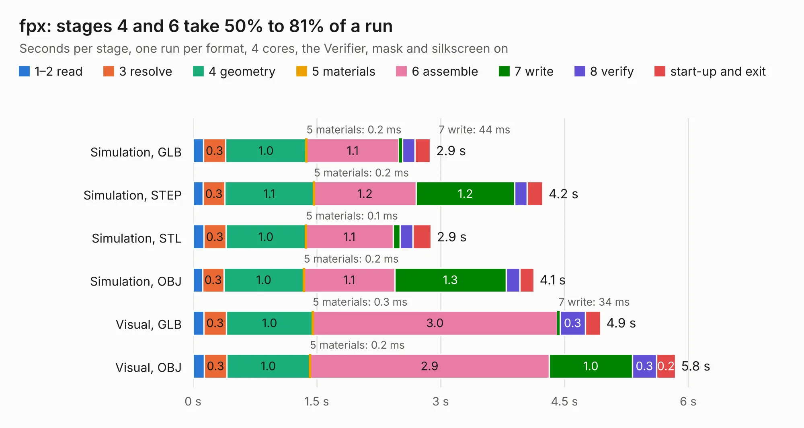

# 2247. fpx

Board 2,247 of the 3,111 of [Corpus Testing](../Corpus-Testing.md), on [Corpus Page 21](../CorpusTestingPages/Corpus-Testing-21.md#2247-fpx).

| Mode and format | 1–2 read | 3 resolve | 4 geometry | 5 materials | 6 assemble | 7 write | 8 verify | start-up and exit | Total |
|---|---:|---:|---:|---:|---:|---:|---:|---:|---:|
| Simulation, GLB | 0.1 | 0.3 | 1.0 | 0.2&nbsp;ms | 1.1 | 44&nbsp;ms | 0.2 | 0.2 | 2.9 |
| Simulation, STEP | 0.1 | 0.3 | 1.1 | 0.2&nbsp;ms | 1.2 | 1.2 | 0.1 | 0.2 | 4.2 |
| Simulation, STL | 0.1 | 0.3 | 1.0 | 0.1&nbsp;ms | 1.1 | 85&nbsp;ms | 0.2 | 0.2 | 2.9 |
| Simulation, OBJ | 0.1 | 0.3 | 1.0 | 0.2&nbsp;ms | 1.1 | 1.3 | 0.2 | 0.2 | 4.1 |
| Visual, GLB | 0.1 | 0.3 | 1.0 | 0.3&nbsp;ms | 3.0 | 34&nbsp;ms | 0.3 | 0.2 | 4.9 |
| Visual, OBJ | 0.1 | 0.3 | 1.0 | 0.2&nbsp;ms | 2.9 | 1.0 | 0.3 | 0.2 | 5.8 |

<table align="center"><tr><td valign="top">

| Board | Repo: [oxplot/fpx](https://github.com/oxplot/fpx) Board: `fpx.kicad_pcb` |
|---|---|
| Folder | board |
| Complexity | 276&nbsp;/&nbsp;1000 (size&nbsp;146, features&nbsp;130) |
| KESE&nbsp;features | through vias, blind and buried vias, slotted holes, custom pads, rounded, trapezoid or chamfered pads, filled zones, copper drawings, curved board outline |
| Tested | 9th November 2026 |
| Copper&nbsp;layers | 2 |
| File&nbsp;format | KiCad 5 (20171130) |
| Parts,&nbsp;tracks,&nbsp;vias | 30, 237, 14 |
| Triangles,&nbsp;simulation | 341,668 in 66 parts |
| Verifier | PASS in all six runs |

</td><td valign="top">

<table>
<tr><th>File type</th><th>File size</th><th>Peak memory used</th></tr>
<tr><th colspan="3" align="left">Simulation</th></tr>
<tr><td>GLB</td><td align="right">12&nbsp;MB</td><td align="right">249&nbsp;MB</td></tr>
<tr><td>STEP</td><td align="right">63&nbsp;MB</td><td align="right">291&nbsp;MB</td></tr>
<tr><td>STL</td><td align="right">17&nbsp;MB</td><td align="right">251&nbsp;MB</td></tr>
<tr><td>OBJ</td><td align="right">35&nbsp;MB</td><td align="right">289&nbsp;MB</td></tr>
<tr><th colspan="3" align="left">Visual</th></tr>
<tr><td>GLB</td><td align="right">9.0&nbsp;MB</td><td align="right">294&nbsp;MB</td></tr>
<tr><td>OBJ</td><td align="right">26&nbsp;MB</td><td align="right">288&nbsp;MB</td></tr>
</table>

</td></tr></table>

| Previous | Next |
|:---|---:|
| [2246. Power](b2246b_twist_Power.md) | [2248. Bad Thing of the Edge Keyboard](b2248b_Bad-Thing-of-the-Edge-keyboard_Bad-Thing-of-the-Edge-Keyboard.md) |
