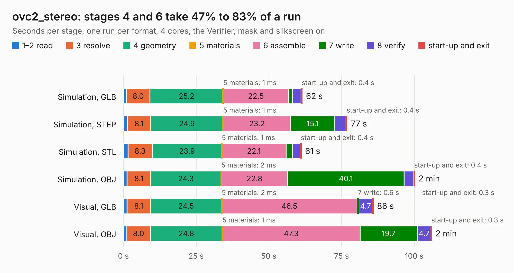

# 2248. ovc2_stereo

Board 2,248 of the 3,138 of [Corpus Testing](../Corpus-Testing.md), on [Corpus Page 21](../CorpusTestingPages/Corpus-Testing-21.md#2248-ovc2_stereo).

| Mode and format | 1–2 read | 3 resolve | 4 geometry | 5 materials | 6 assemble | 7 write | 8 verify | start-up and exit | Total |
|---|---:|---:|---:|---:|---:|---:|---:|---:|---:|
| Simulation, GLB | 1.1 | 8.0 | 25.2 | 1&nbsp;ms | 22.5 | 1.3 | 3.0 | 0.4 | 61.5 |
| Simulation, STEP | 1.3 | 8.1 | 24.9 | 1&nbsp;ms | 23.2 | 15.1 | 3.9 | 0.4 | 77.0 |
| Simulation, STL | 1.6 | 8.3 | 23.9 | 1&nbsp;ms | 22.1 | 2.2 | 2.7 | 0.4 | 61.2 |
| Simulation, OBJ | 1.3 | 8.1 | 24.3 | 2&nbsp;ms | 22.8 | 40.1 | 3.3 | 0.4 | 100.2 |
| Visual, GLB | 1.2 | 8.1 | 24.5 | 2&nbsp;ms | 46.5 | 0.6 | 4.7 | 0.3 | 86.0 |
| Visual, OBJ | 1.2 | 8.0 | 24.8 | 1&nbsp;ms | 47.3 | 19.7 | 4.7 | 0.3 | 106.1 |

<table align="center"><tr><td valign="top">

| Board | Repo: [osrf/ovc](https://github.com/osrf/ovc) Board: `ovc2_stereo.kicad_pcb` |
|---|---|
| Folder | ovc2 / hardware / ovc2b / stereo |
| Complexity | 355&nbsp;/&nbsp;1000 (size&nbsp;300, features&nbsp;55) |
| KESE&nbsp;features | through vias, rounded, trapezoid or chamfered pads, filled zones, curved board outline |
| Tested | 9th November 2026 |
| Copper&nbsp;layers | 6 |
| File&nbsp;format | KiCad 5 (20171130) |
| Parts,&nbsp;tracks,&nbsp;vias | 244, 5,057, 740 |
| Triangles,&nbsp;simulation | 6,710,900 in 522 parts |
| Verifier | PASS in all six runs |

</td><td valign="top">

<table>
<tr><th>File type</th><th>File size</th><th>Peak memory used</th></tr>
<tr><th colspan="3" align="left">Simulation</th></tr>
<tr><td>GLB</td><td align="right">232&nbsp;MB</td><td align="right">1.6&nbsp;GB</td></tr>
<tr><td>STEP</td><td align="right">900&nbsp;MB</td><td align="right">2.2&nbsp;GB</td></tr>
<tr><td>STL</td><td align="right">336&nbsp;MB</td><td align="right">1.6&nbsp;GB</td></tr>
<tr><td>OBJ</td><td align="right">727&nbsp;MB</td><td align="right">4.3&nbsp;GB</td></tr>
<tr><th colspan="3" align="left">Visual</th></tr>
<tr><td>GLB</td><td align="right">122&nbsp;MB</td><td align="right">2.1&nbsp;GB</td></tr>
<tr><td>OBJ</td><td align="right">394&nbsp;MB</td><td align="right">2.7&nbsp;GB</td></tr>
</table>

</td></tr></table>

| Previous | Next |
|:---|---:|
| [2247. ovc2_mobo](b2247b_ovc_ovc2-hardware-ovc2b-mobo_ovc2-mobo.md) | [2249. backpack](b2249b_ovc_backpack.md) |
