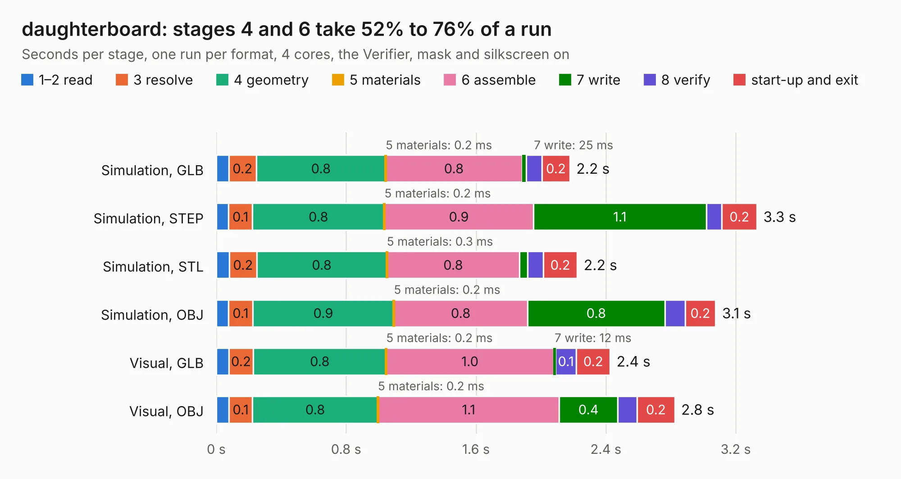

# 2249. daughterboard

Board 2,249 of the 3,119 of [Corpus Testing](../Corpus-Testing.md), on [Corpus Page 21](../CorpusTestingPages/Corpus-Testing-21.md#2249-daughterboard).

| Mode and format | 1–2 read | 3 resolve | 4 geometry | 5 materials | 6 assemble | 7 write | 8 verify | start-up and exit | Total |
|---|---:|---:|---:|---:|---:|---:|---:|---:|---:|
| Simulation, GLB | 77&nbsp;ms | 0.2 | 0.8 | 0.2&nbsp;ms | 0.8 | 25&nbsp;ms | 97&nbsp;ms | 0.2 | 2.2 |
| Simulation, STEP | 75&nbsp;ms | 0.1 | 0.8 | 0.2&nbsp;ms | 0.9 | 1.1 | 96&nbsp;ms | 0.2 | 3.3 |
| Simulation, STL | 81&nbsp;ms | 0.2 | 0.8 | 0.3&nbsp;ms | 0.8 | 50&nbsp;ms | 96&nbsp;ms | 0.2 | 2.2 |
| Simulation, OBJ | 75&nbsp;ms | 0.1 | 0.9 | 0.2&nbsp;ms | 0.8 | 0.8 | 0.1 | 0.2 | 3.1 |
| Visual, GLB | 77&nbsp;ms | 0.2 | 0.8 | 0.2&nbsp;ms | 1.0 | 12&nbsp;ms | 0.1 | 0.2 | 2.4 |
| Visual, OBJ | 77&nbsp;ms | 0.1 | 0.8 | 0.2&nbsp;ms | 1.1 | 0.4 | 0.1 | 0.2 | 2.8 |

<table align="center"><tr><td valign="top">

| Board | Repo: [osusat/cubesat](https://github.com/osusat/cubesat) Board: `daughterboard.kicad_pcb` |
|---|---|
| Folder | shared / kicad / templates / daughterboard |
| Complexity | 44&nbsp;/&nbsp;1000 (size&nbsp;24, features&nbsp;20) |
| KESE&nbsp;features | drill offsets, curved board outline |
| Tested | 9th November 2026 |
| Copper&nbsp;layers | 2 |
| File&nbsp;format | KiCad 10 (20260206) |
| Parts,&nbsp;tracks,&nbsp;vias | 1, 0, 0 |
| Triangles,&nbsp;simulation | 168,952 in 34 parts |
| Verifier | PASS in all six runs |

</td><td valign="top">

<table>
<tr><th>File type</th><th>File size</th><th>Peak memory used</th></tr>
<tr><th colspan="3" align="left">Simulation</th></tr>
<tr><td>GLB</td><td align="right">5.2&nbsp;MB</td><td align="right">187&nbsp;MB</td></tr>
<tr><td>STEP</td><td align="right">22&nbsp;MB</td><td align="right">207&nbsp;MB</td></tr>
<tr><td>STL</td><td align="right">8.5&nbsp;MB</td><td align="right">191&nbsp;MB</td></tr>
<tr><td>OBJ</td><td align="right">16&nbsp;MB</td><td align="right">195&nbsp;MB</td></tr>
<tr><th colspan="3" align="left">Visual</th></tr>
<tr><td>GLB</td><td align="right">2.4&nbsp;MB</td><td align="right">195&nbsp;MB</td></tr>
<tr><td>OBJ</td><td align="right">6.9&nbsp;MB</td><td align="right">190&nbsp;MB</td></tr>
</table>

</td></tr></table>

| Previous | Next |
|:---|---:|
| [2248. usb_c](b2248b_cubesat_usb-c.md) | [2250. film_capacitors](b2250b_micro-inverter_film-capacitors.md) |
