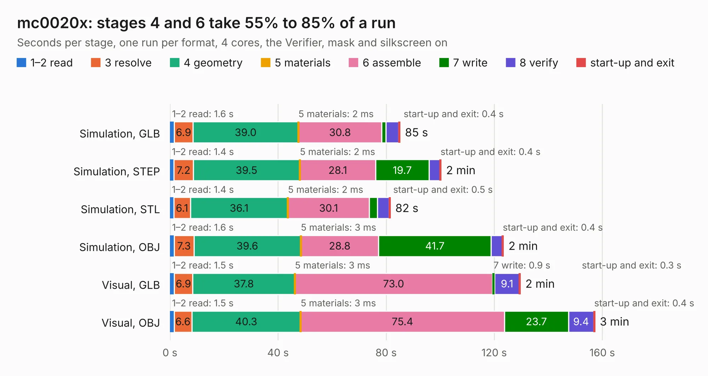

# 2250. mc0020x

Board 2,250 of the 3,102 of [Corpus Testing](../Corpus-Testing.md), on [Corpus Page 21](../CorpusTestingPages/Corpus-Testing-21.md#2250-mc0020x).

| Mode and format | 1–2 read | 3 resolve | 4 geometry | 5 materials | 6 assemble | 7 write | 8 verify | start-up and exit | Total |
|---|---:|---:|---:|---:|---:|---:|---:|---:|---:|
| Simulation, GLB | 1.6 | 6.9 | 39.0 | 2&nbsp;ms | 30.8 | 1.6 | 4.7 | 0.4 | 85.1 |
| Simulation, STEP | 1.4 | 7.2 | 39.5 | 2&nbsp;ms | 28.1 | 19.7 | 4.1 | 0.4 | 100.3 |
| Simulation, STL | 1.4 | 6.1 | 36.1 | 2&nbsp;ms | 30.1 | 3.0 | 4.3 | 0.5 | 81.5 |
| Simulation, OBJ | 1.6 | 7.3 | 39.6 | 3&nbsp;ms | 28.8 | 41.7 | 4.1 | 0.4 | 123.4 |
| Visual, GLB | 1.5 | 6.9 | 37.8 | 3&nbsp;ms | 73.0 | 0.9 | 9.1 | 0.3 | 129.7 |
| Visual, OBJ | 1.5 | 6.6 | 40.3 | 3&nbsp;ms | 75.4 | 23.7 | 9.4 | 0.4 | 157.2 |

<table align="center"><tr><td valign="top">

| Board | Repo: [pelrun/cpc-schematics](https://github.com/pelrun/cpc-schematics) Board: `mc0020x.kicad_pcb` |
|---|---|
| Folder | cpc6128 |
| Complexity | 313&nbsp;/&nbsp;1000 (size&nbsp;228, features&nbsp;85) |
| KESE&nbsp;features | through vias, slotted holes, rounded, trapezoid or chamfered pads, filled zones, stack-up, dielectric εr and tanδ |
| Tested | 9th November 2026 |
| Copper&nbsp;layers | 2 |
| File&nbsp;format | KiCad 9 (20241229) |
| Parts,&nbsp;tracks,&nbsp;vias | 249, 8,293, 589 |
| Triangles,&nbsp;simulation | 9,130,404 in 369 parts |
| Verifier | PASS in all six runs |

</td><td valign="top">

<table>
<tr><th>File type</th><th>File size</th><th>Peak memory used</th></tr>
<tr><th colspan="3" align="left">Simulation</th></tr>
<tr><td>GLB</td><td align="right">307&nbsp;MB</td><td align="right">2.5&nbsp;GB</td></tr>
<tr><td>STEP</td><td align="right">1.3&nbsp;GB</td><td align="right">3.3&nbsp;GB</td></tr>
<tr><td>STL</td><td align="right">457&nbsp;MB</td><td align="right">2.5&nbsp;GB</td></tr>
<tr><td>OBJ</td><td align="right">966&nbsp;MB</td><td align="right">5.7&nbsp;GB</td></tr>
<tr><th colspan="3" align="left">Visual</th></tr>
<tr><td>GLB</td><td align="right">187&nbsp;MB</td><td align="right">3.0&nbsp;GB</td></tr>
<tr><td>OBJ</td><td align="right">601&nbsp;MB</td><td align="right">3.8&nbsp;GB</td></tr>
</table>

</td></tr></table>

| Previous | Next |
|:---|---:|
| [2249. obc-adcs-board](b2249b_obcboard-pcb_obc-adcs-board.md) | [2251. RevA](b2251b_pergola_RevA.md) |
