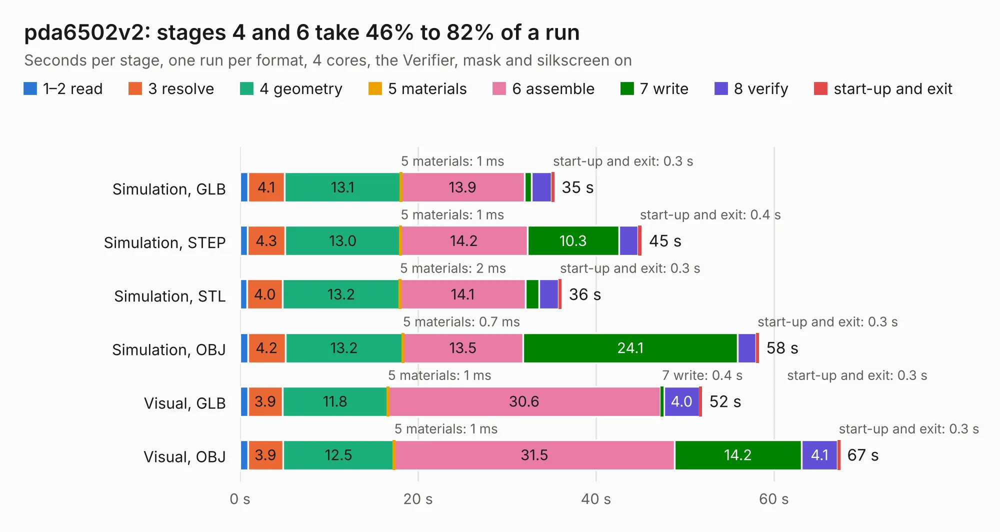

# 2252. pda6502v2

Board 2,252 of the 3,106 of [Corpus Testing](../Corpus-Testing.md), on [Corpus Page 21](../CorpusTestingPages/Corpus-Testing-21.md#2252-pda6502v2).

| Mode and format | 1–2 read | 3 resolve | 4 geometry | 5 materials | 6 assemble | 7 write | 8 verify | start-up and exit | Total |
|---|---:|---:|---:|---:|---:|---:|---:|---:|---:|
| Simulation, GLB | 0.9 | 4.1 | 13.1 | 1&nbsp;ms | 13.9 | 0.8 | 2.2 | 0.3 | 35.3 |
| Simulation, STEP | 0.8 | 4.3 | 13.0 | 1&nbsp;ms | 14.2 | 10.3 | 2.2 | 0.4 | 45.1 |
| Simulation, STL | 0.8 | 4.0 | 13.2 | 2&nbsp;ms | 14.1 | 1.5 | 2.2 | 0.3 | 36.1 |
| Simulation, OBJ | 0.9 | 4.2 | 13.2 | 0.7&nbsp;ms | 13.5 | 24.1 | 2.1 | 0.3 | 58.3 |
| Visual, GLB | 0.9 | 3.9 | 11.8 | 1&nbsp;ms | 30.6 | 0.4 | 4.0 | 0.3 | 51.9 |
| Visual, OBJ | 0.9 | 3.9 | 12.5 | 1&nbsp;ms | 31.5 | 14.2 | 4.1 | 0.3 | 67.4 |

<table align="center"><tr><td valign="top">

| Board | Repo: [pda/pda6502v2](https://github.com/pda/pda6502v2) Board: `pda6502v2.kicad_pcb` |
|---|---|
| Folder | kicad |
| Complexity | 316&nbsp;/&nbsp;1000 (size&nbsp;261, features&nbsp;55) |
| KESE&nbsp;features | through vias, rounded, trapezoid or chamfered pads, filled zones, curved board outline |
| Tested | 9th November 2026 |
| Copper&nbsp;layers | 4 |
| File&nbsp;format | KiCad 7 (20221018) |
| Parts,&nbsp;tracks,&nbsp;vias | 87, 2,260, 321 |
| Triangles,&nbsp;simulation | 4,130,958 in 223 parts |
| Verifier | PASS in all six runs |

</td><td valign="top">

<table>
<tr><th>File type</th><th>File size</th><th>Peak memory used</th></tr>
<tr><th colspan="3" align="left">Simulation</th></tr>
<tr><td>GLB</td><td align="right">140&nbsp;MB</td><td align="right">1.2&nbsp;GB</td></tr>
<tr><td>STEP</td><td align="right">515&nbsp;MB</td><td align="right">1.5&nbsp;GB</td></tr>
<tr><td>STL</td><td align="right">207&nbsp;MB</td><td align="right">1.4&nbsp;GB</td></tr>
<tr><td>OBJ</td><td align="right">436&nbsp;MB</td><td align="right">2.6&nbsp;GB</td></tr>
<tr><th colspan="3" align="left">Visual</th></tr>
<tr><td>GLB</td><td align="right">79&nbsp;MB</td><td align="right">1.4&nbsp;GB</td></tr>
<tr><td>OBJ</td><td align="right">254&nbsp;MB</td><td align="right">1.7&nbsp;GB</td></tr>
</table>

</td></tr></table>

| Previous | Next |
|:---|---:|
| [2251. chocofi](b2251b_chocofi_chocofi.md) | [2253. obc-adcs-board](b2253b_obcboard-pcb_obc-adcs-board.md) |
