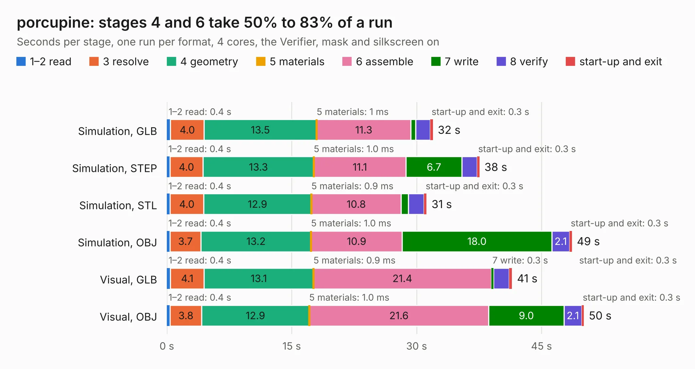

# 2253. porcupine

Board 2,253 of the 3,110 of [Corpus Testing](../Corpus-Testing.md), on [Corpus Page 21](../CorpusTestingPages/Corpus-Testing-21.md#2253-porcupine).

| Mode and format | 1–2 read | 3 resolve | 4 geometry | 5 materials | 6 assemble | 7 write | 8 verify | start-up and exit | Total |
|---|---:|---:|---:|---:|---:|---:|---:|---:|---:|
| Simulation, GLB | 0.4 | 4.0 | 13.5 | 1&nbsp;ms | 11.3 | 0.6 | 1.8 | 0.3 | 31.9 |
| Simulation, STEP | 0.4 | 4.0 | 13.3 | 1.0&nbsp;ms | 11.1 | 6.7 | 1.8 | 0.3 | 37.5 |
| Simulation, STL | 0.4 | 4.0 | 12.9 | 0.9&nbsp;ms | 10.8 | 0.9 | 1.9 | 0.3 | 31.2 |
| Simulation, OBJ | 0.4 | 3.7 | 13.2 | 1.0&nbsp;ms | 10.9 | 18.0 | 2.1 | 0.3 | 48.6 |
| Visual, GLB | 0.4 | 4.1 | 13.1 | 0.9&nbsp;ms | 21.4 | 0.3 | 1.9 | 0.3 | 41.5 |
| Visual, OBJ | 0.4 | 3.8 | 12.9 | 1.0&nbsp;ms | 21.6 | 9.0 | 2.1 | 0.3 | 50.1 |

<table align="center"><tr><td valign="top">

| Board | Repo: [parallella/parallella-hw](https://github.com/parallella/parallella-hw) Board: `porcupine.kicad_pcb` |
|---|---|
| Folder | porcupine |
| Complexity | 264&nbsp;/&nbsp;1000 (size&nbsp;209, features&nbsp;55) |
| KESE&nbsp;features | through vias, drill offsets, filled zones, copper text |
| Tested | 9th November 2026 |
| Copper&nbsp;layers | 6 |
| File&nbsp;format | KiCad 4 (4) |
| Parts,&nbsp;tracks,&nbsp;vias | 28, 2,063, 215 |
| Triangles,&nbsp;simulation | 3,372,204 in 214 parts |
| Verifier | PASS in all six runs |

</td><td valign="top">

<table>
<tr><th>File type</th><th>File size</th><th>Peak memory used</th></tr>
<tr><th colspan="3" align="left">Simulation</th></tr>
<tr><td>GLB</td><td align="right">115&nbsp;MB</td><td align="right">770&nbsp;MB</td></tr>
<tr><td>STEP</td><td align="right">387&nbsp;MB</td><td align="right">1.0&nbsp;GB</td></tr>
<tr><td>STL</td><td align="right">169&nbsp;MB</td><td align="right">814&nbsp;MB</td></tr>
<tr><td>OBJ</td><td align="right">357&nbsp;MB</td><td align="right">2.2&nbsp;GB</td></tr>
<tr><th colspan="3" align="left">Visual</th></tr>
<tr><td>GLB</td><td align="right">51&nbsp;MB</td><td align="right">1.1&nbsp;GB</td></tr>
<tr><td>OBJ</td><td align="right">165&nbsp;MB</td><td align="right">1.2&nbsp;GB</td></tr>
</table>

</td></tr></table>

| Previous | Next |
|:---|---:|
| [2252. paracard-template](b2252b_parallella-hw_paracard-template.md) | [2254. chocofi-topplate](b2254b_chocofi_chocofi-topplate.md) |
