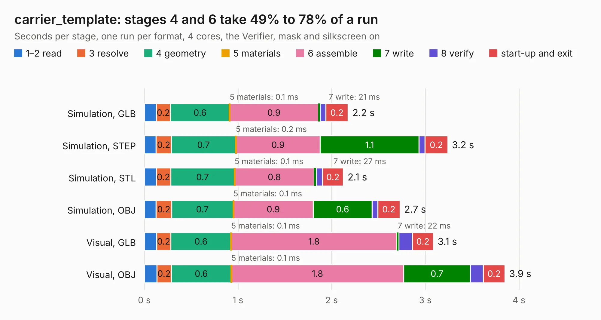

# 2253. carrier_template

Board 2,253 of the 3,101 of [Corpus Testing](../Corpus-Testing.md), on [Corpus Page 21](../CorpusTestingPages/Corpus-Testing-21.md#2253-carrier_template).

| Mode and format | 1–2 read | 3 resolve | 4 geometry | 5 materials | 6 assemble | 7 write | 8 verify | start-up and exit | Total |
|---|---:|---:|---:|---:|---:|---:|---:|---:|---:|
| Simulation, GLB | 0.1 | 0.2 | 0.6 | 0.1&nbsp;ms | 0.9 | 21&nbsp;ms | 62&nbsp;ms | 0.2 | 2.2 |
| Simulation, STEP | 0.1 | 0.2 | 0.7 | 0.2&nbsp;ms | 0.9 | 1.1 | 64&nbsp;ms | 0.2 | 3.2 |
| Simulation, STL | 0.1 | 0.2 | 0.7 | 0.1&nbsp;ms | 0.8 | 27&nbsp;ms | 63&nbsp;ms | 0.2 | 2.1 |
| Simulation, OBJ | 0.1 | 0.2 | 0.7 | 0.1&nbsp;ms | 0.9 | 0.6 | 60&nbsp;ms | 0.2 | 2.7 |
| Visual, GLB | 0.1 | 0.2 | 0.6 | 0.1&nbsp;ms | 1.8 | 22&nbsp;ms | 0.1 | 0.2 | 3.1 |
| Visual, OBJ | 0.1 | 0.2 | 0.6 | 0.1&nbsp;ms | 1.8 | 0.7 | 0.1 | 0.2 | 3.9 |

<table align="center"><tr><td valign="top">

| Board | Repo: [pinguz97/zynq-som](https://github.com/pinguz97/zynq-som) Board: `carrier_template.kicad_pcb` |
|---|---|
| Folder | scripts / carrier_template |
| Complexity | 67&nbsp;/&nbsp;1000 (size&nbsp;32, features&nbsp;35) |
| KESE&nbsp;features | rounded, trapezoid or chamfered pads, arc tracks, curved board outline |
| Tested | 9th November 2026 |
| Copper&nbsp;layers | 2 |
| File&nbsp;format | KiCad 8 (20240108) |
| Parts,&nbsp;tracks,&nbsp;vias | 3, 0, 0 |
| Triangles,&nbsp;simulation | 101,568 in 9 parts |
| Verifier | PASS in all six runs |

</td><td valign="top">

<table>
<tr><th>File type</th><th>File size</th><th>Peak memory used</th></tr>
<tr><th colspan="3" align="left">Simulation</th></tr>
<tr><td>GLB</td><td align="right">4.0&nbsp;MB</td><td align="right">199&nbsp;MB</td></tr>
<tr><td>STEP</td><td align="right">19&nbsp;MB</td><td align="right">205&nbsp;MB</td></tr>
<tr><td>STL</td><td align="right">5.1&nbsp;MB</td><td align="right">198&nbsp;MB</td></tr>
<tr><td>OBJ</td><td align="right">11&nbsp;MB</td><td align="right">199&nbsp;MB</td></tr>
<tr><th colspan="3" align="left">Visual</th></tr>
<tr><td>GLB</td><td align="right">4.2&nbsp;MB</td><td align="right">196&nbsp;MB</td></tr>
<tr><td>OBJ</td><td align="right">12&nbsp;MB</td><td align="right">194&nbsp;MB</td></tr>
</table>

</td></tr></table>

| Previous | Next |
|:---|---:|
| [2252. CM5_MINIMA_2](b2252b_CM5-MINIMA-REV2_CM5-MINIMA-2.md) | [2254. Zynq_SoM](b2254b_zynq-som_Zynq-SoM.md) |
