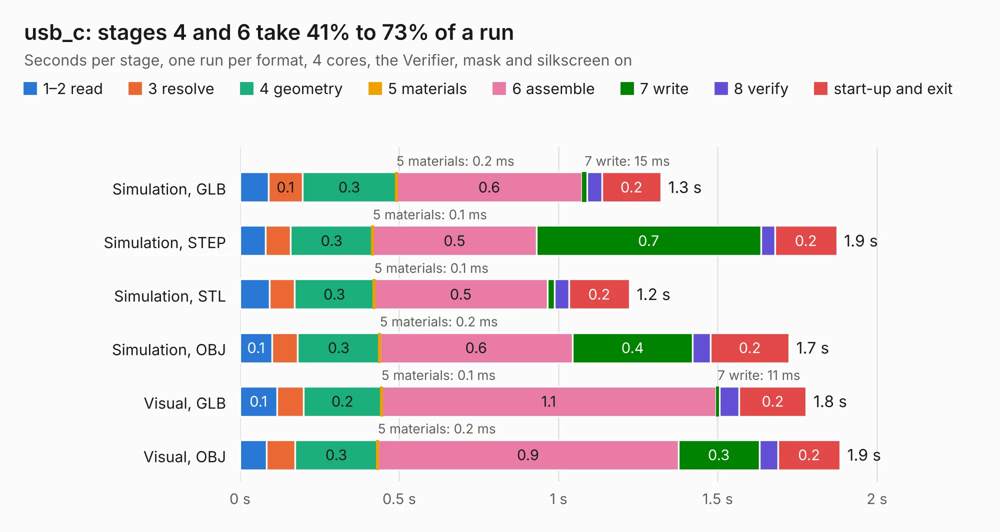

# 2254. usb_c

Board 2,254 of the 3,127 of [Corpus Testing](../Corpus-Testing.md), on [Corpus Page 21](../CorpusTestingPages/Corpus-Testing-21.md#2254-usb_c).

| Mode and format | 1–2 read | 3 resolve | 4 geometry | 5 materials | 6 assemble | 7 write | 8 verify | start-up and exit | Total |
|---|---:|---:|---:|---:|---:|---:|---:|---:|---:|
| Simulation, GLB | 90&nbsp;ms | 0.1 | 0.3 | 0.2&nbsp;ms | 0.6 | 15&nbsp;ms | 47&nbsp;ms | 0.2 | 1.3 |
| Simulation, STEP | 80&nbsp;ms | 79&nbsp;ms | 0.3 | 0.1&nbsp;ms | 0.5 | 0.7 | 44&nbsp;ms | 0.2 | 1.9 |
| Simulation, STL | 93&nbsp;ms | 78&nbsp;ms | 0.3 | 0.1&nbsp;ms | 0.5 | 22&nbsp;ms | 46&nbsp;ms | 0.2 | 1.2 |
| Simulation, OBJ | 0.1 | 80&nbsp;ms | 0.3 | 0.2&nbsp;ms | 0.6 | 0.4 | 56&nbsp;ms | 0.2 | 1.7 |
| Visual, GLB | 0.1 | 84&nbsp;ms | 0.2 | 0.1&nbsp;ms | 1.1 | 11&nbsp;ms | 63&nbsp;ms | 0.2 | 1.8 |
| Visual, OBJ | 84&nbsp;ms | 88&nbsp;ms | 0.3 | 0.2&nbsp;ms | 0.9 | 0.3 | 59&nbsp;ms | 0.2 | 1.9 |

<table align="center"><tr><td valign="top">

| Board | Repo: [osusat/cubesat](https://github.com/osusat/cubesat) Board: `usb_c.kicad_pcb` |
|---|---|
| Folder | shared / kicad / subsheets / usb_c |
| Complexity | 228&nbsp;/&nbsp;1000 (size&nbsp;133, features&nbsp;95) |
| KESE&nbsp;features | through vias, slotted holes, rounded, trapezoid or chamfered pads, filled zones, curved board outline, stack-up, dielectric εr and tanδ |
| Tested | 9th November 2026 |
| Copper&nbsp;layers | 4 |
| File&nbsp;format | KiCad 10 (20260206) |
| Parts,&nbsp;tracks,&nbsp;vias | 9, 73, 8 |
| Triangles,&nbsp;simulation | 94,590 in 24 parts |
| Verifier | PASS in all six runs |

</td><td valign="top">

<table>
<tr><th>File type</th><th>File size</th><th>Peak memory used</th></tr>
<tr><th colspan="3" align="left">Simulation</th></tr>
<tr><td>GLB</td><td align="right">3.2&nbsp;MB</td><td align="right">183&nbsp;MB</td></tr>
<tr><td>STEP</td><td align="right">15&nbsp;MB</td><td align="right">187&nbsp;MB</td></tr>
<tr><td>STL</td><td align="right">4.7&nbsp;MB</td><td align="right">174&nbsp;MB</td></tr>
<tr><td>OBJ</td><td align="right">9.0&nbsp;MB</td><td align="right">182&nbsp;MB</td></tr>
<tr><th colspan="3" align="left">Visual</th></tr>
<tr><td>GLB</td><td align="right">2.2&nbsp;MB</td><td align="right">150&nbsp;MB</td></tr>
<tr><td>OBJ</td><td align="right">6.2&nbsp;MB</td><td align="right">153&nbsp;MB</td></tr>
</table>

</td></tr></table>

| Previous | Next |
|:---|---:|
| [2253. payload](b2253b_cubesat_payload.md) | [2255. daughterboard](b2255b_cubesat_daughterboard.md) |
