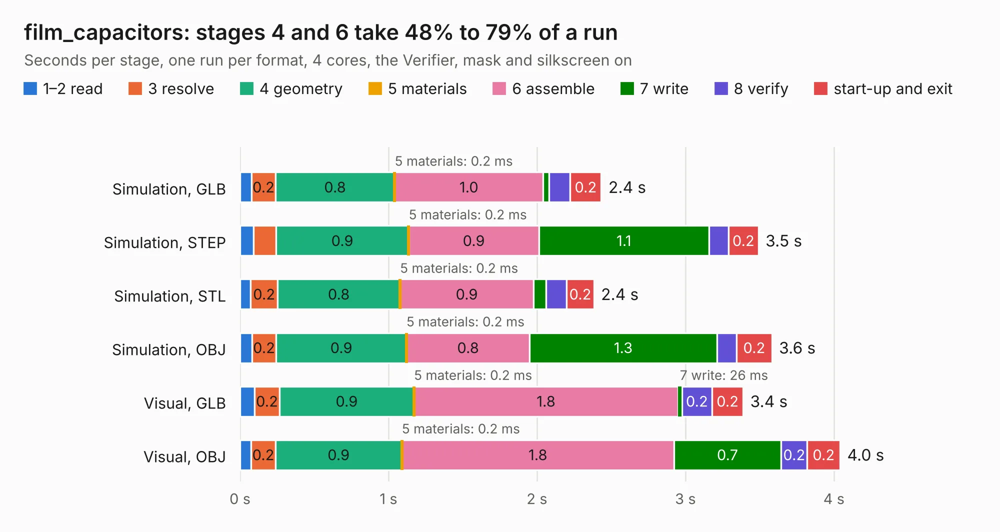

# 2254. film_capacitors

Board 2,254 of the 3,123 of [Corpus Testing](../Corpus-Testing.md), on [Corpus Page 21](../CorpusTestingPages/Corpus-Testing-21.md#2254-film_capacitors).

| Mode and format | 1–2 read | 3 resolve | 4 geometry | 5 materials | 6 assemble | 7 write | 8 verify | start-up and exit | Total |
|---|---:|---:|---:|---:|---:|---:|---:|---:|---:|
| Simulation, GLB | 78&nbsp;ms | 0.2 | 0.8 | 0.2&nbsp;ms | 1.0 | 41&nbsp;ms | 0.1 | 0.2 | 2.4 |
| Simulation, STEP | 91&nbsp;ms | 0.2 | 0.9 | 0.2&nbsp;ms | 0.9 | 1.1 | 0.1 | 0.2 | 3.5 |
| Simulation, STL | 71&nbsp;ms | 0.2 | 0.8 | 0.2&nbsp;ms | 0.9 | 83&nbsp;ms | 0.1 | 0.2 | 2.4 |
| Simulation, OBJ | 80&nbsp;ms | 0.2 | 0.9 | 0.2&nbsp;ms | 0.8 | 1.3 | 0.1 | 0.2 | 3.6 |
| Visual, GLB | 98&nbsp;ms | 0.2 | 0.9 | 0.2&nbsp;ms | 1.8 | 26&nbsp;ms | 0.2 | 0.2 | 3.4 |
| Visual, OBJ | 75&nbsp;ms | 0.2 | 0.9 | 0.2&nbsp;ms | 1.8 | 0.7 | 0.2 | 0.2 | 4.0 |

<table align="center"><tr><td valign="top">

| Board | Repo: [owntech-foundation/micro-inverter](https://github.com/owntech-foundation/micro-inverter) Board: `film_capacitors.kicad_pcb` |
|---|---|
| Folder | KiCAD_Files |
| Complexity | 89&nbsp;/&nbsp;1000 (size&nbsp;39, features&nbsp;50) |
| KESE&nbsp;features | filled zones, stack-up, dielectric εr and tanδ |
| Tested | 9th November 2026 |
| Copper&nbsp;layers | 2 |
| File&nbsp;format | KiCad 9 (20241229) |
| Parts,&nbsp;tracks,&nbsp;vias | 7, 0, 0 |
| Triangles,&nbsp;simulation | 260,380 in 13 parts |
| Verifier | PASS in all six runs |

</td><td valign="top">

<table>
<tr><th>File type</th><th>File size</th><th>Peak memory used</th></tr>
<tr><th colspan="3" align="left">Simulation</th></tr>
<tr><td>GLB</td><td align="right">8.6&nbsp;MB</td><td align="right">217&nbsp;MB</td></tr>
<tr><td>STEP</td><td align="right">35&nbsp;MB</td><td align="right">228&nbsp;MB</td></tr>
<tr><td>STL</td><td align="right">13&nbsp;MB</td><td align="right">216&nbsp;MB</td></tr>
<tr><td>OBJ</td><td align="right">26&nbsp;MB</td><td align="right">216&nbsp;MB</td></tr>
<tr><th colspan="3" align="left">Visual</th></tr>
<tr><td>GLB</td><td align="right">5.3&nbsp;MB</td><td align="right">186&nbsp;MB</td></tr>
<tr><td>OBJ</td><td align="right">15&nbsp;MB</td><td align="right">187&nbsp;MB</td></tr>
</table>

</td></tr></table>

| Previous | Next |
|:---|---:|
| [2253. daughterboard](b2253b_cubesat_daughterboard.md) | [2255. uVerter](b2255b_micro-inverter_uVerter.md) |
