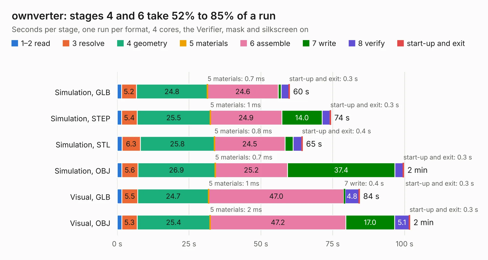

# 2256. ownverter

Board 2,256 of the 3,123 of [Corpus Testing](../Corpus-Testing.md), on [Corpus Page 21](../CorpusTestingPages/Corpus-Testing-21.md#2256-ownverter).

| Mode and format | 1–2 read | 3 resolve | 4 geometry | 5 materials | 6 assemble | 7 write | 8 verify | start-up and exit | Total |
|---|---:|---:|---:|---:|---:|---:|---:|---:|---:|
| Simulation, GLB | 1.5 | 5.2 | 24.8 | 0.7&nbsp;ms | 24.6 | 1.1 | 2.7 | 0.3 | 60.0 |
| Simulation, STEP | 1.5 | 5.4 | 25.5 | 1&nbsp;ms | 24.9 | 14.0 | 2.7 | 0.3 | 74.4 |
| Simulation, STL | 1.7 | 6.3 | 25.8 | 0.8&nbsp;ms | 24.5 | 2.8 | 3.0 | 0.4 | 64.5 |
| Simulation, OBJ | 1.6 | 5.6 | 26.9 | 0.7&nbsp;ms | 25.2 | 37.4 | 2.8 | 0.3 | 99.8 |
| Visual, GLB | 1.6 | 5.5 | 24.7 | 1&nbsp;ms | 47.0 | 0.4 | 4.8 | 0.3 | 84.4 |
| Visual, OBJ | 1.6 | 5.3 | 25.4 | 2&nbsp;ms | 47.2 | 17.0 | 5.1 | 0.3 | 101.9 |

<table align="center"><tr><td valign="top">

| Board | Repo: [owntech-foundation/ownverter](https://github.com/owntech-foundation/ownverter) Board: `ownverter.kicad_pcb` |
|---|---|
| Folder | KiCAD_files |
| Complexity | 384&nbsp;/&nbsp;1000 (size&nbsp;244, features&nbsp;140) |
| KESE&nbsp;features | through vias, slotted holes, rounded, trapezoid or chamfered pads, drill offsets, filled zones, stack-up, dielectric εr and tanδ, copper finish, mask and silkscreen colours, castellated pads |
| Tested | 9th November 2026 |
| Copper&nbsp;layers | 6 |
| File&nbsp;format | KiCad 9 (20241229) |
| Parts,&nbsp;tracks,&nbsp;vias | 377, 2,173, 658 |
| Triangles,&nbsp;simulation | 6,467,298 in 253 parts |
| Verifier | PASS in all six runs |

</td><td valign="top">

<table>
<tr><th>File type</th><th>File size</th><th>Peak memory used</th></tr>
<tr><th colspan="3" align="left">Simulation</th></tr>
<tr><td>GLB</td><td align="right">219&nbsp;MB</td><td align="right">1.4&nbsp;GB</td></tr>
<tr><td>STEP</td><td align="right">880&nbsp;MB</td><td align="right">2.0&nbsp;GB</td></tr>
<tr><td>STL</td><td align="right">323&nbsp;MB</td><td align="right">1.4&nbsp;GB</td></tr>
<tr><td>OBJ</td><td align="right">701&nbsp;MB</td><td align="right">4.2&nbsp;GB</td></tr>
<tr><th colspan="3" align="left">Visual</th></tr>
<tr><td>GLB</td><td align="right">106&nbsp;MB</td><td align="right">1.9&nbsp;GB</td></tr>
<tr><td>OBJ</td><td align="right">340&nbsp;MB</td><td align="right">2.4&nbsp;GB</td></tr>
</table>

</td></tr></table>

| Previous | Next |
|:---|---:|
| [2255. uVerter](b2255b_micro-inverter_uVerter.md) | [2257. heatsink_drawing](b2257b_twist_heatsink-drawing.md) |
