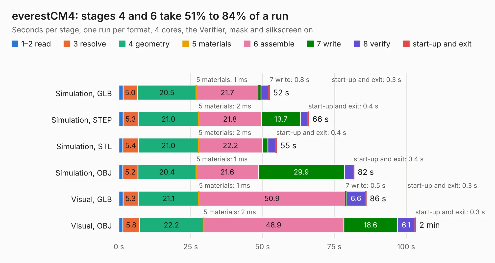

# 2257. everestCM4

Board 2,257 of the 3,103 of [Corpus Testing](../Corpus-Testing.md), on [Corpus Page 21](../CorpusTestingPages/Corpus-Testing-21.md#2257-everestcm4).

| Mode and format | 1–2 read | 3 resolve | 4 geometry | 5 materials | 6 assemble | 7 write | 8 verify | start-up and exit | Total |
|---|---:|---:|---:|---:|---:|---:|---:|---:|---:|
| Simulation, GLB | 1.5 | 5.0 | 20.5 | 1&nbsp;ms | 21.7 | 0.8 | 2.7 | 0.3 | 52.5 |
| Simulation, STEP | 1.4 | 5.3 | 21.0 | 2&nbsp;ms | 21.8 | 13.7 | 2.6 | 0.4 | 66.2 |
| Simulation, STL | 1.4 | 5.4 | 21.0 | 2&nbsp;ms | 22.2 | 1.9 | 2.8 | 0.4 | 55.0 |
| Simulation, OBJ | 1.4 | 5.2 | 20.4 | 1&nbsp;ms | 21.6 | 29.9 | 3.1 | 0.4 | 81.9 |
| Visual, GLB | 1.4 | 5.3 | 21.1 | 1&nbsp;ms | 50.9 | 0.5 | 6.6 | 0.3 | 86.1 |
| Visual, OBJ | 1.4 | 5.8 | 22.2 | 2&nbsp;ms | 48.9 | 18.6 | 6.1 | 0.3 | 103.4 |

<table align="center"><tr><td valign="top">

| Board | Repo: [pionixpublic/reference-hardware](https://github.com/pionixpublic/reference-hardware) Board: `everestCM4.kicad_pcb` |
|---|---|
| Folder | Yak |
| Complexity | 376&nbsp;/&nbsp;1000 (size&nbsp;276, features&nbsp;100) |
| KESE&nbsp;features | through vias, slotted holes, rounded, trapezoid or chamfered pads, arc tracks, filled zones, stack-up, dielectric εr and tanδ |
| Tested | 9th November 2026 |
| Copper&nbsp;layers | 4 |
| File&nbsp;format | KiCad 6 (20211014) |
| Parts,&nbsp;tracks,&nbsp;vias | 181, 3,488, 540 |
| Triangles,&nbsp;simulation | 5,046,938 in 316 parts |
| Verifier | PASS in all six runs |

</td><td valign="top">

<table>
<tr><th>File type</th><th>File size</th><th>Peak memory used</th></tr>
<tr><th colspan="3" align="left">Simulation</th></tr>
<tr><td>GLB</td><td align="right">172&nbsp;MB</td><td align="right">1.7&nbsp;GB</td></tr>
<tr><td>STEP</td><td align="right">929&nbsp;MB</td><td align="right">2.0&nbsp;GB</td></tr>
<tr><td>STL</td><td align="right">252&nbsp;MB</td><td align="right">1.6&nbsp;GB</td></tr>
<tr><td>OBJ</td><td align="right">542&nbsp;MB</td><td align="right">3.3&nbsp;GB</td></tr>
<tr><th colspan="3" align="left">Visual</th></tr>
<tr><td>GLB</td><td align="right">107&nbsp;MB</td><td align="right">1.8&nbsp;GB</td></tr>
<tr><td>OBJ</td><td align="right">340&nbsp;MB</td><td align="right">2.2&nbsp;GB</td></tr>
</table>

</td></tr></table>

| Previous | Next |
|:---|---:|
| [2256. Zynq_SoM](b2256b_zynq-som_Zynq-SoM.md) | [2258. yeti](b2258b_reference-hardware_yeti.md) |
