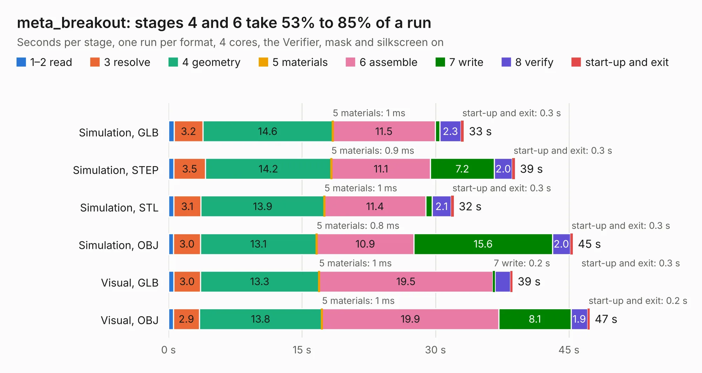

# 2258. meta_breakout

Board 2,258 of the 3,117 of [Corpus Testing](../Corpus-Testing.md), on [Corpus Page 21](../CorpusTestingPages/Corpus-Testing-21.md#2258-meta_breakout).

| Mode and format | 1–2 read | 3 resolve | 4 geometry | 5 materials | 6 assemble | 7 write | 8 verify | start-up and exit | Total |
|---|---:|---:|---:|---:|---:|---:|---:|---:|---:|
| Simulation, GLB | 0.6 | 3.2 | 14.6 | 1&nbsp;ms | 11.5 | 0.5 | 2.3 | 0.3 | 33.2 |
| Simulation, STEP | 0.6 | 3.5 | 14.2 | 0.9&nbsp;ms | 11.1 | 7.2 | 2.0 | 0.3 | 38.9 |
| Simulation, STL | 0.6 | 3.1 | 13.9 | 1&nbsp;ms | 11.4 | 0.7 | 2.1 | 0.3 | 32.1 |
| Simulation, OBJ | 0.6 | 3.0 | 13.1 | 0.8&nbsp;ms | 10.9 | 15.6 | 2.0 | 0.3 | 45.4 |
| Visual, GLB | 0.6 | 3.0 | 13.3 | 1&nbsp;ms | 19.5 | 0.2 | 1.7 | 0.3 | 38.7 |
| Visual, OBJ | 0.6 | 2.9 | 13.8 | 1&nbsp;ms | 19.9 | 8.1 | 1.9 | 0.2 | 47.3 |

<table align="center"><tr><td valign="top">

| Board | Repo: [parallella/parallella-hw](https://github.com/parallella/parallella-hw) Board: `meta_breakout.kicad_pcb` |
|---|---|
| Folder | meta_breakout / src |
| Complexity | 214&nbsp;/&nbsp;1000 (size&nbsp;179, features&nbsp;35) |
| KESE&nbsp;features | through vias, filled zones |
| Tested | 9th November 2026 |
| Copper&nbsp;layers | 4 |
| File&nbsp;format | KiCad 5 (20171130) |
| Parts,&nbsp;tracks,&nbsp;vias | 5, 1,860, 120 |
| Triangles,&nbsp;simulation | 2,578,018 in 222 parts |
| Verifier | PASS in all six runs |

</td><td valign="top">

<table>
<tr><th>File type</th><th>File size</th><th>Peak memory used</th></tr>
<tr><th colspan="3" align="left">Simulation</th></tr>
<tr><td>GLB</td><td align="right">89&nbsp;MB</td><td align="right">737&nbsp;MB</td></tr>
<tr><td>STEP</td><td align="right">387&nbsp;MB</td><td align="right">934&nbsp;MB</td></tr>
<tr><td>STL</td><td align="right">129&nbsp;MB</td><td align="right">747&nbsp;MB</td></tr>
<tr><td>OBJ</td><td align="right">275&nbsp;MB</td><td align="right">1.7&nbsp;GB</td></tr>
<tr><th colspan="3" align="left">Visual</th></tr>
<tr><td>GLB</td><td align="right">45&nbsp;MB</td><td align="right">841&nbsp;MB</td></tr>
<tr><td>OBJ</td><td align="right">139&nbsp;MB</td><td align="right">986&nbsp;MB</td></tr>
</table>

</td></tr></table>

| Previous | Next |
|:---|---:|
| [2257. VESC-controller](b2257b_vesc-controller_VESC-controller.md) | [2259. paracard-template](b2259b_parallella-hw_paracard-template.md) |
