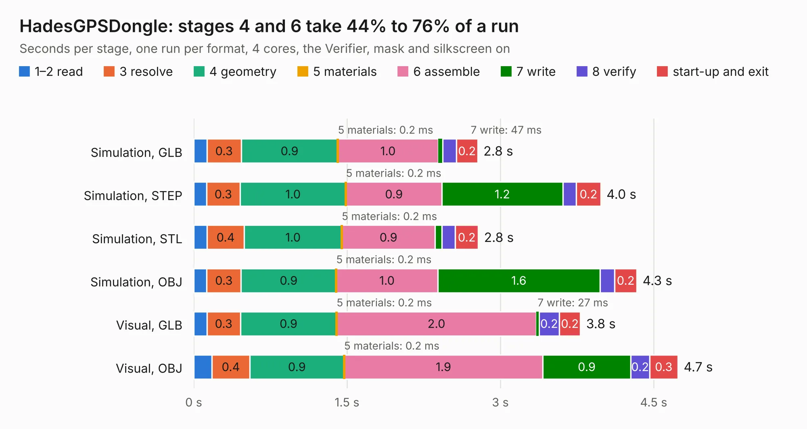

# 2261. HadesGPSDongle

Board 2,261 of the 3,103 of [Corpus Testing](../Corpus-Testing.md), on [Corpus Page 21](../CorpusTestingPages/Corpus-Testing-21.md#2261-hadesgpsdongle).

| Mode and format | 1–2 read | 3 resolve | 4 geometry | 5 materials | 6 assemble | 7 write | 8 verify | start-up and exit | Total |
|---|---:|---:|---:|---:|---:|---:|---:|---:|---:|
| Simulation, GLB | 0.1 | 0.3 | 0.9 | 0.2&nbsp;ms | 1.0 | 47&nbsp;ms | 0.1 | 0.2 | 2.8 |
| Simulation, STEP | 0.1 | 0.3 | 1.0 | 0.2&nbsp;ms | 0.9 | 1.2 | 0.1 | 0.2 | 4.0 |
| Simulation, STL | 0.1 | 0.4 | 1.0 | 0.2&nbsp;ms | 0.9 | 67&nbsp;ms | 0.1 | 0.2 | 2.8 |
| Simulation, OBJ | 0.1 | 0.3 | 0.9 | 0.2&nbsp;ms | 1.0 | 1.6 | 0.1 | 0.2 | 4.3 |
| Visual, GLB | 0.1 | 0.3 | 0.9 | 0.2&nbsp;ms | 2.0 | 27&nbsp;ms | 0.2 | 0.2 | 3.8 |
| Visual, OBJ | 0.2 | 0.4 | 0.9 | 0.2&nbsp;ms | 1.9 | 0.9 | 0.2 | 0.3 | 4.7 |

<table align="center"><tr><td valign="top">

| Board | Repo: [pms67/HadesFCS](https://github.com/pms67/HadesFCS) Board: `HadesGPSDongle.kicad_pcb` |
|---|---|
| Folder | Hardware / HadesGPSDongle |
| Complexity | 214&nbsp;/&nbsp;1000 (size&nbsp;159, features&nbsp;55) |
| KESE&nbsp;features | through vias, rounded, trapezoid or chamfered pads, filled zones, curved board outline |
| Tested | 9th November 2026 |
| Copper&nbsp;layers | 4 |
| File&nbsp;format | KiCad 5 (20171130) |
| Parts,&nbsp;tracks,&nbsp;vias | 27, 124, 39 |
| Triangles,&nbsp;simulation | 268,474 in 40 parts |
| Verifier | PASS in all six runs |

</td><td valign="top">

<table>
<tr><th>File type</th><th>File size</th><th>Peak memory used</th></tr>
<tr><th colspan="3" align="left">Simulation</th></tr>
<tr><td>GLB</td><td align="right">9.0&nbsp;MB</td><td align="right">248&nbsp;MB</td></tr>
<tr><td>STEP</td><td align="right">37&nbsp;MB</td><td align="right">256&nbsp;MB</td></tr>
<tr><td>STL</td><td align="right">13&nbsp;MB</td><td align="right">244&nbsp;MB</td></tr>
<tr><td>OBJ</td><td align="right">27&nbsp;MB</td><td align="right">235&nbsp;MB</td></tr>
<tr><th colspan="3" align="left">Visual</th></tr>
<tr><td>GLB</td><td align="right">5.4&nbsp;MB</td><td align="right">213&nbsp;MB</td></tr>
<tr><td>OBJ</td><td align="right">15&nbsp;MB</td><td align="right">210&nbsp;MB</td></tr>
</table>

</td></tr></table>

| Previous | Next |
|:---|---:|
| [2260. Hades](b2260b_HadesFCS_Hades.md) | [2262. HadesMicro](b2262b_HadesFCS_HadesMicro.md) |
